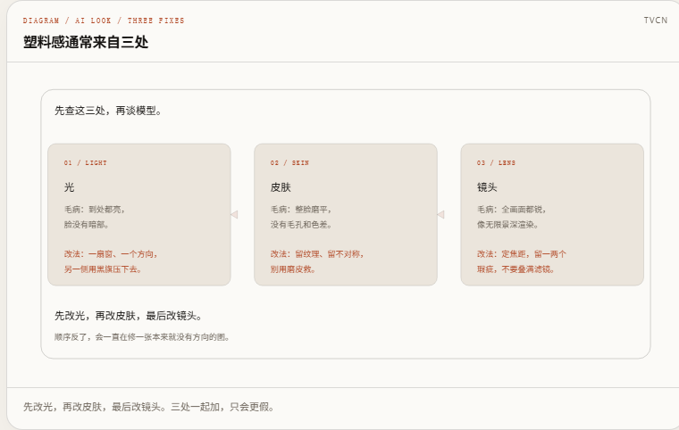

<!-- DIAGRAM_START -->
## 图解

<figure>
  
  <figcaption>先改光，再改皮肤，最后改镜头。三处一起加，只会更假。</figcaption>
</figure>
<!-- DIAGRAM_END -->

AI 图最常见的光，是“到处都亮”：脸没有暗部，鼻子下面没有影子，背景和人物一样清楚。真实房间通常只有一两个光源，其他都是反光。

## 先查光有没有方向

先指定一扇窗、一盏台灯或一块反光板，再让其余地方暗下去。想让它不那么塑料，加一块黑旗压暗另一侧。暗部有东西，脸才立得住。

别用“电影感灯光”这种词，直接写“左侧硬窗光，右侧深阴影，背景暗一档”。

## 皮肤太干净，反而假

真实皮肤有毛孔、细毛、色差和不对称。AI 常把脸磨成一层均匀的膜，连鼻翼和眼下的过渡都没有。

生成时明确写“保留皮肤纹理、可见毛孔、轻微不对称、不要美颜”，比后期加噪点有用。如果已经生成了，别用磨皮救。加一点颗粒、压一点高光、让颧骨和下颌留出真实的明暗。

## 镜头太完美，就没有人味

真实镜头有畸变、暗角、眩光、色散和景深过渡。AI 常常全画面都锐、边缘都干净，像一张无限景深的渲染图。

先定一个焦距和光圈，再允许一点不完美：轻微暗角、高光边缘的柔化、最近处和远处的虚化。但别把所有瑕疵都加满。一个镜头有一两个特征就够了，太多会变成滤镜。

## 检查

- 画面能说清主光从哪来，暗部在哪。
- 皮肤保留纹理，没有整脸磨平。
- 镜头只有一两个不完美，没有叠满滤镜。

<!-- DEEP_DIVE_START -->
## 深读

<strong>约 8 分钟。</strong> “AI 感”不是一种滤镜，是三样东西同时太完整：光没有方向、皮肤没有生活、镜头没有缺陷。

### 塑料感来自“没有选择”的画面

真实场景里，摄影师必须做选择：曝光给脸还是给窗，背景是亮还是暗，哪一侧留暗部。AI 常常替你做相反的选择：脸和背景一样亮，左边和右边一样亮，近处和远处一样清楚。画面没有取舍，眼睛就找不到落点，大脑便判定“假”。

所以去 AI 感的第一步不是加噪点，而是减信息：关掉一半的灯，压暗背景一档，让一侧脸进入阴影。你要让观众看见“有人决定过这张画面”，而不是“模型把整张图填满了”。有暗部，才有空间；有取舍，才有摄影。

### 光：一个主光、一个暗部、一个接触阴影

先指定一个主光来源：左侧窗、右上方台灯、人物背后的招牌。再指定一个暗部：右侧用黑旗压两档，或让墙角的灯不亮。最后补接触阴影：下巴到脖子、杯子到桌面、人物到椅子，接触处必须有暗，不然人会像贴上去的。

提示词里不要写“柔和的电影光”，写“左侧硬窗光，右脸深阴影，背景暗一档，桌沿有接触阴影”。如果要柔，写“北向窗、阴天、无直射”，而不是“柔光”。光的软硬由光源大小和距离决定，不是由形容词决定。

### 皮肤：纹理、色差、油光、不对称

真实皮肤不是一张均匀的膜：鼻翼有毛孔，眼下有细纹，颧骨有轻微色差，额头有油光，左右脸不完全对称。AI 默认把这些“不完美”抹平，于是脸像塑料。生成时明确写“保留毛孔与细纹、可见轻微色差、额头自然油光、左右不对称、不要美颜”。

已经生成了，也不要用磨皮救。加一点颗粒、压一点高光、把鼻翼和眼下的过渡找回来；如果脸仍然像面具，宁可拉远景别，让脸不占画面的一半。观众在近景里最容易看出假，在中景里更容易相信人。

### 镜头：焦距、光圈、畸变、暗角、呼吸

真实镜头有性格：广角会拉宽鼻子，长焦会压平空间，大光圈会让耳朵虚掉，老镜头会有暗角和轻微色散。AI 常常给一个“全画面都清楚、边缘都干净”的完美镜头，像无限景深的渲染图。先定焦距和光圈，再允许一两个缺陷存在。

一个镜头只选一两个特征：轻微暗角、最近处虚化、高光边缘的柔化、广角边缘的一点点拉伸。全加上会变成滤镜，一个都没有就还是塑料。更重要的是全片统一：同一个场景用同一个焦距和同一种缺陷，观众才会觉得这是一台机器拍的，不是每张图各生成的。

### 材质与接触：让物体有重量

塑料感不只在脸。衣服褶皱没有重力、桌面反光没有方向、手拿杯子没有接触阴影、头发边缘像剪纸，都会让画面假。写清材质：棉布、羊毛、磨砂金属、湿玻璃；写清接触：手指压住杯壁、杯底在桌面留下阴影、衣领压住锁骨。

手是最容易崩的地方。与其修手指，不如改构图：让手在画外、让手拿一个能挡住关节的物体、让手只出现一小部分。观众不需要看见十根手指，只需要相信这只手在用力。材质的真实感来自“受力和接触”，不是来自更多的纹理词。

### 三步去 AI 感：先光，再皮肤，最后镜头

不要一次改所有参数。第一步只改光：加方向、压暗部、补接触阴影；跑三条，选一条脸能立住的。第二步只改皮肤：加纹理、色差、油光、不对称；再跑三条。第三步只改镜头：定焦距、加一个缺陷、统一全片。

每一步都问同一个问题：这张画面里，有没有一个“不完美但合理”的决定？如果三处都太完整，就回到光。如果光已经对了，脸还是假，就把景别拉远。去 AI 感的终点不是“看不出是 AI”，是“看得出有人做过选择”。

### 去 AI 感，十项检查
<ul><li>光有明确方向</li><li>背景比脸暗一档</li><li>一侧脸有真实阴影</li><li>下巴脖子有接触阴影</li><li>杯子桌面有接触阴影</li><li>皮肤保留毛孔细纹</li><li>允许轻微色差和油光</li><li>左右脸不完全对称</li><li>镜头只加一两个缺陷</li><li>全片焦距和缺陷统一</li></ul>
去 AI 感不是把画面弄脏，是把它弄得不那么完整。

<!-- DEEP_DIVE_END -->
