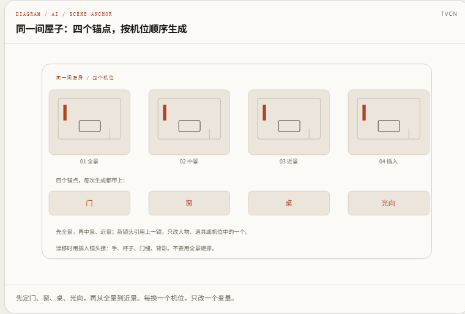

<!-- DIAGRAM_START -->
## 图解

<figure>
  
  <figcaption>先定门、窗、桌、光向，再从全景到近景。每换一个机位，只改一个变量。</figcaption>
</figure>
<!-- DIAGRAM_END -->

AI 最贵的不是生成，是同一间屋子在第三个镜头里悄悄换了方向。

## 先做场景锚点，不要先堆形容词

写提示词之前，先画一张最简陋的平面图：门在哪、窗在哪、桌子在哪、光从哪边来。再用一句话写死：厨房，窗在左，操作台在右，冰箱在门后，顶灯偏黄。这句话后面每个镜头都原样带上。

形容词最容易骗人。“温馨的厨房”每次都能长出不同的厨房；“窗在左、桌在右”才会被反复核对。场景锚点不是气氛，是方位。

再拍一张空镜。没有人物、没有动作，只有空间。它是后面所有镜头的母版，也是发现漂移时唯一能回去对质的东西。

## 按机位顺序生成，不要按剧情顺序

很多人按剧本顺序生成：先近景，再反打，最后才想起全景。结果是每个镜头都在猜房间长什么样。先做全景，再做中景，最后做插入镜头；后面的镜头引用前面的画面，空间才有继承。

每生成一个新镜头，只改一个变量：人物、道具或机位。一次同时换三样，漂了也不知道是哪一样造成的。把每一版的参考图、种子和那句锚点存进同一个文件夹。

如果系列里要换时间，先换光，不要先换房子。白天到夜晚可以变，窗和门的位置不能变。

## 漂移发生了，剪辑要留后手

AI 场景不可能百分百不漂。窗反了、桌子的位置差半米、墙上的画换了一张，这些都会发生。不要指望后期修，先在生成时准备“遮丑镜头”：手、杯子、门缝、背影、脚步。观众看不到全景，就不会发现空间变了。

剪辑时把漂移镜头藏在动作中间：开门、坐下、转身、递东西。动作会吸走注意力，空间错误就过去了。但别用这个办法盖剧情漏洞；它只修背景，不修故事。

## 检查

- 四件空间锚点写得出来：门、窗、桌、光向。
- 先全景后近景，新镜头引用上一镜和锚点。
- 手边至少有 3 个插入镜头，漂移时能接上。
