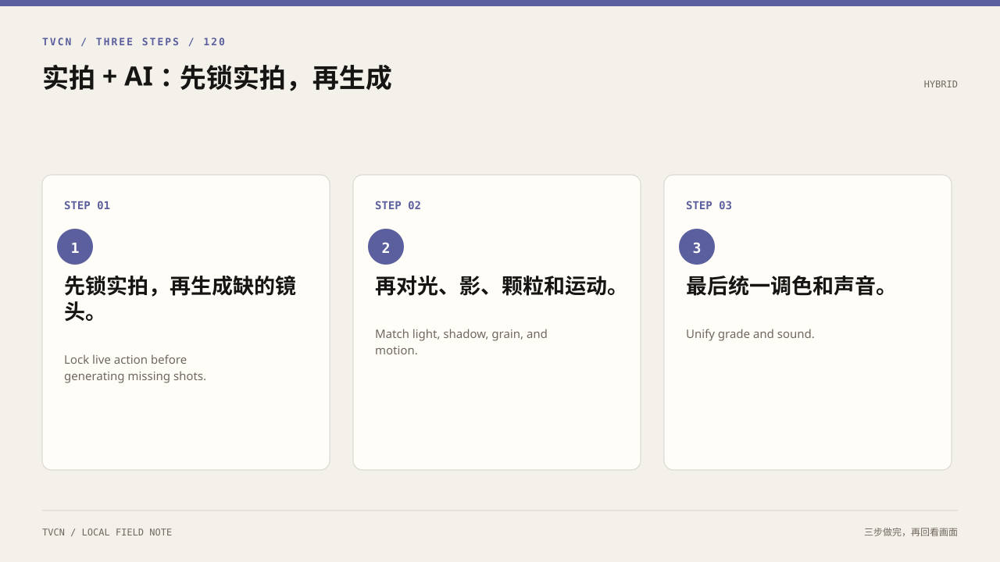

实拍 + AI 先把实拍锁死，再生成缺的镜头；先生成后补拍，光一定对不上。

<!-- DIAGRAM_START -->
<h2>图解</h2>
<figure>
  
  <figcaption>把三步按顺序做完，再回看画面或文件。</figcaption>
</figure>
<!-- DIAGRAM_END -->
<h2>现场</h2>

先拍实拍主镜头，记录机位、焦距、光位；生成补镜头时按这些参数写提示，最后统一颗粒和调色。

<h2>怎么做</h2>

实拍 + AI 先把实拍锁死，再生成缺的镜头；先生成后补拍，光一定对不上。
<ol><li>先拍实拍主镜头，记录机位、焦距、光位。</li><li>生成补镜头时按这些参数写提示。</li><li>最后统一颗粒、调色和声音，检查接缝。</li></ol>
<h2>别踩</h2>

别先生成再补拍；光一定对不上。

<h2>验收</h2>
<ul><li>实拍主镜头有完整的机位、焦距和光位记录。</li><li>生成镜头的提示来自这些参数，不是另起一套。</li><li>接缝处光向、颗粒和运动一致，成片尺寸看不出边界。</li></ul>
