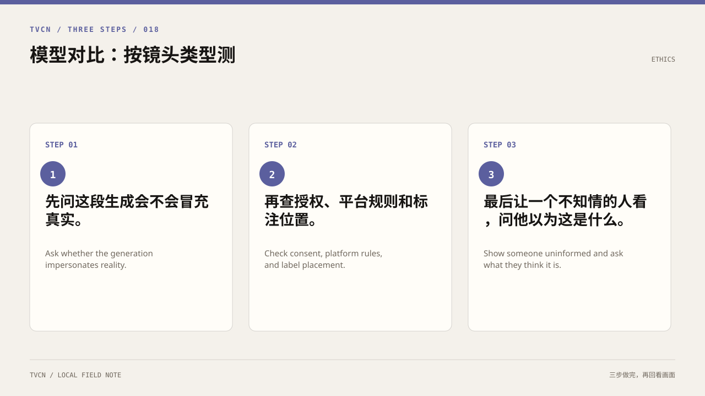

模型对比别只看总排名，按你的镜头类型测：人脸、手、运动、文字、长镜头。

<!-- DIAGRAM_START -->
<h2>图解</h2>
<figure>
  
  <figcaption>把三步按顺序做完，再回看画面或文件。</figcaption>
</figure>
<!-- DIAGRAM_END -->
<h2>现场</h2>

用同一条 5 秒提示、同一张参考图测五个模型；每个模型跑三次，记录人脸、手、文字、运动四项。

<h2>怎么做</h2>

模型对比别只看总排名，按你的镜头类型测：人脸、手、运动、文字、长镜头。
<ol><li>用同一条 5 秒提示、同一张参考图测五个模型。</li><li>每个模型跑三次，记录人脸、手、文字、运动四项。</li><li>按你的项目权重打分，不看排行榜总名次。</li></ol>
<h2>别踩</h2>

别用总排名选模型；你的镜头类型才是评分表。

<h2>验收</h2>
<ul><li>五个模型用的是同一条提示和同一张参考图。</li><li>每个模型跑三次，人脸、手、文字、运动都有记录。</li><li>最终排序按项目权重，不是按排行榜总名次。</li></ul>
<!-- SOURCES_START -->
<h2>参考与延伸阅读</h2>

经验来源：TVCN 现场手册与项目复盘；实测来源：页面标注的复核环境与可复现练习；参考来源：以下公开链接。

<ul><li>[S04] 《生成式人工智能服务管理暂行办法》</li><li>[S05] 欧盟 AI Act 政策页</li><li>[S19] GAN 原始论文（2014）</li><li>[S20] DDPM 原始论文（2020）</li></ul>

<a href="../../SOURCES.md">完整链接与用途见 SOURCES.md</a>

<!-- SOURCES_END -->
