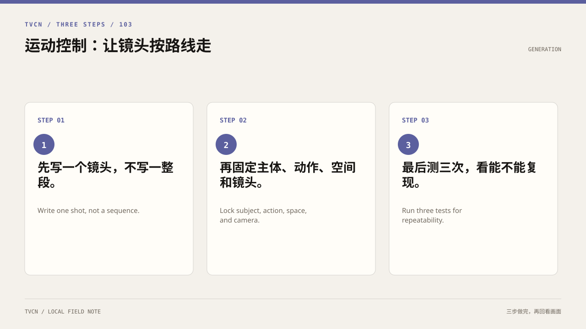

运动控制先写机位路线：从哪起、经过什么、停在哪；只说“镜头运动”等于没说。

<!-- DIAGRAM_START -->
<h2>图解</h2>
<figure>
  
  <figcaption>把三步按顺序做完，再回看画面或文件。</figcaption>
</figure>
<!-- DIAGRAM_END -->
<h2>现场</h2>

写机位路线：从门口推到桌前 1 米，停 2 秒；用参考视频或关键帧控制，别只写环绕。

<h2>怎么做</h2>

运动控制先写机位路线：从哪起、经过什么、停在哪；只说“镜头运动”等于没说。
<ol><li>写机位路线：从门口推到桌前 1 米，停 2 秒。</li><li>用参考视频或关键帧控制，不只写“环绕”。</li><li>跑三次确认路线可复现，再换变量。</li></ol>
<h2>别踩</h2>

别只写“环绕、推拉”；没有起点和落点，模型只能乱走。

<h2>验收</h2>
<ul><li>提示里有起点、路径和落点，能画成一条线。</li><li>三次输出都走到同一落点，没有中途改方向。</li><li>换速度或焦段时，路线本身仍然可复现。</li></ul>
