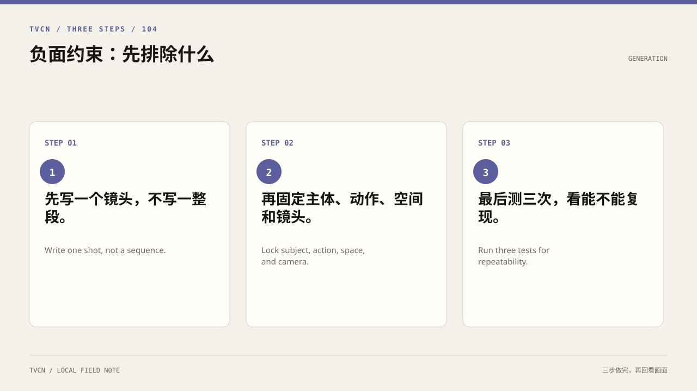

负面约束先排掉最破坏画面的东西：闪烁、多指、文字乱码、脸部变形。

<!-- DIAGRAM_START -->
<h2>图解</h2>
<figure>
  
  <figcaption>把三步按顺序做完，再回看画面或文件。</figcaption>
</figure>
<!-- DIAGRAM_END -->
<h2>现场</h2>

先列四类：闪烁、多指、文字乱码、脸变形；每类写一个负面词，别堆 50 个。

<h2>怎么做</h2>

负面约束先排掉最破坏画面的东西：闪烁、多指、文字乱码、脸部变形。
<ol><li>先列四类：闪烁、多指、文字乱码、脸变形。</li><li>每类只写一个负面词，别堆 50 个。</li><li>跑三次，确认负面词真的减少了这一类问题。</li></ol>
<h2>别踩</h2>

别堆一长串负面词；互相冲突的约束会让模型更乱。

<h2>验收</h2>
<ul><li>负面词只覆盖四类问题，每条都能对应一个可见错误。</li><li>三次输出里该类问题明显减少，不是心理作用。</li><li>删掉某条负面词后问题回来，证明它真的有用。</li></ul>
