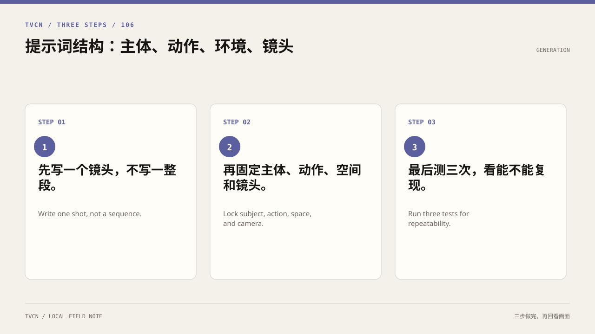

提示词按四段写：谁、做什么、在哪、镜头怎么放；顺序稳定，结果才稳定。

<!-- DIAGRAM_START -->
<h2>图解</h2>
<figure>
  
  <figcaption>把三步按顺序做完，再回看画面或文件。</figcaption>
</figure>
<!-- DIAGRAM_END -->
<h2>现场</h2>

固定四行：主体是谁、动作做什么、环境在哪、镜头怎么放；每行只改一个词做测试。

<h2>怎么做</h2>

提示词按四段写：谁、做什么、在哪、镜头怎么放；顺序稳定，结果才稳定。
<ol><li>固定四行：主体是谁、动作做什么、环境在哪、镜头怎么放。</li><li>每行只改一个词做测试。</li><li>保持顺序不变，别把环境写到动作前面。</li></ol>
<h2>别踩</h2>

别把四段揉成一段散文；模型分不清哪个词管动作、哪个管镜头。

<h2>验收</h2>
<ul><li>提示能拆成主体、动作、环境、镜头四行，顺序固定。</li><li>每次测试只改一行里的一个词。</li><li>换行或换序后结果明显变差，说明结构在起作用。</li></ul>

<!-- DEEP_DIVE_START -->
## 深读

<strong>约 7 分钟。</strong> 提示词不是咒语，是把画面拆成主体、动作、镜头、光线、风格五件事，一次只改一件。

### 五件事写全

主体是谁、在做什么、镜头在哪、光从哪来、画面是什么质感；五件事缺一件，模型就会替你猜，猜错再改就靠运气。

先写具体的名词和动作，再写形容词；不要一上来写“电影感、高级、氛围”。这些词没有方向，模型只能给你平均值。

### 一次只改一件

第一版定主体和动作，第二版只改机位，第三版只改光；一次改三件，出来不对，你不知道是哪件错了。

把每版提示词和输出存下来，标上版本号；三次之后，你才知道模型对哪个词最敏感。

### 用镜头语言写

写“低机位、35 毫米、人物在画面右侧、背景压缩”，比写“好看”有用；写“侧逆光、硬阴影、暖色温”比写“氛围”有用。

要运动就写起点和终点：从手部特写拉到半身，或人物从左走到右；不要只写“运镜”。

### 五分钟练习：五格提示词

写一张五格表：主体、动作、机位、光线、风格；每格一句，不超过十五字。先按表生成一张，再只改机位格生成第二张。

把两张并排看，差异是不是你想要的；不是，回到表里改那一格，不要整段重写。

### 什么时候算提示词可用

同一提示词连出三张，主体、动作、构图方向都稳定；改一格，输出按预期变；换一个人用同一张表，能出相似结果。三项都过，提示词才算可用。

只有一张好看，叫抽中；三张稳定，才叫方法。

### 再看一遍主体

把五格表遮住，只看生成图：主体是不是第一眼能认出、动作是不是一句话能说出；两项有一项含糊，先改主体和动作，不要先加风格词。提示词的顺序，永远是先让人看懂，再让人喜欢。

### 提示词，十项检查
<ul><li>主体是谁写清</li><li>动作写清</li><li>机位写清</li><li>光线方向写清</li><li>风格质感写清</li><li>名词动作先于形容词</li><li>一次只改一格</li><li>每版存提示词和输出</li><li>运动写起点终点</li><li>三张稳定才算可用</li></ul>
提示词的好坏，不看一次抽中什么，看改一格能不能按预期变。

<!-- DEEP_DIVE_END -->
