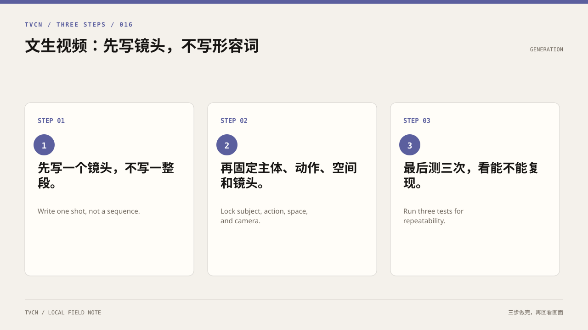

文生视频先写镜头和动作，别写“电影感、史诗感”；模型听不懂形容词。

<!-- DIAGRAM_START -->
<h2>图解</h2>
<figure>
  
  <figcaption>把三步按顺序做完，再回看画面或文件。</figcaption>
</figure>
<!-- DIAGRAM_END -->
<h2>现场</h2>

先写一条 3 秒镜头：人物从画面左侧走到右侧，背景不动；测试三次，只改一个变量，比如速度、镜头或光，别一次换整段。

<h2>怎么做</h2>

文生视频先写镜头和动作，别写“电影感、史诗感”；模型听不懂形容词。
<ol><li>先写一条 3 秒镜头：人物从画面左侧走到右侧，背景不动。</li><li>固定主体、动作、环境、景别、角度和焦段。</li><li>跑三次，每次只改一个变量：速度、镜头或光。</li></ol>
<h2>别踩</h2>

别用形容词堆提示；模型只认可见名词和动作。

<h2>验收</h2>
<ul><li>三条输出都是同一个 3 秒镜头，主体和背景没有漂移。</li><li>三次只改一个变量，能指出哪一格改变带来了什么差异。</li><li>提示里没有“电影感、史诗感”这类空形容词。</li></ul>

<!-- DEEP_DIVE_START -->
## 深读

<strong>约 7 分钟。</strong> 文生视频真正的难点不是“生成好看的画面”，是让同一个镜头跑三次还像同一个镜头。先学会写镜头，再谈风格。

### 把感觉翻译成五个可见项

一条能执行的提示词，至少写清五项：主体是谁、正在做什么、在什么空间、镜头在哪、画面怎么结束。不是写“孤独感”，而是写“一个人坐在末班地铁靠门的位置，双手放在膝盖上，车进站时身体轻轻前倾”。

形容词只描述你的感受，名词和动词才描述画面。把“电影感”删掉，换成“35mm、低机位、窗外冷光、车厢内暖光”；把“高级”删掉，换成“桌面只有一只玻璃杯和一把钥匙”。模型不会因为词更美就拍得更好，它只会因为信息更具体而少猜。

### 首帧、动作、尾帧：三张图定一个镜头

生成前先在心里（或在纸上）画三张图：第一帧观众看到什么，中间发生哪一个动作，最后一帧停在哪里。三张图之间只允许一个主要变化。人物从左走到右是一个变化；同时转身、开门、变焦、换光，就是四个变化，模型一定丢。

如果工具支持首尾帧，优先用首尾帧锁构图，让中间的运动去补；如果不支持，就把镜头改成固定机位，用一个动作完成。三到五秒是最稳的长度；超过五秒，要么拆成两个镜头，要么接受主体漂移。不要用“一镜到底”挑战模型的记忆力，除非你准备逐帧修。

### 变量控制：一次只改一项

把测试当成实验，不是抽奖。第一轮固定主体、服装、空间、机位、光位，只改动作速度；第二轮只改镜头高度；第三轮只改光线方向。每轮跑三条，记录哪一条能复现。你要找的不是“最好看的一条”，是“最稳定的一组”。

做一张三列记录表：改了什么、结果哪里变了、下次保留还是删除。没有记录，第三次生成时你只会记得“好像有一版很好”，然后永远找不回来。可复现性比单条惊艳更重要，因为片子需要的是十个能接上的镜头，不是一张海报。

### 失败分类：主体漂、动作假、镜头乱、质感塑料

主体漂：脸、衣服、年龄在镜头里变。先减动作、减运镜，再换更短时长；还漂，就把人物改成背影、侧影或局部，不要让观众盯着脸看四秒。动作假：走路像滑、手伸出去没有重量。把动作拆成“准备—发生—结束”，只保留发生的那一段；或者让动作在画外完成。

镜头乱：模型自作主张推拉摇移。把机位写成“locked-off, no camera movement”，再用画面内的运动制造节奏。质感塑料：光没有方向、皮肤没有纹理、镜头没有缺陷；回到光、皮肤、镜头三件事，不要靠加滤镜掩盖。每次只修一类，修完再跑三条对比。

### 从片段到序列：接得上才算完成

单条能看，不等于能剪。检查四件事：运动方向是否一致、光从哪边来、服装和道具是否连续、景别跳变是否舒服。人物在 A 镜从右往左走，B 镜不能突然从左往右；窗光在 A 镜在左脸，B 镜不能换到右脸。

给每个镜头留两秒头尾，方便剪辑；重要转场生成一张重叠帧，让两个镜头有共同的参照。不要指望后期调色能救回方向错误；方向错了，观众只觉得“哪里不对”，说不出原因，但会出戏。序列的完成标准是：关掉声音，只看画面，故事仍然清楚。

### 文生视频，十项检查
<ul><li>一条提示只写一个镜头</li><li>主体、动作、空间、机位、结束写清</li><li>删掉不可见的形容词</li><li>首帧和尾帧先画出来</li><li>三到五秒为稳</li><li>一次只改一个变量</li><li>每轮跑三条并记录</li><li>主体漂就减动作和时长</li><li>机位写 locked-off</li><li>关声音看序列是否讲得通</li></ul>
文生视频不是让模型替你想，是把镜头想到模型不用猜。

<!-- DEEP_DIVE_END -->
<!-- SOURCES_START -->
<h2>参考与延伸阅读</h2>

经验来源：TVCN 现场手册与项目复盘；实测来源：页面标注的复核环境与可复现练习；参考来源：以下公开链接。

<ul><li>[S04] 《生成式人工智能服务管理暂行办法》</li><li>[S05] 欧盟 AI Act 政策页</li><li>[S19] GAN 原始论文（2014）</li><li>[S20] DDPM 原始论文（2020）</li></ul>

<a href="../../SOURCES.md">完整链接与用途见 SOURCES.md</a>

<!-- SOURCES_END -->
