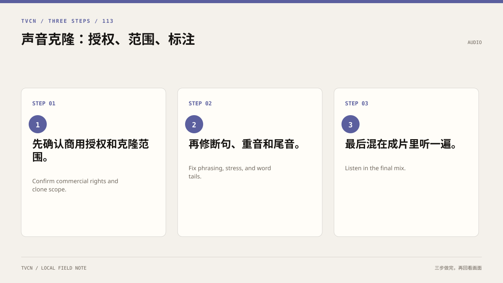

声音克隆写清授权、期限、平台和是否允许再训练；片尾要标注。

<!-- DIAGRAM_START -->
<h2>图解</h2>
<figure>
  
  <figcaption>把三步按顺序做完，再回看画面或文件。</figcaption>
</figure>
<!-- DIAGRAM_END -->
<h2>现场</h2>

授权范围写平台、期限、是否允许二次训练；成片片尾和简介都标注 AI 配音。

<h2>怎么做</h2>

声音克隆写清授权、期限、平台和是否允许再训练；片尾要标注。
<ol><li>授权范围写平台、期限、是否允许二次训练。</li><li>成片片尾和简介都标注 AI 配音。</li><li>保留授权文件和生成记录，交付时一起归档。</li></ol>
<h2>别踩</h2>

别把“能克隆”当“能商用”；授权范围写不清就不做。

<h2>验收</h2>
<ul><li>授权文件写清平台、期限和二次训练三项。</li><li>片尾和简介都有 AI 配音标注，不只藏在小字里。</li><li>授权文件和生成记录能随交付一起找到。</li></ul>
