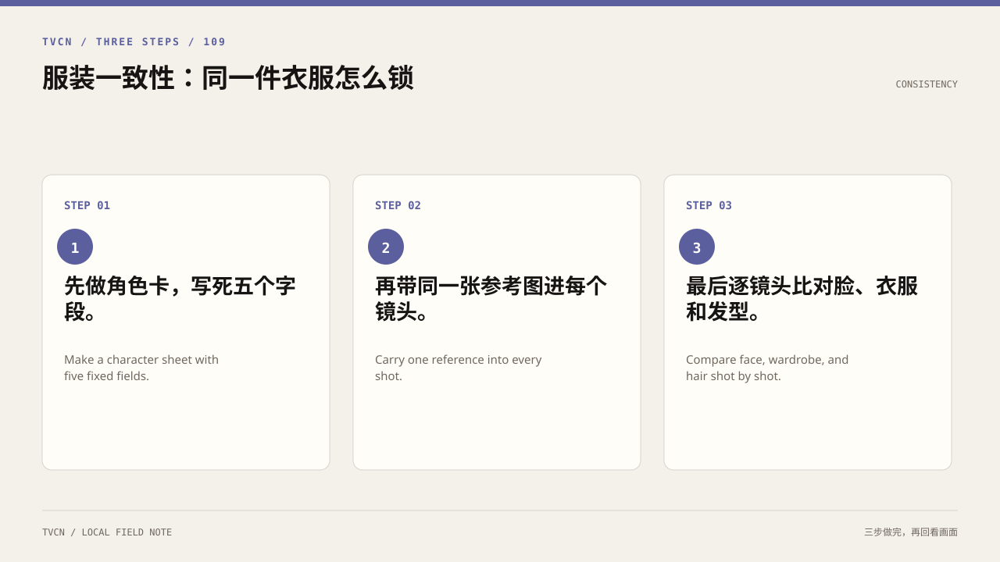

服装一致性靠固定描述和参考图，不靠“同一个人”这四个字。

<!-- DIAGRAM_START -->
<h2>图解</h2>
<figure>
  
  <figcaption>把三步按顺序做完，再回看画面或文件。</figcaption>
</figure>
<!-- DIAGRAM_END -->
<h2>现场</h2>

服装写颜色、材质、领口、袖子、图案五样；参考图只截衣服，别带脸，避免模型混脸。

<h2>怎么做</h2>

服装一致性靠固定描述和参考图，不靠“同一个人”这四个字。
<ol><li>服装写颜色、材质、领口、袖子、图案五样。</li><li>参考图只截衣服，别带脸，避免模型混脸。</li><li>每个镜头生成后比对领口和图案，漂了就改描述。</li></ol>
<h2>别踩</h2>

别用带脸的参考图锁衣服；模型会把脸和衣服一起混。

<h2>验收</h2>
<ul><li>服装描述覆盖颜色、材质、领口、袖子、图案五项。</li><li>参考图只有衣服，没有脸和背景干扰。</li><li>各镜头领口和图案一致，没有一件衣服变两次。</li></ul>
