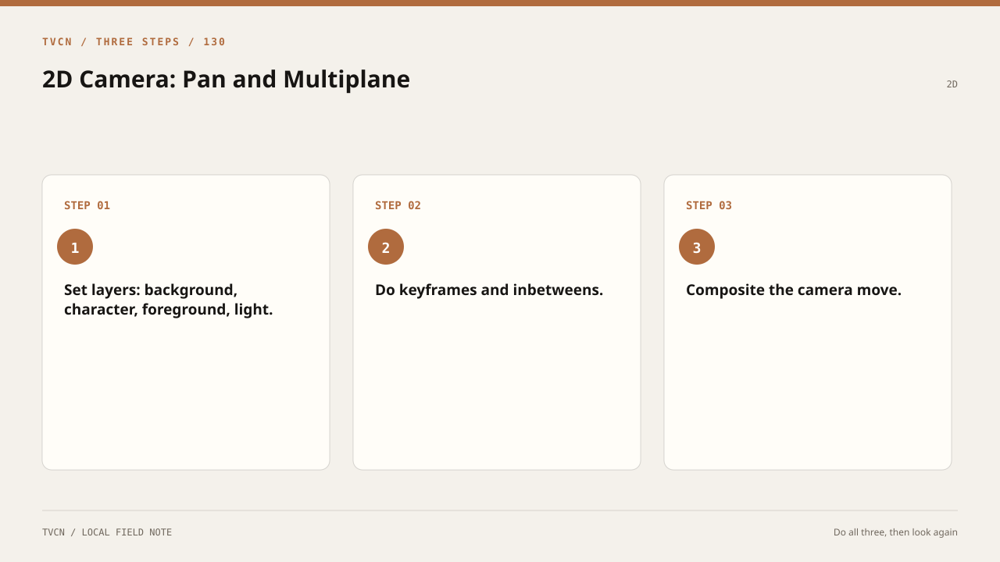

Camera moves in 2D start with layer layout: foreground, middle and background on separate planes, moving at different speeds to create space. Move them together and the audience sees a sliding drawing.

<!-- DIAGRAM_START -->
<h2>Diagram</h2>
<figure>
  
  <figcaption>Watch “Split the background into far mountain, midground, near” and “Pan at speeds of 1:2:4.”; judge whether the speed split between foreground, midground and background reads in one move.</figcaption>
</figure>
<!-- DIAGRAM_END -->
<section><h2 id="section-1">A 2D camera is a stage, not a 3D scene</h2>
For a push-in, decide whether to move the camera or scale the layer; scaling softens, camera movement stays sharp.
<h2 id="section-2">Limits</h2>
A 2D camera cannot replace perspective. If layer scale is wrong, complex moves still look like paper; draw the space first.
<h2 id="section-3">A 2D camera is not a zoom; it is layered parallax</h2>

The point of a 2D camera move is not to push the whole image closer, but to move foreground, midground and background at different speeds. The speed difference creates space. Without layers, even a large move looks like a flat image scaling.

<table class="data-table"><thead><tr><th>Layer</th><th>Speed</th><th>Common error</th></tr></thead><tbody>
<tr><td>Foreground</td><td>Fastest; may leave frame</td><td>Scales with background, loses occlusion</td></tr>
<tr><td>Midground</td><td>Medium; carries subject</td><td>Motion blur points the wrong way</td></tr>
<tr><td>Background</td><td>Slowest; needs overscan</td><td>Edges show after scaling</td></tr>
</tbody></table>

<h3>Project-level checks</h3>
<ol><li>Build the background at twice final size to give the camera room. Do not push a final-size plate.</li><li>Use two or three camera keyframes with ease in/out. Linear keys feel like a conveyor belt.</li><li>Tune motion blur per layer and speed; foreground and background should not share one setting.</li><li>Toggle each layer before output; check blank edges, seams and repeated texture.</li></ol>

For acceptance, watch the film at 50%. If space remains, the layers work. If it only “gets bigger,” return to layer speed.
</section><section><h2 id="section-4">On set</h2>
Split the background into far, middle, and near layers and pan them at 1:2:4 speed. Keep the character on its own layer, still.
</section><section><h2 id="section-5">Do this</h2>
2D camera moves are not one flat pan; layers at different speeds create space.
<ol><li>Split the background into far mountain, midground, near trees.</li><li>Pan at speeds of 1:2:4.</li><li>Keep the character on a separate layer, still or with a small follow.</li></ol></section><section><h2 id="section-6">Avoid</h2>
Do not pan the whole image at one speed; equal layers flatten the space.
</section><section><h2>Judge</h2>
Three signals are observable on set:
<ul><li>the speed split between foreground, midground and background reads in one pan</li><li>a 0.5-second action still carries weight or anticipation</li><li>turn off any layer and the space still holds</li></ul></section><section><h2>Failures</h2>
These three moves erase the detail you just built:
<ul><li>more layers, same speed: the space stays flat</li><li>anticipation without follow-through: the weight is only half done</li><li>rendering before assets are locked: rework starts at the compositor</li></ul></section><section><h2>Extend</h2>
<strong>10-minute exercise:</strong> Draw three keys at 24 fps, change only “Pan at speeds of 1:2:4.”, and export two seconds. If the weight still does not read, add anticipation before adding blur.
</section>
<h2>Check</h2><ul><li>Far, mid, and near layers move at different speeds near 1:2:4.</li><li>The character layer is separate and does not slide with the background.</li><li>One pan shows near-fast, far-slow parallax.</li></ul>

<!-- SOURCES_START -->
## Sources

- [S12] See the original link and use note in SOURCES.md.
- [S23] See the original link and use note in SOURCES.md.

Full links and use notes: [`SOURCES.md`](../../about/).
<!-- SOURCES_END -->
