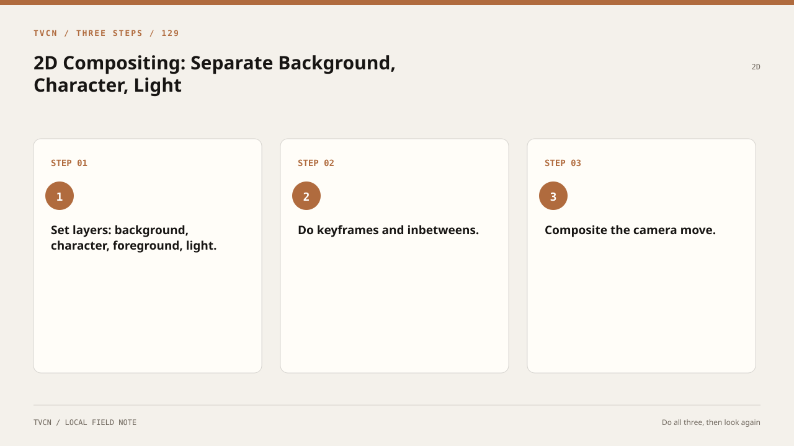

The giveaway is inconsistent line weight and color. Unify stroke width, anti-aliasing and value range before lighting; adjust each layer separately, not with a global filter.

<!-- DIAGRAM_START -->
<h2>Diagram</h2>
<figure>
  
  <figcaption>Watch “Use four layers: background, character, foreground, light effect.” and “Grade each layer separately and keep shadows off”; judge whether the speed split between foreground, midground and background reads in one move.</figcaption>
</figure>
<!-- DIAGRAM_END -->
<section><h2 id="section-1">2D compositing aligns line and color first</h2>
Check with a comparison frame: foreground and background blacks and whites must match; if not, it looks pasted on.
<h2 id="section-2">Limits</h2>
Compositing is not adding effects. No amount of effects fixes misaligned lines; align the base layers first.
<h2 id="section-3">2D compositing: fix edges, then color, then light</h2>

Compositing problems are usually order problems, not “not enough effect.” Color before edge work magnifies edge fringes. Light before edge work covers seams. The order is: clean plate → edge → color match → light → output.

<table class="data-table"><thead><tr><th>Step</th><th>Check</th><th>Failure signal</th></tr></thead><tbody>
<tr><td>Edge</td><td>Inspect at 1:1 pixels</td><td>White/black fringe, jaggies</td></tr>
<tr><td>Color</td><td>Skin and sky within one scene</td><td>Foreground warmer or greener than background</td></tr>
<tr><td>Light</td><td>Light direction matches</td><td>Glow passes through an occluder</td></tr>
<tr><td>Output</td><td>Review at each delivery size</td><td>Edge vanishes small, seam shows large</td></tr>
</tbody></table>

<h3>Project-level checks</h3>
<ol><li>Toggle every element and make a list. One missing shadow or contact shadow makes the layer float.</li><li>Use the smallest edge setting, several light passes. One maxed-out pass eats detail.</li><li>Match color on neutral gray first, then skin. Eyes alone drift on a colored background.</li><li>Put the light pass on top but mask it behind foreground objects; otherwise light goes through walls.</li></ol>

Before delivery, ask someone else to watch ten seconds and answer only “what floats?” After staring for hours, you stop seeing seams.
</section><section><h2 id="section-4">On set</h2>
Use four layers: background, character, foreground, and light. Grade each separately and keep shadows off the character layer.
</section><section><h2 id="section-5">Do this</h2>
2D compositing separates background, character, foreground, and light; one flattened image means redrawing everything for one change.
<ol><li>Use four layers: background, character, foreground, light effect.</li><li>Grade each layer separately and keep shadows off the character layer.</li><li>Composite position first, then light and shadow.</li></ol></section><section><h2 id="section-6">Avoid</h2>
Do not draw everything on one layer; one change forces a full redraw.
</section><section><h2>Judge</h2>
Three signals are observable on set:
<ul><li>the speed split between foreground, midground and background reads in one pan</li><li>a 0.5-second action still carries weight or anticipation</li><li>turn off any layer and the space still holds</li></ul></section><section><h2>Failures</h2>
These three moves erase the detail you just built:
<ul><li>more layers, same speed: the space stays flat</li><li>anticipation without follow-through: the weight is only half done</li><li>rendering before assets are locked: rework starts at the compositor</li></ul></section><section><h2>Extend</h2>
<strong>10-minute exercise:</strong> Draw three keys at 24 fps, change only “Grade each layer separately and keep shadows off”, and export two seconds. If the weight still does not read, add anticipation before adding blur.
</section>
<h2>Check</h2><ul><li>Background, character, foreground, and light are separate layers with clear structure.</li><li>Shadows live on their own layer, not baked into the character.</li><li>Changing an action moves only the character layer; background and light stay.</li></ul>
<!-- SOURCES_START -->
<aside class="article-sources experience-source" data-source-kind="experience">

Sources / 来源
Experience source

Experience source: TVCN field handbook and editorial review; no laboratory measurement or external data is claimed here.
</aside>
