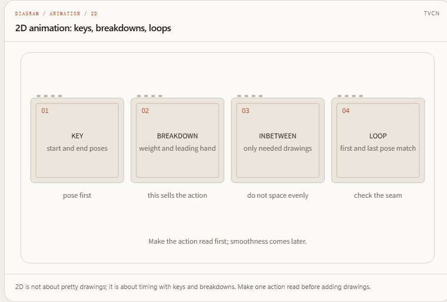

<!-- DIAGRAM_START -->
## Diagram

<figure>
  
  <figcaption>2D is not about pretty drawings; it is about timing with keys and breakdowns. Make one action read before adding drawings.</figcaption>
</figure>
<!-- DIAGRAM_END -->

2D is not about beautiful drawings. It is about controlling time with keys and breakdowns. Make one action read first.

## Keyframes

Draw the start, the turn, and the end of the action. Those three drawings are the keys. Do not draw every frame from first to last; you will lose timing.

A key must read: where is the hand, where is the weight, where is the gaze. Even in line art, another person should understand it.

## Breakdowns

Add breakdowns between keys to decide “fast–slow–fast” or “slow–fast–stop.” A breakdown is not just an in-between; it controls acceleration and weight.

Test an action in eight drawings before building three minutes. Eight drawings expose timing problems at the lowest cost.

## Loops

For loops (walk, breathe, rain), build eight or twelve frames and check whether the end connects to the start. The first and last drawings are not identical, but the motion must return seamlessly.

Loop length comes from the action, not the software. A step may take twelve frames; a breath may take forty-eight. Do not use one length for everything.

## Three checks

- An eight-drawing test reads start, turn, and end.
- Breakdowns change acceleration, not just fill inbetweens.
- The loop connects seamlessly.

<!-- DEEP_DIVE_START -->
## Deep dive

<strong>About 7 minutes.</strong> 2D animation is not more drawings. It is keyframes that state the action, then inbetweens that control time.

### Keys first, inbetweens second

Block a scene with three keys: start, turn, end. If three drawings tell the action, add inbetweens. If the keys are unclear, more inbetweens only make it blurrier.

The turn key carries weight: foot contact, hand on the door, head turning. Draw contact first, then follow-through. Do not tween straight from the first drawing to the last.

### Separate layers by function

Separate body, hair, cloth, and props into layers. The body uses fewer frames; hair and hem lag. If everything moves on the same frame, it looks like stickers.

For a loop, draw four: contact, down, passing, up. Check for foot slide, then repeat. A loop is not the same drawing repeated; it is the same rhythm repeated.

### Timing before detail

Set the frame rate first: twelve frames per second for hand-drawn, twenty-four for smooth. One missing drawing at twelve changes the speed. Count frames before drawing detail.

A hold says more about weight than movement: two extra frames before lifting, two extra after landing. The audience feels time, not line quality.

### Five-minute drill: four-drawing loop

Draw a walk in place with four drawings: contact, down, passing, up. Change only feet and pelvis; keep the head. Play it at twelve frames and check for foot slide.

Draw a second version with one extra hold on the down. Compare which feels heavier. Write the result into the next loop's frame chart.

### When the 2D shot works

The shot works when, muted, the audience can say what the character does, why, and what they hit; feet do not slide, the center bounces, hair and cloth lag. All three pass.

If the audience needs a caption to read the action, return to the keys, not add inbetweens. Most 2D problems live in the keys, not in line detail.

### Ten 2D animation checks
<ul><li>Three keys first</li><li>Keys tell the action</li><li>Contact drawn at the turn</li><li>Body, hair, cloth layered</li><li>Hair and hem lag</li><li>Four drawings for a loop</li><li>Foot slide checked</li><li>Frame rate before detail</li><li>Holds carry weight</li><li>Frame counts recorded</li></ul>
2D craft is not fine drawing. It is whether keys and frame counts make the action true.

<!-- DEEP_DIVE_END -->

<!-- SOURCES_START -->
## References and further reading

- [S62] [Blender Foundation: Blender Manual](https://docs.blender.org/manual/en/latest/) — Accessed 2026-11-26. Used to check the terminology and public context in the opening paragraph (“2D is not about beautiful drawings. It is about controlling ”) against Modelling, rigging, animation and rendering; not a substitute for an on-set test.
- [S63] [Toon Boom: Documentation](https://docs.toonboom.com/) — Accessed 2026-11-26. Used to check the terminology and public context in the opening paragraph (“2D is not about beautiful drawings. It is about controlling ”) against 2D animation, rigging and production pipeline; not a substitute for an on-set test.
- [S12] [Animation](https://www.britannica.com/art/animation) — Accessed 2026-11-26. Used to check the terminology and public context in the opening paragraph (“2D is not about beautiful drawings. It is about controlling ”) against Encyclopedia entry on animation principles, techniques and industry history; not a substitute for an on-set test.
- [S59] [Adobe: After Effects User Guide](https://helpx.adobe.com/after-effects/user-guide.html) — Accessed 2026-11-26. Used to check the terminology and public context in the opening paragraph (“2D is not about beautiful drawings. It is about controlling ”) against Compositing, keyframes, tracking and export; not a substitute for an on-set test.
<!-- SOURCES_END -->

