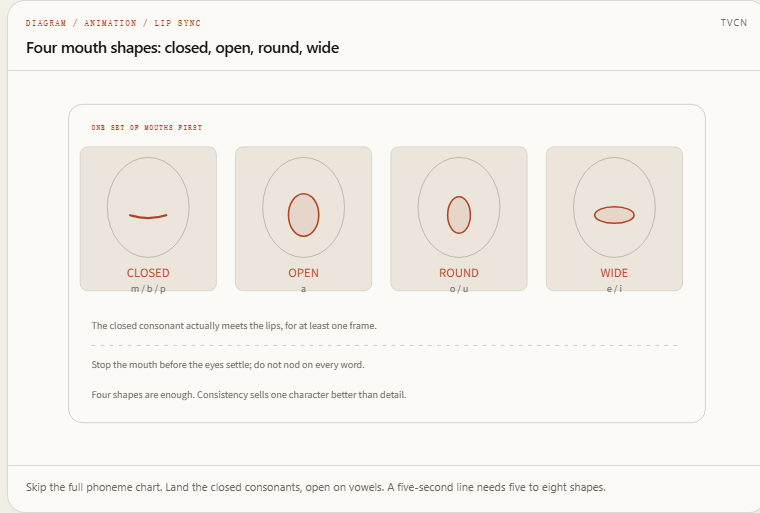

<!-- DIAGRAM_START -->
## Diagram

<figure>
  
  <figcaption>Skip the full phoneme chart. Land the closed consonants, open on vowels. A five-second line needs five to eight shapes.</figcaption>
</figure>
<!-- DIAGRAM_END -->

Lip sync is not a drawing for every word. The audience watches the closure, not the lip detail.

## Sort the voice into four mouths

You do not need the full phoneme chart. Start with four mouth groups: closed (m, b, p), open (a), round (o, u), wide (e, i). Most dialogue needs no more than these.

Draw one clear profile or front view for each group and pin it beside the lightbox. Do not invent a fifth mouth mid-scene. The more consistent the set, the more the audience believes one person is speaking.

If the design is simple, use fewer shapes. Closed and open can carry a scene. Timing of the closure matters more than lip detail.

## The closed frame matters more than the open one

The audience decides “is he speaking” on the consonant closure. On m, b, and p, the lips actually meet, even for a single frame. A mouth left half open reads as dubbing no matter how good the track is.

Listen once, mark the closed-lip sounds on the waveform, put the closed shape one or two frames before each mark, then move into the vowel. Do not cut a shape for every letter. A five-second line needs five to eight mouth shapes.

Keep the closure clean. Too many in-betweens make the mouth look like it is chewing.

## Let the expression lag; stop nodding

Do not land eyes and brows on the same frame as the mouth. Let the eyes arrive two to four frames late, the head a little after that. The audience hears the stress first and sees the reaction second; that is where believability comes from.

The head can move on a stressed word. At the end of a line, stop the mouth first and let the eyes settle. The worst habit is a nod on every word, like keeping time. One sentence needs one main action: look away, lower the head, blink, take a breath.

## Checks

- Four mouth shapes cover the whole line.
- Every closed consonant actually closes for at least one frame.
- Eyes and head arrive after the mouth; the mouth stops first at the end.

<section><h2>Boundary</h2>
This page only covers “Lip Sync: Close on Consonants, Open on Vowels”; it does not replace The Twelve Principles: Use One at a Time, Timing in Animation: The Weight Lives Between Two Keys, Brand Film: Make Them Believe One Sentence. When the problem belongs to one of those pages, use that page instead of adding more parameters here.
</section>
<!-- SOURCES_START -->
## References and further reading

- [S63] [Toon Boom: Documentation](https://docs.toonboom.com/) — Accessed 2026-11-26. Used to check the terminology/method/rule in the “Sort the voice into four mouths” section against Toon Boom documentation, not an industry pipeline standard; it does not verify numbers, model choices or on-set conclusions derived from this page, and is not a substitute for a test.
- [S62] [Blender: Official Manual](https://docs.blender.org/manual/en/latest/) — Accessed 2026-11-26. Used to check the terminology/method/rule in the “The closed frame matters more than the open one” section against Blender manual, not an industry pipeline standard; it does not verify numbers, model choices or on-set conclusions derived from this page, and is not a substitute for a test.
- [S59] [Adobe: After Effects Guide](https://helpx.adobe.com/after-effects/user-guide.html) — Accessed 2026-11-26. Used to check the terminology/method/rule in the “Let the expression lag; stop nodding” section against official After Effects guide, not a verdict on compositing aesthetics; it does not verify numbers, model choices or on-set conclusions derived from this page, and is not a substitute for a test.
<!-- SOURCES_END -->

