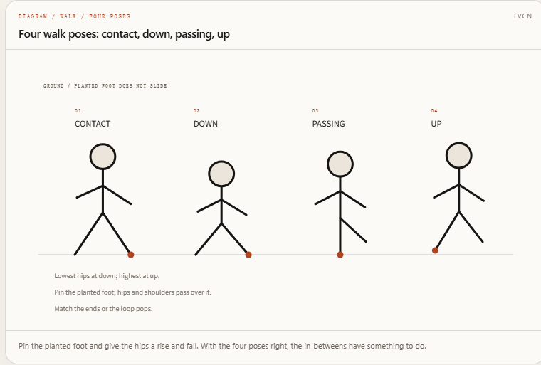

<!-- DIAGRAM_START -->
## Diagram

<figure>
  
  <figcaption>Pin the planted foot and give the hips a rise and fall. With the four poses right, the in-betweens have something to do.</figcaption>
</figure>
<!-- DIAGRAM_END -->

## Lock the four poses

Block a walk with four poses: contact, down, passing, up. Contact is the front heel down and the back toe still on the ground. Down is the lowest point of the hips. Passing is the back leg under the body. Up is the highest point before the front foot leaves.

Stand the four poses up before adding in-betweens. A floaty walk usually has bad weight in the poses, not too few drawings.

## The planted foot cannot slide

Once a foot lands, it should look pinned to the screen. The body can pass over it; the foot cannot drift with it. Lock the foot, then move the hips and shoulders past. A sliding foot makes the character walk on ice.

The hips need to go up and down. Every step has a low point and a high point; the body does not travel on a flat line. Hold the down pose one extra frame and weight appears.

## Let hands and head lag; judge the loop by its ends

Do not move arms and head on the same frame as the hips. Hips first, arms one or two frames later, head a little after that. That is what makes a walk feel weighted instead of translated. Arms swing opposite the same-side leg; do not move hand and foot together.

When the cycle is done, put the first and last frames side by side. If they do not match, it pops. Fix the ends before the middle; doing it backwards wastes ten passes.

## Checks

- All four poses carry weight.
- The planted foot does not slide; hips and shoulders pass over it.
- First and last frames connect without a pop.

<!-- DEEP_DIVE_START -->
## Deep dive

<strong>About 6 minutes.</strong> A walk is not legs alternating. It is weight falling, one foot supporting, then the other foot catching.

### Four poses

Contact, down, passing, up: four drawings make half a step. Contact is the widest stride; down is the lowest center; passing is the straight support leg; up is the highest body.

Draw the pelvis and ribcage up and down first, then the legs. Without that bounce, correct legs still slide.

### The planted foot cannot slide

The support foot must stay planted on screen while the body moves forward. Check by lining up the background with the foot and watching frame by frame for drift.

Heel contacts, foot rolls, toe leaves. Three clear points give the push. Do not slap the whole foot down flat.

### Arm and head lag

Arms swing opposite the legs but one or two frames later; the head lags the ribcage by one. If everything arrives together, the walk looks robotic.

A tired walk adds a drag: shorter support, deeper down, head lowering first. Do not just slow the playback.

### Five-minute drill: eight-drawing cycle

Draw an eight-drawing walk: left contact, left down, left passing, left up, right contact, right down, right passing, right up. Side view only, no background.

Play the loop. Check foot slide first, then the vertical bounce, then arm lag. When all three work, add cloth and hair.

### When the walk is right

Line the background to the foot and check the plant does not drift; the pelvis bounces, the head lags, the arms swing opposite; the loop returns to the first drawing without a jump. All three pass.

If the foot slides, check the plant before changing the upper body. If it looks robotic, add lag before adding inbetweens.

### Watch the pelvis again

Cover the legs and watch only the pelvis: no side shift makes it march in place; too much makes it dance. Set the side shift to half a foot, then animate the legs.

### Ten walk-cycle checks
<ul><li>Four poses per half step</li><li>Pelvis and ribcage first</li><li>Widest stride at contact</li><li>Lowest center at down</li><li>Straight support leg at passing</li><li>Planted foot does not slide</li><li>Heel, ball, toe clear</li><li>Arms opposite and lagging</li><li>Head one frame behind ribcage</li><li>Fatigue adds drag, not slow motion</li></ul>
Every walk-cycle problem comes back to two places: does the center bounce, and does the planted foot slide?

<!-- DEEP_DIVE_END -->
