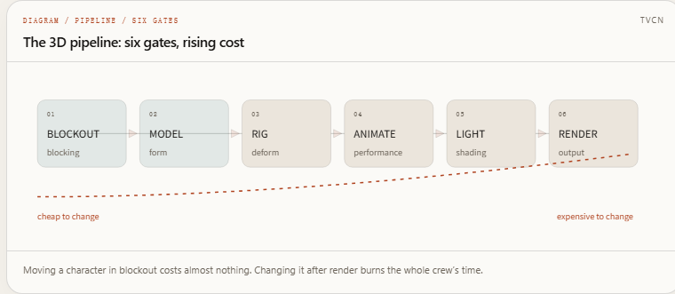

<!-- DIAGRAM_START -->
## Diagram

<figure>
  
  <figcaption>Moving a character in blockout costs almost nothing. Changing it after render burns the whole crew’s time.</figcaption>
</figure>
<!-- DIAGRAM_END -->

## Blockout sets timing

Use simple cubes and spheres to lay out timing and camera. No modeling or texturing yet; only answer when things happen and where the camera is.

Do not move on until blockout works. If the rhythm is wrong here, detail makes it harder to fix later.

## Layout locks the camera before animation

Layout sets framing, focal length, and camera path. If the camera is not locked, animators perform inside the wrong frame and everything gets redone.

Make a playblast with no detail and confirm the cut points. Once shot length is fixed, allocate animation time.

## Lighting and render are separate checks

Lighting checks separation: subject, background, environment. Render checks output: noise, samples, passes, and compositing.

Do not treat “fix it in render” as a workflow. Preview lighting at low samples to confirm mood; only then raise samples.

## Three checks

- Blockout timing and cut points are approved.
- Cameras are locked before animation starts.
- Lighting preview and final render are reviewed separately.

<!-- DEEP_DIVE_START -->
## Deep dive

<strong>About 7 minutes.</strong> The 3D pipeline is not a software menu. It is a chain where every step can go back one step; skip blockout and you rebuild structure forever.

### Blockout before modeling

Block with boxes and cylinders for proportion, camera, and blocking. Confirm what the shot can see before modeling detail. If the blockout fails, more detail is more waste.

Put the camera in the scene first and check composition at the real focal length. Do not model first and look for a camera later; by then it cannot change.

### Rig and animation handoff

Set joint count and naming before rigging. Animators need a rig that bends, turns, and carries weight, not a pile of controls. Record a test action at handoff.

Animate on the low model first to confirm timing and center of gravity, then move to high. Animating heavy geometry slows both the viewport and your judgment.

### Lighting, render, and rollback

Light the gray model first to confirm the key direction. Do not load full materials at the start; read the value structure first. Render low resolution and low samples to confirm motion and composition.

Save a version at every stage with date and content in the name. Rolling back is part of the pipeline, not a failure. Without versions, rollback means redo.

### Five-minute drill: one shot through the pipeline

Take a simple scene through blockout, low model, rig test, low-model animation, gray lighting, low-res render. Ten minutes per step; no detail chasing.

Save a version each step, then roll back to the blockout and check the camera. If it moved, you changed structure later without admitting it.

### When a 3D shot is done

From blockout to final render: the camera did not secretly move, proportions held, the rig did not break, light direction matches, and the low-res test and final share composition. All five pass.

If the final composition differs from the blockout, roll back and check. Do not hide it with a post crop. The expensive 3D problems are decisions changed late.

### Ten 3D pipeline checks
<ul><li>Blockout before modeling</li><li>Boxes and cylinders in blockout</li><li>Camera placed first</li><li>Composition at real focal length</li><li>Joints and naming before rig</li><li>Test action recorded at handoff</li><li>Animation on low model</li><li>Gray-model lighting first</li><li>Low-res, low-sample test render</li><li>Version saved at every stage</li></ul>
The way to save time in 3D is not skipping a step. It is making every step able to go back one.

<!-- DEEP_DIVE_END -->

<!-- SOURCES_START -->
## References and further reading

- [S62] [Blender Foundation: Blender Manual](https://docs.blender.org/manual/en/latest/) — Accessed 2026-11-26. Used to check the terminology and public context in the opening paragraph (“3D does not start with animation after modeling. Blockout se”) against Modelling, rigging, animation and rendering; not a substitute for an on-set test.
- [S63] [Toon Boom: Documentation](https://docs.toonboom.com/) — Accessed 2026-11-26. Used to check the terminology and public context in the opening paragraph (“3D does not start with animation after modeling. Blockout se”) against 2D animation, rigging and production pipeline; not a substitute for an on-set test.
- [S12] [Animation](https://www.britannica.com/art/animation) — Accessed 2026-11-26. Used to check the terminology and public context in the opening paragraph (“3D does not start with animation after modeling. Blockout se”) against Encyclopedia entry on animation principles, techniques and industry history; not a substitute for an on-set test.
- [S59] [Adobe: After Effects User Guide](https://helpx.adobe.com/after-effects/user-guide.html) — Accessed 2026-11-26. Used to check the terminology and public context in the opening paragraph (“3D does not start with animation after modeling. Blockout se”) against Compositing, keyframes, tracking and export; not a substitute for an on-set test.
<!-- SOURCES_END -->

