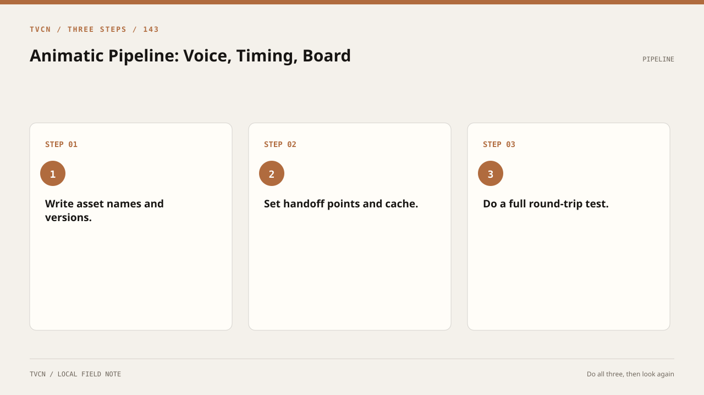

Lay temp voice, set duration, then revise the board. Without sound, timing is fiction.

<!-- DIAGRAM_START -->
<h2>Diagram</h2>
<figure>
  
  <figcaption>Do the three steps in order, then look again at the image or file.</figcaption>
</figure>
<!-- DIAGRAM_END -->
<h2>On set</h2>

Record the voice first and time it at real speed. Write each shot's seconds and keep the total under 110 percent of target, then draw.

<h2>Do this</h2>

Animatic starts with voice, then timing, then boards; without sound, timing is fake.
<ol><li>Record voice and time it at real speaking speed.</li><li>Write seconds per shot and keep total within 110 percent of target.</li><li>Draw after timing is locked.</li></ol>
<h2>Avoid</h2>

Do not draw everything before voice; a pace change re-times every shot.

<h2>Check</h2>
<ul><li>Voice is recorded at real speed and every shot duration comes from it.</li><li>Total stays within 110 percent of target and timing is locked first.</li><li>Eyes closed, audio tells the story; muted, the picture does.</li></ul>

<!-- DEEP_DIVE_START -->
## Deep dive

<strong>About 6 minutes.</strong> An animatic is not a slideshow of boards. It uses scratch sound and timing to test whether the film works.

### Time first, detail later

Put each board on the timeline at its estimated duration with scratch dialogue and sound. Check total length and rhythm before drawing beautiful faces.

If a shot runs four seconds without new information, shorten or split it. Changing time in animatic is ten times cheaper than changing it in animation.

### Scratch sound must be understandable

Record the dialogue yourself, even if it sounds rough. The audience needs the information, not voice quality. Use only key effects: door, steps, phone.

Put a scratch music track and mark the chorus and pauses. Do not wait until animation is finished to find music; the rhythm will not match.

### Lock before animation

An animatic passes when it is understandable muted and understandable with eyes closed. Only then move to layout and animation.

Even one line change after lock requires retiming. Do not rewrite the story while animating. Changing story is always cheaper than changing animation.

### Five-minute drill: thirty-second animatic

Make a thirty-second animatic with six boards, phone-recorded dialogue, and two sound effects. Mark seconds per board; total must not exceed thirty.

Watch muted, then listen with eyes closed. Fix whichever version fails; do not add narration to explain.

### When the animatic is ready for animation

Understandable muted, understandable eyes closed, total length on budget, every second brings new information, scratch music marks the rhythm. All five pass before layout and animation.

If one second needs narration to explain, cut or redraw it; do not carry it into animation. The animatic's job is to keep “I do not understand” in the cheapest stage.

### Watch the total length again

Play the whole animatic three times. Whatever you want to fast-forward on the third pass is what must be cut. The audience will not forgive drag because you watched it longer. Cut time before discussing style.

### Ten animatic checks
<ul><li>Seconds marked per board</li><li>Scratch dialogue recorded</li><li>Only key sound effects</li><li>Scratch music with chorus marked</li><li>Total length checked first</li><li>Four seconds without new info gets cut</li><li>Understandable muted</li><li>Understandable eyes closed</li><li>Locked before animation</li><li>Line changes retimed</li></ul>
The only purpose of an animatic is to discover the film does not work while it is still cheap.

<!-- DEEP_DIVE_END -->
