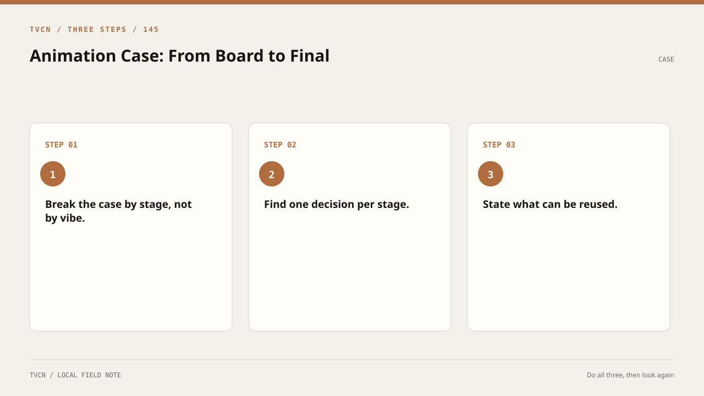

When studying an animation case, note three limits first: budget, schedule, team size. Style is the result of those limits, not the starting point. Translate “beautiful” into trade-offs: fewer characters, fewer sets, repeated shots, limited frame rate.

<!-- DIAGRAM_START -->
<h2>Diagram</h2>
<figure>
  
  <figcaption>Watch “Compare three board panels, animatic timing, layout camera,” and “Log one decision and one rework per stage.”; judge whether the speed split between foreground, midground and background reads in one move.</figcaption>
</figure>
<!-- DIAGRAM_END -->
<section><h2 id="section-1">Read constraints before style in a case study</h2>
Then trace one action: how many frames, key poses, reused assets. If you can retell the production path, you understood the case.
<h2 id="section-2">Limits</h2>
Do not just save the image. A case without a production path is a reference image, not a method.
</section><section><h2 id="section-3">On set</h2>
Compare stage by stage: three board panels, animatic timing, layout camera, animation keys, light, and comp. Log one change per stage.
</section><section><h2 id="section-4">Do this</h2>
An animation case study compares boards, animatic, layout, animation, light, and comp stage by stage, not just praising the final.
<ol><li>Compare three board panels, animatic timing, layout camera, keyframes, light, comp.</li><li>Log one decision and one rework per stage.</li><li>State what can be reused, not just “it looks good.”</li></ol></section><section><h2 id="section-5">Avoid</h2>
Do not look only at the final; the final hides the rework.
</section><section><h2>Judge</h2>
This page passes on three observable checks, not slogans:
<ul><li><strong>1.</strong> All six stages are compared, not just final stills.</li><li><strong>2.</strong> Each stage logs one decision and one rework.</li><li><strong>3.</strong> At least one reusable step is written so another person can follow it.</li></ul></section><section><h2>Failures</h2>
Any one of these means stop and fix it before post:
<ul><li><strong>1.</strong> Check 1 is only staged (“All six stages are compared, not just final st…”); another camera position or location exposes it.</li><li><strong>2.</strong> Check 2 is left to post or a verbal explanation (“Each stage logs one decision and one rework”); nothing on set can be rechecked.</li><li><strong>3.</strong> Do not look only at the final; the final hides the rework.</li></ul></section><section><h2>Extend</h2>
<strong>10-minute exercise:</strong> Draw three keys at 24 fps, change only “Log one decision and one rework per stage.”, and export two seconds. If the weight still does not read, add anticipation before adding blur.
</section>
<h2>Check</h2><ul><li>All six stages are compared, not just final stills.</li><li>Each stage logs one decision and one rework.</li><li>At least one reusable step is written so another person can follow it.</li></ul>

<!-- SOURCES_START -->
## References and further reading

- [S62] [Blender: Official Manual](https://docs.blender.org/manual/en/latest/) — Accessed 2026-11-26. Used to check the terminology/method/rule in the “Read constraints before style in a case study” section against Blender manual, not an industry pipeline standard; it does not verify numbers, model choices or on-set conclusions derived from this page, and is not a substitute for a test.
- [S63] [Toon Boom: Documentation](https://docs.toonboom.com/) — Accessed 2026-11-26. Used to check the terminology/method/rule in the “Limits” section against Toon Boom documentation, not an industry pipeline standard; it does not verify numbers, model choices or on-set conclusions derived from this page, and is not a substitute for a test.
- [S59] [Adobe: After Effects Guide](https://helpx.adobe.com/after-effects/user-guide.html) — Accessed 2026-11-26. Used to check the terminology/method/rule in the “On set” section against official After Effects guide, not a verdict on compositing aesthetics; it does not verify numbers, model choices or on-set conclusions derived from this page, and is not a substitute for a test.
<!-- SOURCES_END -->

