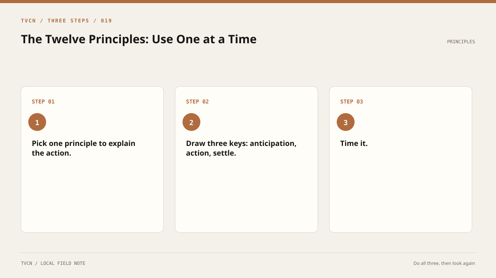

The twelve principles are not filters. Use one to explain one action; otherwise the audience sees noise.

<!-- DIAGRAM_START -->
<h2>Diagram</h2>
<figure>
  
  <figcaption>Do the three steps in order, then look again at the image or file.</figcaption>
</figure>
<!-- DIAGRAM_END -->
<h2>On set</h2>

Pick one action: a character reaches for a cup. Use anticipation and ease in and out only: five frames of anticipation, three of action, four of settle. Do not add squash and stretch at the same time.

<h2>Do this</h2>

The twelve principles are not twelve filters; use one principle per action so the audience can read it.
<ol><li>Choose one action: a character reaches for a cup.</li><li>Use only anticipation and ease in/out: five frames of anticipation, three of action, four of settle.</li><li>Do not add squash and stretch at the same time; test one principle per pass.</li></ol>
<h2>Avoid</h2>

Do not apply all twelve principles at once; the action becomes a spasm.

<h2>Check</h2>
<ul><li>One action uses one main principle and you can say what it solves.</li><li>Anticipation, action, and settle have written frame counts, not random drawing.</li><li>Remove the principle and the action reads worse, proving it mattered.</li></ul>

<!-- DEEP_DIVE_START -->
## Deep dive

<strong>About 6 minutes.</strong> The twelve principles are not twelve boxes to tick. Pick three per shot and make the action clear.

### Pick three

Choose three per shot: squash and stretch for material, anticipation for intention, follow-through for inertia. If three tell the action, stop.

Using all twelve over-explains the action; the audience sees technique, not character. Principles are tools, not an exam.

### Anticipation and follow-through pair

Crouch before a jump, pull back before a punch, lower before a run. Anticipation tells the audience what is coming. After landing, hair, cloth, and props keep moving; follow-through gives weight.

Too much anticipation deflates; too little surprises. Try two to four frames; do not guess.

### Exaggerate from a baseline

Draw a normal-proportion version first, then decide what to push: face, hands, speed. Push one thing so the audience sees the contrast.

Exaggeration is not distortion; it enlarges the key information. If the audience cannot tell what is exaggerated, return to the normal version and cut the effect.

### Five-minute drill: three principles, one action

Animate a door opening with only three principles: anticipation, squash and stretch, follow-through. The handle turns, the body leans back, the cloth settles after the door opens. Write one line for each.

Remove one and see if the action still works. If it does, that principle was decoration; if not, it was structure.

### When the principles are used right

Remove one principle: if the action still works, it was decoration; if it collapses, it was structure. A principle is used right when you can name the problem it solves.

If the audience says what the character is thinking, not “the animation is impressive,” the principles are inside the action, not on top of it.

### Watch the anticipation again

Play the anticipation alone: can the audience guess the direction half a second early? If not, add two reverse frames; if too early, remove one. Anticipation is not more; it is just enough to make the next move believable.

### Ten principle checks
<ul><li>Three principles per shot</li><li>Squash and stretch for material</li><li>Anticipation for intention</li><li>Follow-through for inertia</li><li>Crouch before jump, pull before punch</li><li>Hair and cloth continue after landing</li><li>Anticipation tested at two to four frames</li><li>Normal proportions first</li><li>Push one thing only</li><li>Remove one and test the action</li></ul>
Right principles show what the character is thinking. Too many show you showing off.

<!-- DEEP_DIVE_END -->
<!-- SOURCES_START -->
<h2>Sources</h2>

Experience: TVCN field notes and project reviews; tested: the review setup and reproducible exercises noted on the page; references: public links below.

<ul><li>[S12] Britannica: Animation</li><li>[S28] Netflix Partner Help</li><li>[S34] Adobe Premiere Pro Guide</li></ul>

<a href="../../SOURCES.md">Full links and notes in SOURCES.md</a>

<!-- SOURCES_END -->
