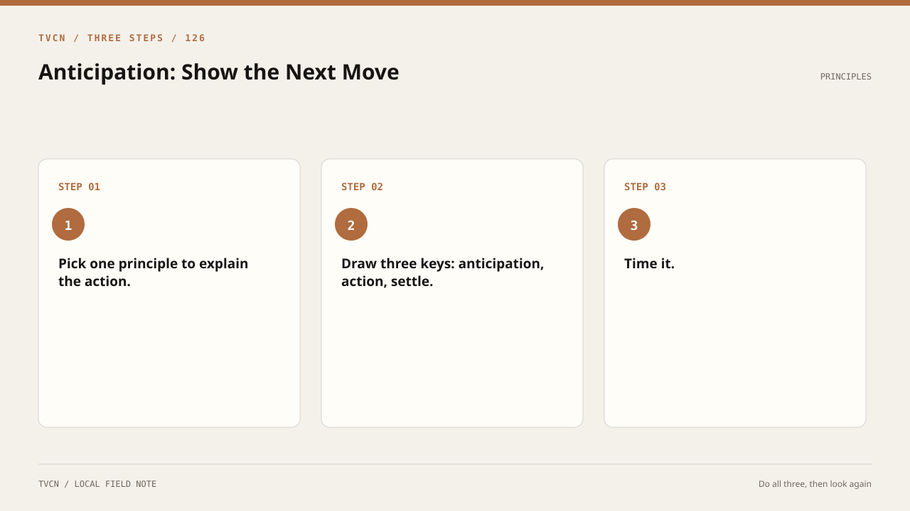

Anticipation tells the audience what is coming; without it, action feels pasted in.

<!-- DIAGRAM_START -->
<h2>Diagram</h2>
<figure>
  
  <figcaption>Do the three steps in order, then look again at the image or file.</figcaption>
</figure>
<!-- DIAGRAM_END -->
<h2>On set</h2>

Add four to six frames of reverse anticipation: the body moves five centimeters back before going forward. Let the audience predict the direction.

<h2>Do this</h2>

Anticipation tells the audience what is about to happen; without it, action feels cut in.
<ol><li>Add four to six frames of reverse anticipation before the move.</li><li>Move the body back five centimeters, then forward.</li><li>Let the audience predict direction instead of hiding it with a cut.</li></ol>
<h2>Avoid</h2>

Do not replace anticipation with a cut; without prediction, the action has no force.

<h2>Check</h2>
<ul><li>Four to six frames of reverse action precede the main move.</li><li>The body goes back before forward and the direction is predictable.</li><li>Remove anticipation and the action feels sudden, proving it worked.</li></ul>
