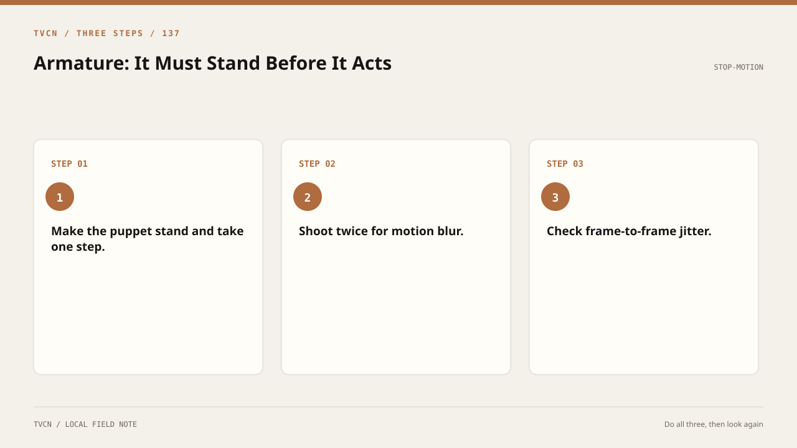

Test three moves: standing without wobble, raising an arm without sag, sitting without collapse. Use a metal armature with silicone pads and enlarge the feet; do not start with fingers before the center of gravity and knees are stable.

<!-- DIAGRAM_START -->
<h2>Diagram</h2>
<figure>
  
  <figcaption>Watch “Stand the puppet for ten seconds without wobble.” and “Walk three steps without collapse.”; judge whether the speed split between foreground, midground and background reads in one move.</figcaption>
</figure>
<!-- DIAGRAM_END -->
<section><h2 id="section-1">The armature must stand before it performs</h2>
Before touching the puppet each frame, ask whether it will fall; shoot a test and check the pivot frame by frame.
<h2 id="section-2">Limits</h2>
Harder is not better. Too rigid looks robotic; leave softness where it bends and stiffness where it carries weight.
<h2 id="section-3">Rigging: run extreme-pose tests before animation</h2>

A rig is not done when bones are connected. Problems appear when an animator pulls: elbow collapse, knee inversion, shoulder intersections. Before handoff, run extreme-pose tests; do not start animation until they pass.

<table class="data-table"><thead><tr><th>Test</th><th>Pose</th><th>Pass condition</th></tr></thead><tbody>
<tr><td>Shoulder</td><td>Arm raised 180°</td><td>No armpit collapse, no cloth intersection</td></tr>
<tr><td>Elbow</td><td>Bend 140°</td><td>Volume holds, no candy-wrapper twist</td></tr>
<tr><td>Knee</td><td>Deep squat + reverse</td><td>No inversion, feet do not slide</td></tr>
<tr><td>Spine</td><td>Twist + side bend</td><td>Chest and pelvis transition smoothly</td></tr>
</tbody></table>

<h3>Project-level checks</h3>
<ol><li>Standardize controller names: left/right, FK/IK, mirror rules on one page. Animators should not guess.</li><li>Lock axes that should not move and hide unused controls. A rig that can be bumped will be bumped.</li><li>Save a screenshot of every extreme pose as the rig acceptance record. “It works” is not evidence.</li><li>Weight joints before muscles; a full-body weight pass hides problems inside other problems.</li></ol>

If the schedule is under three days, do not build film-level facial rigging. Use simplified facial controls and spend the time on performance and rendering.
</section><section><h2 id="section-4">On set</h2>
Make the puppet stand for ten seconds without wobble, then walk three steps without collapsing. Use a metal armature and weight the feet.
</section><section><h2 id="section-5">Do this</h2>
A stop-motion puppet must stand, walk, and repeat before performance; a soft armature collapses in ten frames.
<ol><li>Stand the puppet for ten seconds without wobble.</li><li>Walk three steps without collapse.</li><li>Use a metal armature and add weight to the feet.</li></ol></section><section><h2 id="section-6">Avoid</h2>
Do not let the armature stay soft; it collapses within ten frames.
</section><section><h2>Judge</h2>
This page passes on three observable checks, not slogans:
<ul><li><strong>1.</strong> The puppet stands ten seconds without wobble and the feet are weighted.</li><li><strong>2.</strong> Three steps hold without collapse or sudden joint lock.</li><li><strong>3.</strong> Ten frames of one pose show no positional drift.</li></ul></section><section><h2>Failures</h2>
Any one of these means stop and fix it before post:
<ul><li><strong>1.</strong> Check 1 is only staged (“The puppet stands ten seconds without wobble a…”); another camera position or location exposes it.</li><li><strong>2.</strong> Check 2 is left to post or a verbal explanation (“Three steps hold without collapse or sudden jo…”); nothing on set can be rechecked.</li><li><strong>3.</strong> Do not let the armature stay soft; it collapses within ten frames.</li></ul></section><section><h2>Extend</h2>
<strong>10-minute exercise:</strong> Draw three keys at 24 fps, change only “Walk three steps without collapse.”, and export two seconds. If the weight still does not read, add anticipation before adding blur.
</section>
<h2>Check</h2><ul><li>The puppet stands ten seconds without wobble and the feet are weighted.</li><li>Three steps hold without collapse or sudden joint lock.</li><li>Ten frames of one pose show no positional drift.</li></ul>

<!-- SOURCES_START -->
## References and further reading

- [S62] [Blender Foundation: Blender Manual](https://docs.blender.org/manual/en/latest/) — Accessed 2026-11-26. Used to check the terminology and public context in the opening paragraph (“A stop-motion puppet must stand, walk, and repeat before act”) against Modelling, rigging, animation and rendering; not a substitute for an on-set test.
- [S63] [Toon Boom: Documentation](https://docs.toonboom.com/) — Accessed 2026-11-26. Used to check the terminology and public context in the opening paragraph (“A stop-motion puppet must stand, walk, and repeat before act”) against 2D animation, rigging and production pipeline; not a substitute for an on-set test.
<!-- SOURCES_END -->

