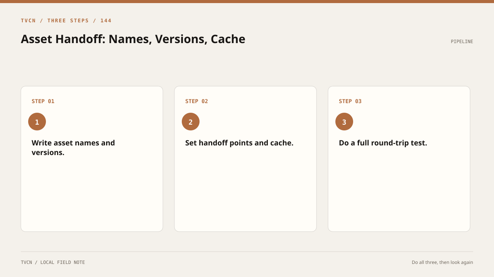

A handoff must open on someone else&#x27;s machine without you: relative texture paths, versioned caches, filenames with scene and date. Never use “final final” as a version.

<!-- DIAGRAM_START -->
<h2>Diagram</h2>
<figure>
  
  <figcaption>Watch “Name assets project_asset_version.” and “Deliver to a shared drive with a dependency”; judge whether the speed split between foreground, midground and background reads in one move.</figcaption>
</figure>
<!-- DIAGRAM_END -->
<section><h2 id="section-1">Names, versions and paths must open on their own</h2>
A handoff must open on someone else's machine without you: relative texture paths, versioned caches, filenames with scene and date. Never use “final final” as a version.

Give each asset one line: who made it, what it is for, what it depends on, which version is current. The receiver should rebuild from the note without asking you.
<h2 id="section-2">Limits</h2>
A handoff is not zipping the entire project. Deliver only assets and caches for the current shot; archive old versions, or the package becomes too big to touch.
</section><section><h2 id="section-3">On set</h2>
Name assets project_asset_version and deliver to a shared drive with a dependency list and cache path. The next person runs it once before starting.
</section><section><h2 id="section-4">Do this</h2>
Asset handoff states naming, version, cache, and dependencies; miss one and the next person rebuilds.
<ol><li>Name assets project_asset_version.</li><li>Deliver to a shared drive with a dependency list and cache path.</li><li>Have the next person open it once before taking over.</li></ol></section><section><h2 id="section-5">Avoid</h2>
Do not leave assets on a personal desktop; the next person cannot find them.
</section><section><h2>Judge</h2>
This page passes on three observable checks, not slogans:
<ul><li><strong>1.</strong> Asset names include project, asset, and version and sort cleanly.</li><li><strong>2.</strong> The shared drive holds a dependency list and cache path.</li><li><strong>3.</strong> The next person opens the asset from the list without asking the original artist.</li></ul></section><section><h2>Failures</h2>
Any one of these means stop and fix it before post:
<ul><li><strong>1.</strong> Check 1 is only staged (“Asset names include project, asset, and versio…”); another camera position or location exposes it.</li><li><strong>2.</strong> Check 2 is left to post or a verbal explanation (“The shared drive holds a dependency list and c…”); nothing on set can be rechecked.</li><li><strong>3.</strong> Do not leave assets on a personal desktop; the next person cannot find them.</li></ul></section><section><h2>Extend</h2>
<strong>10-minute exercise:</strong> Draw three keys at 24 fps, change only “Deliver to a shared drive with a dependency”, and export two seconds. If the weight still does not read, add anticipation before adding blur.
</section>
<h2>Check</h2><ul><li>Asset names include project, asset, and version and sort cleanly.</li><li>The shared drive holds a dependency list and cache path.</li><li>The next person opens the asset from the list without asking the original artist.</li></ul>

<!-- SOURCES_START -->
## References and further reading

- [S62] [Blender Foundation: Blender Manual](https://docs.blender.org/manual/en/latest/) — Accessed 2026-11-26. Used to check the terminology and public context in the opening paragraph (“Handoff states names, versions, cache, and dependencies. Mis”) against Modelling, rigging, animation and rendering; not a substitute for an on-set test.
- [S63] [Toon Boom: Documentation](https://docs.toonboom.com/) — Accessed 2026-11-26. Used to check the terminology and public context in the opening paragraph (“Handoff states names, versions, cache, and dependencies. Mis”) against 2D animation, rigging and production pipeline; not a substitute for an on-set test.
<!-- SOURCES_END -->

