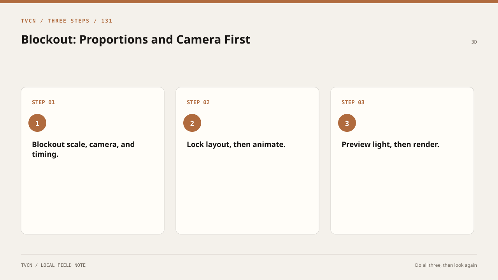

Blockout sets scale, camera, and timing before detail. Get it wrong and everything is redone.

<!-- DIAGRAM_START -->
<h2>Diagram</h2>
<figure>
  
  <figcaption>Do the three steps in order, then look again at the image or file.</figcaption>
</figure>
<!-- DIAGRAM_END -->
<h2>On set</h2>

Block the figure with three boxes: head, chest, pelvis. Lock the camera and a ten-second duration before modeling.

<h2>Do this</h2>

Blockout fixes proportion, camera, and duration before detail; a wrong blockout reworks everything.
<ol><li>Use box figures to set head, chest, and pelvis proportions.</li><li>Lock the camera and a ten-second duration.</li><li>Only model after proportion and camera are approved.</li></ol>
<h2>Avoid</h2>

Do not animate performance before the camera is locked; it will be reworked.

<h2>Check</h2>
<ul><li>The box figure reads head, chest, and pelvis proportions.</li><li>Camera and ten-second duration are locked with screenshots and settings.</li><li>The final shot matches the blockout camera without a composition change.</li></ul>

<!-- DEEP_DIVE_START -->
## Deep dive

<strong>About 6 minutes.</strong> Blockout is not a draft. It is the simplest shapes deciding what happens in the shot.

### Proportion and camera first

Use boxes for person, door, table; set height and distance first. If the person-to-door relationship is wrong, accurate modeling will not save it. Check at the real focal length; do not hide the problem with a wide lens.

Set three cameras: main, reverse, one detail. When all three explain the space, continue.

### Blocking in time

Do not pose one frame. Walk a simple proxy through the shot and mark start, turn, end. Give each beat one action, not “walks over.”

Shoot a live-action version on the phone and compare it with the blockout. If a person cannot do it, animation will look fake too.

### Gray box solves three things

Space, proportion, motion. Material, light, and detail do not belong in blockout. Adding materials early makes you unwilling to change structure.

Blockout passes when, muted, someone can say who is where, what they want, and what blocks them.

### Five-minute drill: one room, three cameras

Build one room, one person, one obstacle. Set three cameras, each solving one piece of information. Render three gray frames; no materials.

Show them to one person and ask where the person wants to go and what blocks them. If they cannot answer, change the camera, not the model.

### When the blockout passes

Muted, someone who has not read the script can say who is where, what they want, what blocks them, and why the camera is there. Four answers right means the blockout passes.

If they cannot answer, change the camera and blocking; do not add model detail. Detail makes the problem harder to see, not gone.

### Ten blockout checks
<ul><li>Boxes set person and door height</li><li>Distance relationship first</li><li>Composition at real focal length</li><li>Main, reverse, detail cameras</li><li>Proxy walks the shot</li><li>Start, turn, end marked</li><li>One action per beat</li><li>Phone live-action comparison</li><li>No material or light in gray box</li><li>Muted, viewer knows who, where, wants what</li></ul>
The only job of blockout is to stop everyone downstream from guessing the space.

<!-- DEEP_DIVE_END -->
