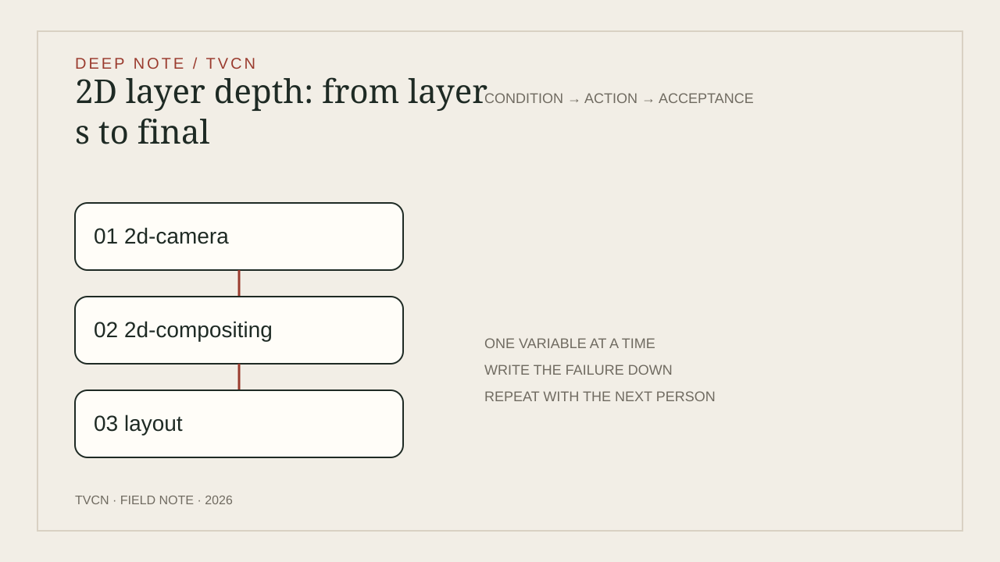

2D space is not drawn; it is built from layers, speed differences and occlusion. One page of &amp;quot;2D Camera: Pan and Multiplane&amp;quot; solves one local problem; joining &amp;quot;2D Camera: Pan and Multiplane&amp;quot;, &amp;quot;2D Compositing: Separate Background, Character, Light&amp;quot; and &amp;quot;Layout: Camera and Asset Handoff&amp;quot; exposes the real failure: conditions are missing, too many variables move, and the result cannot be reproduced.

<!-- DEEP_DIVE_START -->
<!-- DIAGRAM_START -->
<h2>图解</h2>
<figure>
  
  <figcaption>Read &quot;2D Camera: Pan and Multiplane&quot; and &quot;2D Compositing: Separate Background, Character, Li…&quot;: write the condition first, then check whether the failure can be recorded.</figcaption>
</figure>
<!-- DIAGRAM_END -->

<section><h2 id="section-1">Problem</h2>
The problem is not a lack of methods; each step works alone, but together they fail because the condition was not written, too many variables moved and the result cannot be reproduced.

The order is condition, judgement, one variable and evidence. A step is complete only when the next person can repeat it.
</section>
<section><h2 id="section-2">Judgement</h2><ul><li>First gate in &quot;2D Camera: Pan and Multiplane&quot;: Far, mid, and near layers move at different speeds near 1:2:4.</li><li>Second gate in &quot;2D Compositing: Separate Background, Character, Light&quot;: The character layer is separate and does not slide with the background.</li><li>Third gate in &quot;Layout: Camera and Asset Handoff&quot;: One pan shows near-fast, far-slow parallax.</li></ul>
If one gate fails, return to its single page; do not hide an unsolved point inside a longer chain.
</section>
<section><h2 id="section-3">Method</h2><ol><li>Write the condition first: turn &quot;Split the background into far mountain, midground, near trees.&quot; from &quot;2D Camera: Pan and Multiplane&quot; into three rows: material, environment, acceptance.</li><li>Run one minimal action: follow &quot;2D Camera: Pan and Multiplane&quot; for 30 seconds and do not add the second page yet.</li><li>Attach the second page: Pan at speeds of 1:2:4..</li><li>Use the third page as a control: Keep the character on a separate layer, still or with a small follow..</li><li>Change one variable at a time; write the other conditions down instead of remembering them.</li><li>Film the failure too: put failure and success side by side to see which step cannot be skipped.</li><li>Ask the next person to reproduce from the record; if they cannot, the record is not finished.</li></ol></section>
<section><h2 id="section-4">Field test</h2>
A reproducible test, not a client case: take 30 seconds of material, make version A using &quot;Far, mid, and near layers move at different speeds near 1:2:4.&quot; from &quot;2D Camera: Pan and Multiplane&quot;, then version B using &quot;The character layer is separate and does not slide with the backg…&quot; from &quot;2D Compositing: Separate Background, Character, Light&quot;; only one variable may differ. Put them side by side and record what breaks first in &quot;Layout: Camera and Asset Handoff&quot;: condition, action or acceptance. If it works on the first try, add one real constraint and run it again.
</section>
<section><h2 id="section-5">Failure table</h2>
<table class="data-table"><thead><tr><th>Symptom</th><th>Cause</th><th>Replacement action</th></tr></thead><tbody><tr><td>Do not pan the whole image at one speed; equal layers flatten the…</td><td>Condition was not written</td><td>Return to page one and rewrite the three rows</td></tr><tr><td>Do not draw everything on one layer; one change forces a full red…</td><td>Condition was not written</td><td>Return to page one and rewrite the three rows</td></tr><tr><td>Do not leave the camera live in layout; changing it after animati…</td><td>Condition was not written</td><td>Return to page one and rewrite the three rows</td></tr></tbody></table>
</section>
<section><h2 id="section-6">Acceptance</h2><ul><li>Far, mid, and near layers move at different speeds near 1:2:4.</li><li>The character layer is separate and does not slide with the background.</li><li>One pan shows near-fast, far-slow parallax.</li><li>Background, character, foreground, and light are separate layers with clear structure.</li><li>Shadows live on their own layer, not baked into the character.</li><li>Changing an action moves only the character layer; background and light stay.</li><li>Camera, character scale, and asset version are locked and versioned.</li><li>The file header shows version and dependencies so animators do not guess.</li><li>Animation does not change the camera and the final shot matches layout.</li><li>The condition from 2D Camera: Pan and Multiplane fits on one line and can be repeated by someone else.</li></ul></section>
<section><h2 id="section-7">Alternatives</h2><ul><li>For a single-point problem in "2D Camera: Pan and Multiplane", go back to <a href="https://animation.tvcn.org/en/article/2d-camera/">2D Camera: Pan and Multiplane</a>; do not use the whole chain.</li><li>To compare two actions, read <a href="https://animation.tvcn.org/en/article/2d-compositing/">2D Compositing: Separate Background, Character, Light</a> and leave the third page alone.</li><li>For acceptance only, use <a href="https://animation.tvcn.org/en/article/layout/">Layout: Camera and Asset Handoff</a> as a self-test sheet.</li></ul></section>
