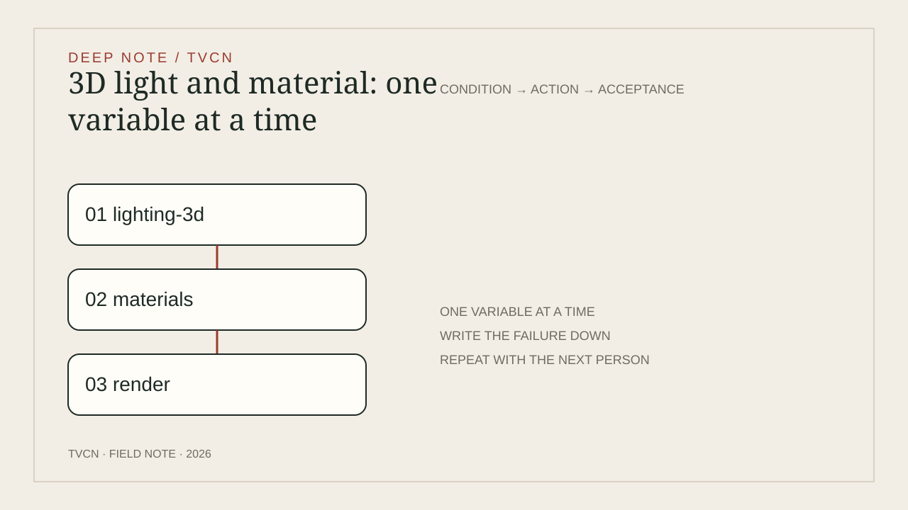

Light and material disguise each other; lock one before judging the other. One page of &amp;quot;3D Lighting: Three Points and HDRI&amp;quot; solves one local problem; joining &amp;quot;3D Lighting: Three Points and HDRI&amp;quot;, &amp;quot;Materials: Roughness and Specular&amp;quot; and &amp;quot;Render: Samples and Noise&amp;quot; exposes the real failure: conditions are missing, too many variables move, and the result cannot be reproduced.

<!-- DEEP_DIVE_START -->
<!-- DIAGRAM_START -->
<h2>图解</h2>
<figure>
  
  <figcaption>Read &quot;3D Lighting: Three Points and HDRI&quot; and &quot;Materials: Roughness and Specular&quot;: write the condition first, then check whether the failure can be recorded.</figcaption>
</figure>
<!-- DIAGRAM_END -->

<section><h2 id="section-1">Problem</h2>
The problem is not a lack of methods; each step works alone, but together they fail because the condition was not written, too many variables moved and the result cannot be reproduced.

The order is condition, judgement, one variable and evidence. A step is complete only when the next person can repeat it.
</section>
<section><h2 id="section-2">Judgement</h2><ul><li>First gate in &quot;3D Lighting: Three Points and HDRI&quot;: With HDRI off, the key already defines form.</li><li>Second gate in &quot;Materials: Roughness and Specular&quot;: Fill and rim do their jobs without flattening the key.</li><li>Third gate in &quot;Render: Samples and Noise&quot;: HDRI stays at 20 to 30 percent and does not take over.</li></ul>
If one gate fails, return to its single page; do not hide an unsolved point inside a longer chain.
</section>
<section><h2 id="section-3">Method</h2><ol><li>Write the condition first: turn &quot;Turn off HDRI and shape with the key only.&quot; from &quot;3D Lighting: Three Points and HDRI&quot; into three rows: material, environment, acceptance.</li><li>Run one minimal action: follow &quot;3D Lighting: Three Points and HDRI&quot; for 30 seconds and do not add the second page yet.</li><li>Attach the second page: Add fill and rim..</li><li>Use the third page as a control: Bring HDRI in at 20 to 30 percent to fill the environment..</li><li>Change one variable at a time; write the other conditions down instead of remembering them.</li><li>Film the failure too: put failure and success side by side to see which step cannot be skipped.</li><li>Ask the next person to reproduce from the record; if they cannot, the record is not finished.</li></ol></section>
<section><h2 id="section-4">Field test</h2>
A reproducible test, not a client case: take 30 seconds of material, make version A using &quot;With HDRI off, the key already defines form.&quot; from &quot;3D Lighting: Three Points and HDRI&quot;, then version B using &quot;Fill and rim do their jobs without flattening the key.&quot; from &quot;Materials: Roughness and Specular&quot;; only one variable may differ. Put them side by side and record what breaks first in &quot;Render: Samples and Noise&quot;: condition, action or acceptance. If it works on the first try, add one real constraint and run it again.
</section>
<section><h2 id="section-5">Failure table</h2>
<table class="data-table"><thead><tr><th>Symptom</th><th>Cause</th><th>Replacement action</th></tr></thead><tbody><tr><td>Do not start with HDRI; environment light hides the form.</td><td>Condition was not written</td><td>Return to page one and rewrite the three rows</td></tr><tr><td>Do not hide material with texture; wrong roughness looks like pap…</td><td>Condition was not written</td><td>Return to page one and rewrite the three rows</td></tr><tr><td>Do not brute-force noise with total samples; without the source, …</td><td>Condition was not written</td><td>Return to page one and rewrite the three rows</td></tr></tbody></table>
</section>
<section><h2 id="section-6">Acceptance</h2><ul><li>With HDRI off, the key already defines form.</li><li>Fill and rim do their jobs without flattening the key.</li><li>HDRI stays at 20 to 30 percent and does not take over.</li><li>Three spheres show clearly different highlight sizes under one light.</li><li>The difference between 0.2 and 0.8 roughness is nameable, not just color.</li><li>Texture is added after material approval and does not hide highlight issues.</li><li>A 50 percent low-sample pass shows whether noise comes from light or material.</li><li>Light and material samples were adjusted separately.</li><li>Final noise is traced to a specific source, not brute-forced.</li><li>The condition from 3D Lighting: Three Points and HDRI fits on one line and can be repeated by someone else.</li></ul></section>
<section><h2 id="section-7">Alternatives</h2><ul><li>For a single-point problem in "3D Lighting: Three Points and HDRI", go back to <a href="https://animation.tvcn.org/en/article/lighting-3d/">3D Lighting: Three Points and HDRI</a>; do not use the whole chain.</li><li>To compare two actions, read <a href="https://animation.tvcn.org/en/article/materials/">Materials: Roughness and Specular</a> and leave the third page alone.</li><li>For acceptance only, use <a href="https://animation.tvcn.org/en/article/render/">Render: Samples and Noise</a> as a self-test sheet.</li></ul></section>

<!-- SOURCES_START -->
## References and further reading

- [S62] [Blender: Official Manual](https://docs.blender.org/manual/en/latest/) — Accessed 2026-11-26. Used to check the terminology/method/rule in the “Problem” section against Blender manual, not an industry pipeline standard; it does not verify numbers, model choices or on-set conclusions derived from this page, and is not a substitute for a test.
- [S59] [Adobe: After Effects Guide](https://helpx.adobe.com/after-effects/user-guide.html) — Accessed 2026-11-26. Used to check the terminology/method/rule in the “Judgement” section against official After Effects guide, not a verdict on compositing aesthetics; it does not verify numbers, model choices or on-set conclusions derived from this page, and is not a substitute for a test.
<!-- SOURCES_END -->

