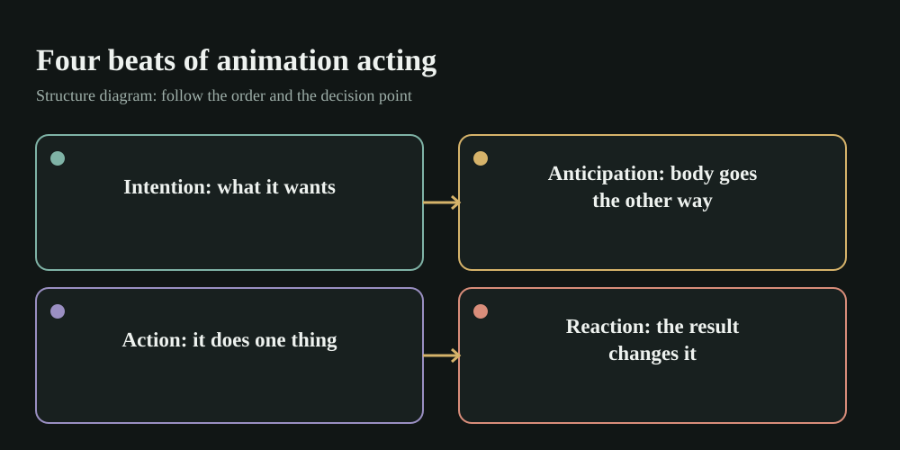

A 3D character most easily becomes “technically correct but mechanical”: the hand reaches the handle, the feet reach the mark, the head turns the right way, but the audience does not believe it wants to open the door. The rig is not the problem; the animator keyed poses without giving the character an intention.

<!-- DIAGRAM_START -->
<h2 id="diagram">Diagram</h2>
<figure class="diagram">
  
  <figcaption>Check intention, anticipation, action and reaction. If the character only moves from A to B with no want, smooth motion is still mechanical.</figcaption>
</figure>
<!-- DIAGRAM_END -->

<section><h2 id="section-1">On location</h2>
A 3D short shot: the character walks to a door, stops, opens it and enters the dark. The animator keys four poses: stand, reach, pull, step. The motion is smooth; the director says it looks like a robot. The character does not hesitate, listen or decide anything before opening.
</section>
<section><h2 id="section-2">What to look for</h2><ul><li><strong>Visible intention:</strong> the audience can say what the character wants before the door opens: enter, escape, check if someone is inside.</li><li><strong>Anticipation:</strong> the body first goes the other way or holds, then acts; without it, the motion feels pushed.</li><li><strong>Eyes have a target:</strong> the eyes reach the handle, the gap or the peephole before the hand; eyes and hand arriving together look fake.</li><li><strong>Reaction changes the body:</strong> after the door opens, weight, breath or hand position changes; without reaction, the action is only completed.</li></ul></section>
<section><h2 id="section-3">What to do</h2><ol><li>Write one intention: not “open the door” but “check whether someone is inside”; the intention must be testable by one action.</li><li>Add anticipation: the body shifts back half an inch, the hand tightens, the breath stops; anticipation tells the audience an action is coming.</li><li>Order the eyes: eyes to the target, head turns, hand arrives last; separate the three times, not one frame.</li><li>Add breakdowns: two or three between key poses to decide how weight transfers; do not rely only on curves.</li><li>Shoot reference: perform it yourself or with an actor on a phone; do not copy, watch the moment the body decides.</li></ol></section>
<section><h2 id="section-4">Failure modes</h2><ul><li><strong>Only key poses:</strong> stand, reach, pull and step are accurate, but the body has no process of deciding.</li><li><strong>Whole body moves at once:</strong> hand, head and feet start on the same frame, like being pulled by one string.</li><li><strong>Expression before action:</strong> the face shows surprise before the hand reaches the door; the expression feels pasted on.</li></ul></section>
<section><h2 id="section-5">Limits</h2>
This suits character shots, narrative animation and performance-led 3D or 2D. It is not for pure physical cycles such as walk or run, or effects simulation, which depend more on curves and physics. Acting cannot replace rigging either: if a body part has no controller, no intention can be animated. Check the rig before discussing performance.
</section>
<section><h2 id="section-6">Check</h2><ul><li>The audience can say what the character wants before the action.</li><li>At least one anticipation group precedes the action; it does not start directly.</li><li>Eyes, head and hand arrive at three separate times.</li><li>After the action, the body shows a reaction change.</li></ul></section>
<!-- DEEP_DIVE_START -->
## Deep dive

<strong>About 8 minutes.</strong> This section places the same judgement in two different conditions, then gives a counterexample and a reusable model. It does not repeat the page; it decides when to change the method.

### Condition A: realistic acting

Realistic animation needs small intentions and fine reactions. Do not give the character “I am sad”; give “I want to set the cup down steadily, but my hand shakes”. The audience sees the hand and feels the sadness. Realistic acting works by suppression: the more the character hides, the more the audience sees.

Reference should film someone not acting: have them do a real task such as tying a shoe, finding keys or answering a phone; watch where they pause. The animator copies the position of the pause, not the expression. When the pause is right, the face can do very little.

### Condition B: stylised acting

Stylised animation can push intention outside the body: the want becomes a stretching arm, a growing shadow, an exaggerated dash. But the push needs a rule: enlarge one part and keep the rest stable; enlarge everything and the audience tires.

Stylised acting has harder beats than realism: longer anticipation, faster action, shorter pause. The audience needs to see “about to happen”, then “happening”, then “result”. Keep the three distinct or the style dissolves. Do not smear them together with in-betweens.

### Counterexample: too many intentions

A character wants to open the door, check the phone, look back and catch a breath in one shot. The animator anticipates every intention, so the body keeps twitching and the audience cannot tell what it wants most. The problem is not too little action; the intentions have no order.

Put them on one line: first check if someone is inside (main intention); the phone is interference; looking back is a reaction; breathing is a result. One main intention, everything else is resistance or consequence. Delete two and the action becomes clearer.

### Reusable model

<strong>Intention → anticipation → action → reaction.</strong> Intention tells the audience why; anticipation tells them it is coming; action shows what; reaction shows where the result lands. The hardest beat is reaction; many animations stop at action.

Write one main intention per shot, at most two resistances. If you cannot write the main intention, the shot is not designed; it is only moving a character. Write intention before keying; do not key to find intention.

<!-- DEEP_DIVE_END -->
<!-- SOURCES_START -->
## Further reading

- [S62] [Blender Foundation: Blender Manual](https://docs.blender.org/manual/en/latest/) — accessed 2026-11-26. Used to check the terms, method or rule in the “What to look for” section; not the page's field numbers, gear models or conclusions, and not a substitute for a test or contract.
- [S42] [Pixar: Pixar in a Box](https://www.khanacademy.org/partner-content/pixar) — accessed 2026-11-26. Used to check the terms, method or rule in the “Limits” section; not the page's field numbers, gear models or conclusions, and not a substitute for a test or contract.
<!-- SOURCES_END -->
