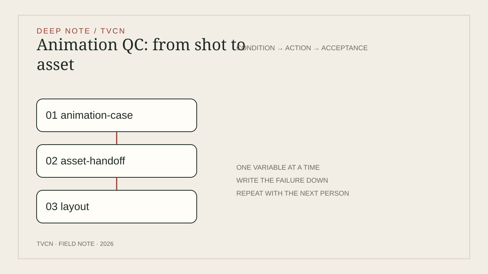

Animation QC is not only whether a shot looks good; shots, rigs, assets and naming must be reproducible. One page of &amp;quot;Animation Case: From Board to Final&amp;quot; solves one local problem; joining &amp;quot;Animation Case: From Board to Final&amp;quot;, &amp;quot;Asset Handoff: Names, Versions, Cache&amp;quot; and &amp;quot;Layout: Camera and Asset Handoff&amp;quot; exposes the real failure: conditions are missing, too many variables move, and the result cannot be reproduced.

<!-- DEEP_DIVE_START -->
<!-- DIAGRAM_START -->
<h2>图解</h2>
<figure>
  
  <figcaption>Read &quot;Animation Case: From Board to Final&quot; and &quot;Asset Handoff: Names, Versions, Cache&quot;: write the condition first, then check whether the failure can be recorded.</figcaption>
</figure>
<!-- DIAGRAM_END -->

<section><h2 id="section-1">Problem</h2>
The problem is not a lack of methods; each step works alone, but together they fail because the condition was not written, too many variables moved and the result cannot be reproduced.

The order is condition, judgement, one variable and evidence. A step is complete only when the next person can repeat it.
</section>
<section><h2 id="section-2">Judgement</h2><ul><li>First gate in &quot;Animation Case: From Board to Final&quot;: All six stages are compared, not just final stills.</li><li>Second gate in &quot;Asset Handoff: Names, Versions, Cache&quot;: Each stage logs one decision and one rework.</li><li>Third gate in &quot;Layout: Camera and Asset Handoff&quot;: At least one reusable step is written so another person can follow it.</li></ul>
If one gate fails, return to its single page; do not hide an unsolved point inside a longer chain.
</section>
<section><h2 id="section-3">Method</h2><ol><li>Write the condition first: turn &quot;Compare three board panels, animatic timing, layout camera, keyframes, light, co…&quot; from &quot;Animation Case: From Board to Final&quot; into three rows: material, environment, acceptance.</li><li>Run one minimal action: follow &quot;Animation Case: From Board to Final&quot; for 30 seconds and do not add the second page yet.</li><li>Attach the second page: Log one decision and one rework per stage..</li><li>Use the third page as a control: State what can be reused, not just “it looks good.”.</li><li>Change one variable at a time; write the other conditions down instead of remembering them.</li><li>Film the failure too: put failure and success side by side to see which step cannot be skipped.</li><li>Ask the next person to reproduce from the record; if they cannot, the record is not finished.</li></ol></section>
<section><h2 id="section-4">Field test</h2>
A reproducible test, not a client case: take 30 seconds of material, make version A using &quot;All six stages are compared, not just final stills.&quot; from &quot;Animation Case: From Board to Final&quot;, then version B using &quot;Each stage logs one decision and one rework.&quot; from &quot;Asset Handoff: Names, Versions, Cache&quot;; only one variable may differ. Put them side by side and record what breaks first in &quot;Layout: Camera and Asset Handoff&quot;: condition, action or acceptance. If it works on the first try, add one real constraint and run it again.
</section>
<section><h2 id="section-5">Failure table</h2>
<table class="data-table"><thead><tr><th>Symptom</th><th>Cause</th><th>Replacement action</th></tr></thead><tbody><tr><td>Do not look only at the final; the final hides the rework.</td><td>Condition was not written</td><td>Return to page one and rewrite the three rows</td></tr><tr><td>Do not leave assets on a personal desktop; the next person cannot…</td><td>Condition was not written</td><td>Return to page one and rewrite the three rows</td></tr><tr><td>Do not leave the camera live in layout; changing it after animati…</td><td>Condition was not written</td><td>Return to page one and rewrite the three rows</td></tr></tbody></table>
</section>
<section><h2 id="section-6">Acceptance</h2><ul><li>All six stages are compared, not just final stills.</li><li>Each stage logs one decision and one rework.</li><li>At least one reusable step is written so another person can follow it.</li><li>Asset names include project, asset, and version and sort cleanly.</li><li>The shared drive holds a dependency list and cache path.</li><li>The next person opens the asset from the list without asking the original artist.</li><li>Camera, character scale, and asset version are locked and versioned.</li><li>The file header shows version and dependencies so animators do not guess.</li><li>Animation does not change the camera and the final shot matches layout.</li><li>The condition from Animation Case: From Board to Final fits on one line and can be repeated by someone else.</li></ul></section>
<section><h2 id="section-7">Alternatives</h2><ul><li>For a single-point problem in "Animation Case: From Board to Final", go back to <a href="https://animation.tvcn.org/en/article/animation-case/">Animation Case: From Board to Final</a>; do not use the whole chain.</li><li>To compare two actions, read <a href="https://animation.tvcn.org/en/article/asset-handoff/">Asset Handoff: Names, Versions, Cache</a> and leave the third page alone.</li><li>For acceptance only, use <a href="https://animation.tvcn.org/en/article/layout/">Layout: Camera and Asset Handoff</a> as a self-test sheet.</li></ul></section>
