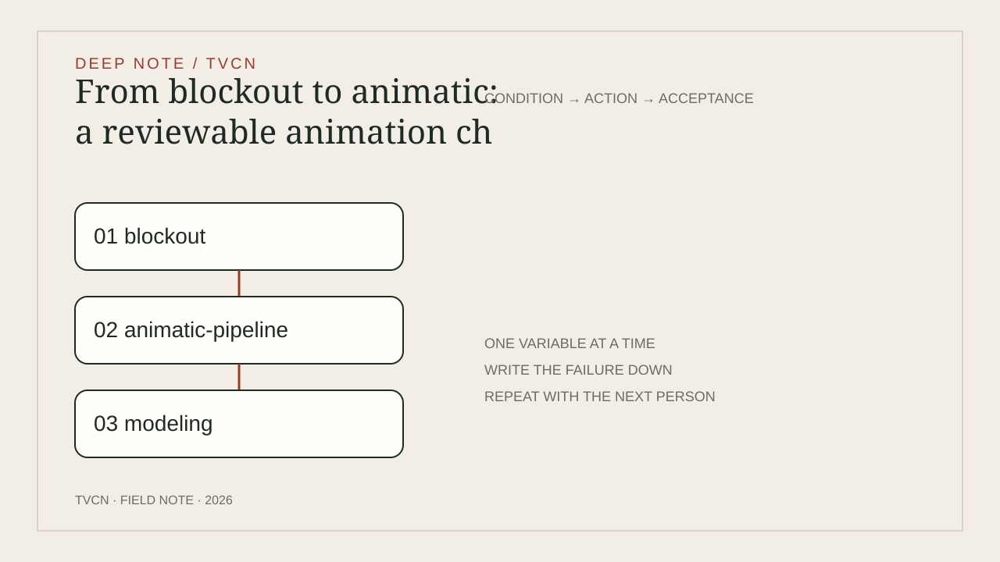

Space and duration first, performance second; blockout and animatic are two different review gates. One page of &amp;quot;Blockout: Proportions and Camera First&amp;quot; solves one local problem; joining &amp;quot;Blockout: Proportions and Camera First&amp;quot;, &amp;quot;Animatic Pipeline: Voice, Timing, Board&amp;quot; and &amp;quot;Modeling: Silhouette Before Polygons&amp;quot; exposes the real failure: conditions are missing, too many variables move, and the result cannot be reproduced.

<!-- DEEP_DIVE_START -->
<!-- DIAGRAM_START -->
<h2>图解</h2>
<figure>
  
  <figcaption>Read &quot;Blockout: Proportions and Camera First&quot; and &quot;Animatic Pipeline: Voice, Timing, Board&quot;: write the condition first, then check whether the failure can be recorded.</figcaption>
</figure>
<!-- DIAGRAM_END -->

<section><h2 id="section-1">Problem</h2>
The problem is not a lack of methods; each step works alone, but together they fail because the condition was not written, too many variables moved and the result cannot be reproduced.

The order is condition, judgement, one variable and evidence. A step is complete only when the next person can repeat it.
</section>
<section><h2 id="section-2">Judgement</h2><ul><li>First gate in &quot;Blockout: Proportions and Camera First&quot;: The box figure reads head, chest, and pelvis proportions.</li><li>Second gate in &quot;Animatic Pipeline: Voice, Timing, Board&quot;: Camera and ten-second duration are locked with screenshots and settings.</li><li>Third gate in &quot;Modeling: Silhouette Before Polygons&quot;: The final shot matches the blockout camera without a composition change.</li></ul>
If one gate fails, return to its single page; do not hide an unsolved point inside a longer chain.
</section>
<section><h2 id="section-3">Method</h2><ol><li>Write the condition first: turn &quot;Use box figures to set head, chest, and pelvis proportions.&quot; from &quot;Blockout: Proportions and Camera First&quot; into three rows: material, environment, acceptance.</li><li>Run one minimal action: follow &quot;Blockout: Proportions and Camera First&quot; for 30 seconds and do not add the second page yet.</li><li>Attach the second page: Lock the camera and a ten-second duration..</li><li>Use the third page as a control: Only model after proportion and camera are approved..</li><li>Change one variable at a time; write the other conditions down instead of remembering them.</li><li>Film the failure too: put failure and success side by side to see which step cannot be skipped.</li><li>Ask the next person to reproduce from the record; if they cannot, the record is not finished.</li></ol></section>
<section><h2 id="section-4">Field test</h2>
A reproducible test, not a client case: take 30 seconds of material, make version A using &quot;The box figure reads head, chest, and pelvis proportions.&quot; from &quot;Blockout: Proportions and Camera First&quot;, then version B using &quot;Camera and ten-second duration are locked with screenshots and se…&quot; from &quot;Animatic Pipeline: Voice, Timing, Board&quot;; only one variable may differ. Put them side by side and record what breaks first in &quot;Modeling: Silhouette Before Polygons&quot;: condition, action or acceptance. If it works on the first try, add one real constraint and run it again.
</section>
<section><h2 id="section-5">Failure table</h2>
<table class="data-table"><thead><tr><th>Symptom</th><th>Cause</th><th>Replacement action</th></tr></thead><tbody><tr><td>Do not animate performance before the camera is locked; it will b…</td><td>Condition was not written</td><td>Return to page one and rewrite the three rows</td></tr><tr><td>Do not draw everything before voice; a pace change re-times every…</td><td>Condition was not written</td><td>Return to page one and rewrite the three rows</td></tr><tr><td>Do not fix a silhouette with subdivision; more polygons will not …</td><td>Condition was not written</td><td>Return to page one and rewrite the three rows</td></tr></tbody></table>
</section>
<section><h2 id="section-6">Acceptance</h2><ul><li>The box figure reads head, chest, and pelvis proportions.</li><li>Camera and ten-second duration are locked with screenshots and settings.</li><li>The final shot matches the blockout camera without a composition change.</li><li>Boxes set person and door height</li><li>Distance relationship first</li><li>Composition at real focal length</li><li>Main, reverse, detail cameras</li><li>Proxy walks the shot</li><li>Voice is recorded at real speed and every shot duration comes from it.</li><li>Total stays within 110 percent of target and timing is locked first.</li></ul></section>
<section><h2 id="section-7">Alternatives</h2><ul><li>For a single-point problem in "Blockout: Proportions and Camera First", go back to <a href="https://animation.tvcn.org/en/article/blockout/">Blockout: Proportions and Camera First</a>; do not use the whole chain.</li><li>To compare two actions, read <a href="https://animation.tvcn.org/en/article/animatic-pipeline/">Animatic Pipeline: Voice, Timing, Board</a> and leave the third page alone.</li><li>For acceptance only, use <a href="https://animation.tvcn.org/en/article/modeling/">Modeling: Silhouette Before Polygons</a> as a self-test sheet.</li></ul></section>
