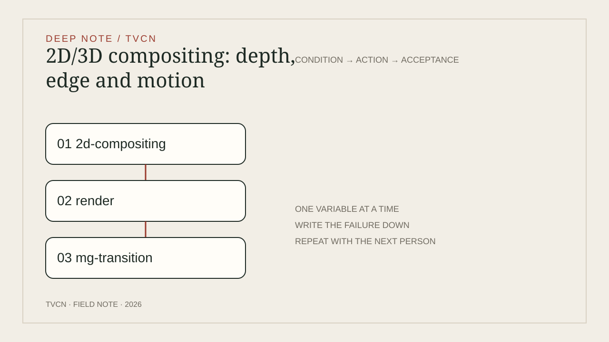

Compositing is not layering; depth, edge and motion must agree on the same space. One page of &amp;quot;2D Compositing: Separate Background, Character, Light&amp;quot; solves one local problem; joining &amp;quot;2D Compositing: Separate Background, Character, Light&amp;quot;, &amp;quot;Render: Samples and Noise&amp;quot; and &amp;quot;Motion Graphics Transition: Shape to Shape&amp;quot; exposes the real failure: conditions are missing, too many variables move, and the result cannot be reproduced.

<!-- DEEP_DIVE_START -->
<!-- DIAGRAM_START -->
<h2>图解</h2>
<figure>
  
  <figcaption>Read &quot;2D Compositing: Separate Background, Character, Li…&quot; and &quot;Render: Samples and Noise&quot;: write the condition first, then check whether the failure can be recorded.</figcaption>
</figure>
<!-- DIAGRAM_END -->

<section><h2 id="section-1">Problem</h2>
The problem is not a lack of methods; each step works alone, but together they fail because the condition was not written, too many variables moved and the result cannot be reproduced.

The order is condition, judgement, one variable and evidence. A step is complete only when the next person can repeat it.
</section>
<section><h2 id="section-2">Judgement</h2><ul><li>First gate in &quot;2D Compositing: Separate Background, Character, Light&quot;: Background, character, foreground, and light are separate layers with clear structure.</li><li>Second gate in &quot;Render: Samples and Noise&quot;: Shadows live on their own layer, not baked into the character.</li><li>Third gate in &quot;Motion Graphics Transition: Shape to Shape&quot;: Changing an action moves only the character layer; background and light stay.</li></ul>
If one gate fails, return to its single page; do not hide an unsolved point inside a longer chain.
</section>
<section><h2 id="section-3">Method</h2><ol><li>Write the condition first: turn &quot;Use four layers: background, character, foreground, light effect.&quot; from &quot;2D Compositing: Separate Background, Character, Light&quot; into three rows: material, environment, acceptance.</li><li>Run one minimal action: follow &quot;2D Compositing: Separate Background, Character, Light&quot; for 30 seconds and do not add the second page yet.</li><li>Attach the second page: Grade each layer separately and keep shadows off the character layer..</li><li>Use the third page as a control: Composite position first, then light and shadow..</li><li>Change one variable at a time; write the other conditions down instead of remembering them.</li><li>Film the failure too: put failure and success side by side to see which step cannot be skipped.</li><li>Ask the next person to reproduce from the record; if they cannot, the record is not finished.</li></ol></section>
<section><h2 id="section-4">Field test</h2>
A reproducible test, not a client case: take 30 seconds of material, make version A using &quot;Background, character, foreground, and light are separate layers …&quot; from &quot;2D Compositing: Separate Background, Character, Light&quot;, then version B using &quot;Shadows live on their own layer, not baked into the character.&quot; from &quot;Render: Samples and Noise&quot;; only one variable may differ. Put them side by side and record what breaks first in &quot;Motion Graphics Transition: Shape to Shape&quot;: condition, action or acceptance. If it works on the first try, add one real constraint and run it again.
</section>
<section><h2 id="section-5">Failure table</h2>
<table class="data-table"><thead><tr><th>Symptom</th><th>Cause</th><th>Replacement action</th></tr></thead><tbody><tr><td>Do not draw everything on one layer; one change forces a full red…</td><td>Condition was not written</td><td>Return to page one and rewrite the three rows</td></tr><tr><td>Do not brute-force noise with total samples; without the source, …</td><td>Condition was not written</td><td>Return to page one and rewrite the three rows</td></tr><tr><td>Do not use white flashes and pushes as universal transitions; if …</td><td>Condition was not written</td><td>Return to page one and rewrite the three rows</td></tr></tbody></table>
</section>
<section><h2 id="section-6">Acceptance</h2><ul><li>Background, character, foreground, and light are separate layers with clear structure.</li><li>Shadows live on their own layer, not baked into the character.</li><li>Changing an action moves only the character layer; background and light stay.</li><li>A 50 percent low-sample pass shows whether noise comes from light or material.</li><li>Light and material samples were adjusted separately.</li><li>Final noise is traced to a specific source, not brute-forced.</li><li>The same shape morphs across the transition instead of hard-cutting.</li><li>The morph completes in eight to twelve frames at a readable speed.</li><li>Without a white flash, information still connects and the audience knows where they are.</li><li>The condition from 2D Compositing: Separate Background, Character, Light fits on one line and can be repeated by someone else.</li></ul></section>
<section><h2 id="section-7">Alternatives</h2><ul><li>For a single-point problem in "2D Compositing: Separate Background, Character, Light", go back to <a href="https://animation.tvcn.org/en/article/2d-compositing/">2D Compositing: Separate Background, Character, Light</a>; do not use the whole chain.</li><li>To compare two actions, read <a href="https://animation.tvcn.org/en/article/render/">Render: Samples and Noise</a> and leave the third page alone.</li><li>For acceptance only, use <a href="https://animation.tvcn.org/en/article/mg-transition/">Motion Graphics Transition: Shape to Shape</a> as a self-test sheet.</li></ul></section>

<!-- SOURCES_START -->
## References and further reading

- [S62] [Blender Foundation: Blender Manual](https://docs.blender.org/manual/en/latest/) — Accessed 2026-11-26. Used to check the terminology and public context in the opening paragraph (“Compositing is not layering; depth, edge and motion must agr”) against Modelling, rigging, animation and rendering; not a substitute for an on-set test.
- [S63] [Toon Boom: Documentation](https://docs.toonboom.com/) — Accessed 2026-11-26. Used to check the terminology and public context in the opening paragraph (“Compositing is not layering; depth, edge and motion must agr”) against 2D animation, rigging and production pipeline; not a substitute for an on-set test.
- [S12] [Animation](https://www.britannica.com/art/animation) — Accessed 2026-11-26. Used to check the terminology and public context in the opening paragraph (“Compositing is not layering; depth, edge and motion must agr”) against Encyclopedia entry on animation principles, techniques and industry history; not a substitute for an on-set test.
- [S59] [Adobe: After Effects User Guide](https://helpx.adobe.com/after-effects/user-guide.html) — Accessed 2026-11-26. Used to check the terminology and public context in the opening paragraph (“Compositing is not layering; depth, edge and motion must agr”) against Compositing, keyframes, tracking and export; not a substitute for an on-set test.
<!-- SOURCES_END -->

