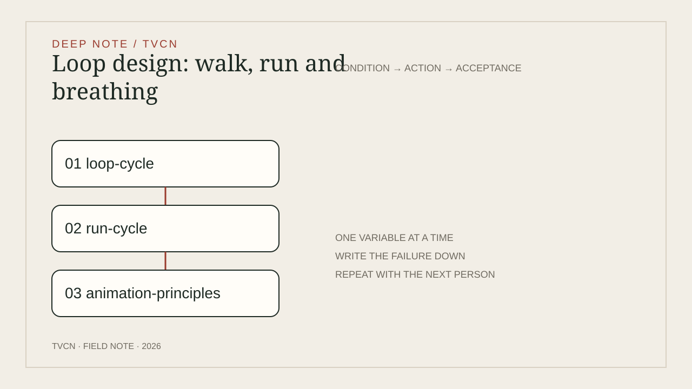

A loop is not a matching first and last frame; it is weight, contact and rhythm closing on the same beat. One page of &amp;quot;Loop Cycle: Match the First and Last Frame&amp;quot; solves one local problem; joining &amp;quot;Loop Cycle: Match the First and Last Frame&amp;quot;, &amp;quot;Run Cycle: Feet and Center of Gravity&amp;quot; and &amp;quot;The Twelve Principles: Use One at a Time&amp;quot; exposes the real failure: conditions are missing, too many variables move, and the result cannot be reproduced.

<!-- DEEP_DIVE_START -->
<!-- DIAGRAM_START -->
<h2>图解</h2>
<figure>
  
  <figcaption>Read &quot;Loop Cycle: Match the First and Last Frame&quot; and &quot;Run Cycle: Feet and Center of Gravity&quot;: write the condition first, then check whether the failure can be recorded.</figcaption>
</figure>
<!-- DIAGRAM_END -->

<section><h2 id="section-1">Problem</h2>
The problem is not a lack of methods; each step works alone, but together they fail because the condition was not written, too many variables moved and the result cannot be reproduced.

The order is condition, judgement, one variable and evidence. A step is complete only when the next person can repeat it.
</section>
<section><h2 id="section-2">Judgement</h2><ul><li>First gate in &quot;Loop Cycle: Match the First and Last Frame&quot;: First and last frames are the same pose in position and shape.</li><li>Second gate in &quot;Run Cycle: Feet and Center of Gravity&quot;: Eight to twelve frames fill the middle at an even rhythm.</li><li>Third gate in &quot;The Twelve Principles: Use One at a Time&quot;: Ten loops play with no hitch or stick at the seam.</li></ul>
If one gate fails, return to its single page; do not hide an unsolved point inside a longer chain.
</section>
<section><h2 id="section-3">Method</h2><ol><li>Write the condition first: turn &quot;Draw the same pose at the head and tail.&quot; from &quot;Loop Cycle: Match the First and Last Frame&quot; into three rows: material, environment, acceptance.</li><li>Run one minimal action: follow &quot;Loop Cycle: Match the First and Last Frame&quot; for 30 seconds and do not add the second page yet.</li><li>Attach the second page: Fill eight to twelve frames between them..</li><li>Use the third page as a control: Play on loop and check the last-to-first transition for a jump..</li><li>Change one variable at a time; write the other conditions down instead of remembering them.</li><li>Film the failure too: put failure and success side by side to see which step cannot be skipped.</li><li>Ask the next person to reproduce from the record; if they cannot, the record is not finished.</li></ol></section>
<section><h2 id="section-4">Field test</h2>
A reproducible test, not a client case: take 30 seconds of material, make version A using &quot;First and last frames are the same pose in position and shape.&quot; from &quot;Loop Cycle: Match the First and Last Frame&quot;, then version B using &quot;Eight to twelve frames fill the middle at an even rhythm.&quot; from &quot;Run Cycle: Feet and Center of Gravity&quot;; only one variable may differ. Put them side by side and record what breaks first in &quot;The Twelve Principles: Use One at a Time&quot;: condition, action or acceptance. If it works on the first try, add one real constraint and run it again.
</section>
<section><h2 id="section-5">Failure table</h2>
<table class="data-table"><thead><tr><th>Symptom</th><th>Cause</th><th>Replacement action</th></tr></thead><tbody><tr><td>Do not leave a one-frame mismatch at the seam; repetition makes t…</td><td>Condition was not written</td><td>Return to page one and rewrite the three rows</td></tr><tr><td>Do not fix arms first; sliding feet make even smooth arms look fl…</td><td>Condition was not written</td><td>Return to page one and rewrite the three rows</td></tr><tr><td>Do not apply all twelve principles at once; the action becomes a …</td><td>Condition was not written</td><td>Return to page one and rewrite the three rows</td></tr></tbody></table>
</section>
<section><h2 id="section-6">Acceptance</h2><ul><li>First and last frames are the same pose in position and shape.</li><li>Eight to twelve frames fill the middle at an even rhythm.</li><li>Ten loops play with no hitch or stick at the seam.</li><li>All four key poses read: contact, down, passing, airborne.</li><li>The planted foot rolls heel to toe instead of sliding flat.</li><li>Vertical travel stays within one head and the loop does not float.</li><li>One action uses one main principle and you can say what it solves.</li><li>Anticipation, action, and settle have written frame counts, not random drawing.</li><li>Remove the principle and the action reads worse, proving it mattered.</li><li>Three principles per shot</li></ul></section>
<section><h2 id="section-7">Alternatives</h2><ul><li>For a single-point problem in "Loop Cycle: Match the First and Last Frame", go back to <a href="https://animation.tvcn.org/en/article/loop-cycle/">Loop Cycle: Match the First and Last Frame</a>; do not use the whole chain.</li><li>To compare two actions, read <a href="https://animation.tvcn.org/en/article/run-cycle/">Run Cycle: Feet and Center of Gravity</a> and leave the third page alone.</li><li>For acceptance only, use <a href="https://animation.tvcn.org/en/article/animation-principles/">The Twelve Principles: Use One at a Time</a> as a self-test sheet.</li></ul></section>
