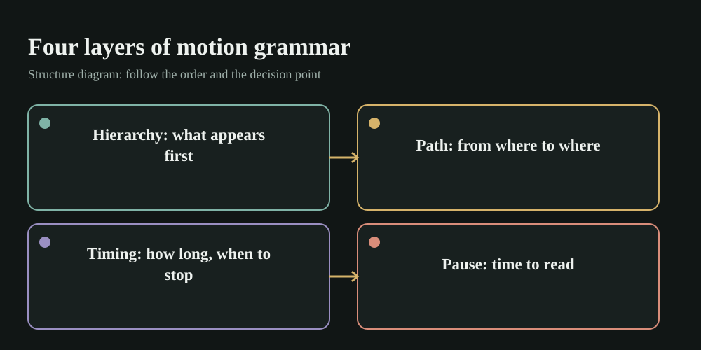

The most common failure in information motion is that every element moves: the title flies in, icons rotate, numbers count, background particles drift. The audience sees a lot of motion and does not know where to look first. Motion is not decoration; it is the order of attention.

<!-- DIAGRAM_START -->
<h2 id="diagram">Diagram</h2>
<figure class="diagram">
  
  <figcaption>Check hierarchy, path, timing and pause. If everything moves and stops together, the audience remembers the noise, not the information.</figcaption>
</figure>
<!-- DIAGRAM_END -->

<section><h2 id="section-1">On location</h2>
A thirty-second data explainer needs three numbers: 40% growth, 18% lower cost and a two-minute dwell time. The designer gives all three bounce, rotation and particles; the client calls it “techy”. In a rough screening with five people, three remember only 40%, and nobody remembers the other two numbers.
</section>
<section><h2 id="section-2">What to look for</h2><ul><li><strong>One line, one idea:</strong> the main motion has one direction; a second motion of equal strength splits attention.</li><li><strong>Consistent direction:</strong> everything moves left-to-right or bottom-to-top; opposite directions read as conflict.</li><li><strong>Enough pause:</strong> after a number lands, hold at least half a second; without a pause, the audience cannot finish reading.</li><li><strong>One easing family:</strong> the same easing set across the film; a different curve on every line makes the frame feel scattered.</li></ul></section>
<section><h2 id="section-3">What to do</h2><ol><li>Write the information hierarchy first: what the audience sees first, second and third. One sentence, not a storyboard.</li><li>Give each piece one main motion: enter, travel, land. Do not add rotation, scale and colour at the same time.</li><li>Use one easing family: ease-out for entrances, ease-in-out for travel, a slight rebound for landings; no more than three in the film.</li><li>Hold 0.5–1 second after landing. The pause is not empty frames; it is reading time.</li><li>Build a system: one rule each for colour, stroke width, corner radius, spacing and rhythm. The next frame applies the system instead of reinventing it.</li></ol></section>
<section><h2 id="section-4">Failure modes</h2><ul><li><strong>Everything moves:</strong> background particles, title, numbers and icons all move at once; the audience has no entry point.</li><li><strong>Different easing on every line:</strong> one bounces, one slides, one flashes, like five designers working separately.</li><li><strong>Text and graphics move together:</strong> the graphic competes while the audience reads, and by the time they finish, the graphic has left.</li></ul></section>
<section><h2 id="section-5">Limits</h2>
This grammar suits infographics, data explainers and product explainers. It is not for narrative titles, music videos or experimental film, which need conflict and surprise. Motion cannot replace graphic design either: if the hierarchy is unclear, motion only accelerates the confusion. Make a static version first; if it reads static, motion has meaning.
</section>
<section><h2 id="section-6">Check</h2><ul><li>With sound off, a viewer can name the first, second and third thing they see.</li><li>The film uses no more than three easings and one direction.</li><li>Each number holds at least half a second after landing.</li><li>The final frame, frozen as a still, still communicates the information.</li></ul></section>
<!-- DEEP_DIVE_START -->
## Deep dive

<strong>About 8 minutes.</strong> This section places the same judgement in two different conditions, then gives a counterexample and a reusable model. It does not repeat the page; it decides when to change the method.

### Condition A: data or infographic

The first job of data motion is readability; the second is beauty. Do not roll numbers from zero unless the roll itself is the information; most of the time the number lands directly with a short scale, and the audience reads faster. Use position for comparison, not colour: one bar higher than another is more direct than red versus blue.

Calculate pauses from reading speed: four to six Chinese characters per second, three to four English words per second. A twelve-character conclusion needs at least two seconds. Do not decide pauses by feel; divide characters by reading speed and add 0.3 seconds of breath.

### Condition B: title or brand motion

A title is not an infographic; it can build expectation before giving the answer. Brand motion usually needs one memory point: a shape, a line, a letter transformation; everything else falls back. Hold half a second before the memory point and one second after; the blank is not laziness, it is attention.

Titles are easy to over-design: every letter gets glow, particles and glitch. The audience remembers the effect, not the brand. Make the black-and-white still frame right, then add one layer of motion; if one layer is not enough, the still is not working, not the motion.

### Counterexample: cool motion, unreadable

A twenty-second explainer: the title flies in from five directions, numbers roll for three seconds, the chart slides in from off-screen, the logo spins 720 degrees. The client loves it; completion rate is low. The audience does not dislike it; they cannot keep up. Every time they want to look, the frame has changed.

The fix is not removing motion. Give each element land, hold, then move on. The title holds 0.8 seconds, the number one second, the chart 1.5 seconds, and the logo appears without spinning. The duration stays, but the information enters.

### Reusable model

<strong>Hierarchy → path → timing → pause.</strong> Hierarchy decides what the audience sees first; path makes motion believable; timing sets speed; pause lets information be read. Define all four before talking about style; style comes after the fourth layer.

Build a five-page motion spec: primary and secondary colours, stroke width, corner radius, three easings, two pause lengths. The next frame applies the spec instead of retuning. The simpler the spec, the more stable the system.

<!-- DEEP_DIVE_END -->
<!-- SOURCES_START -->
## Further reading

- [S59] [Adobe: After Effects User Guide](https://helpx.adobe.com/after-effects/user-guide.html) — accessed 2026-11-26. Used to check the terms, method or rule in the “What to look for” section; not the page's field numbers, gear models or conclusions, and not a substitute for a test or contract.
- [S62] [Blender Foundation: Blender Manual](https://docs.blender.org/manual/en/latest/) — accessed 2026-11-26. Used to check the terms, method or rule in the “Limits” section; not the page's field numbers, gear models or conclusions, and not a substitute for a test or contract.
<!-- SOURCES_END -->
