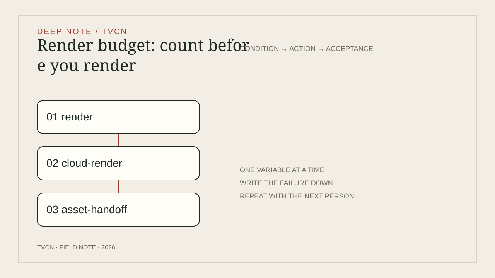

Render time is not a final-stage surprise; resolution, samples, layers and retries are a budget. One page of &amp;quot;Render: Samples and Noise&amp;quot; solves one local problem; joining &amp;quot;Render: Samples and Noise&amp;quot;, &amp;quot;Cloud Render: Cost and Transfer&amp;quot; and &amp;quot;Asset Handoff: Names, Versions, Cache&amp;quot; exposes the real failure: conditions are missing, too many variables move, and the result cannot be reproduced.

<!-- DEEP_DIVE_START -->
<!-- DIAGRAM_START -->
<h2>图解</h2>
<figure>
  
  <figcaption>Read &quot;Render: Samples and Noise&quot; and &quot;Cloud Render: Cost and Transfer&quot;: write the condition first, then check whether the failure can be recorded.</figcaption>
</figure>
<!-- DIAGRAM_END -->

<section><h2 id="section-1">Problem</h2>
The problem is not a lack of methods; each step works alone, but together they fail because the condition was not written, too many variables moved and the result cannot be reproduced.

The order is condition, judgement, one variable and evidence. A step is complete only when the next person can repeat it.
</section>
<section><h2 id="section-2">Judgement</h2><ul><li>First gate in &quot;Render: Samples and Noise&quot;: A 50 percent low-sample pass shows whether noise comes from light or material.</li><li>Second gate in &quot;Cloud Render: Cost and Transfer&quot;: Light and material samples were adjusted separately.</li><li>Third gate in &quot;Asset Handoff: Names, Versions, Cache&quot;: Final noise is traced to a specific source, not brute-forced.</li></ul>
If one gate fails, return to its single page; do not hide an unsolved point inside a longer chain.
</section>
<section><h2 id="section-3">Method</h2><ol><li>Write the condition first: turn &quot;Render at 50 percent resolution and low samples to see noise distribution.&quot; from &quot;Render: Samples and Noise&quot; into three rows: material, environment, acceptance.</li><li>Run one minimal action: follow &quot;Render: Samples and Noise&quot; for 30 seconds and do not add the second page yet.</li><li>Attach the second page: Adjust light samples and material samples separately..</li><li>Use the third page as a control: Do not only raise total samples; find which source causes the noise..</li><li>Change one variable at a time; write the other conditions down instead of remembering them.</li><li>Film the failure too: put failure and success side by side to see which step cannot be skipped.</li><li>Ask the next person to reproduce from the record; if they cannot, the record is not finished.</li></ol></section>
<section><h2 id="section-4">Field test</h2>
A reproducible test, not a client case: take 30 seconds of material, make version A using &quot;A 50 percent low-sample pass shows whether noise comes from light…&quot; from &quot;Render: Samples and Noise&quot;, then version B using &quot;Light and material samples were adjusted separately.&quot; from &quot;Cloud Render: Cost and Transfer&quot;; only one variable may differ. Put them side by side and record what breaks first in &quot;Asset Handoff: Names, Versions, Cache&quot;: condition, action or acceptance. If it works on the first try, add one real constraint and run it again.
</section>
<section><h2 id="section-5">Failure table</h2>
<table class="data-table"><thead><tr><th>Symptom</th><th>Cause</th><th>Replacement action</th></tr></thead><tbody><tr><td>Do not brute-force noise with total samples; without the source, …</td><td>Condition was not written</td><td>Return to page one and rewrite the three rows</td></tr><tr><td>Do not look at price per frame alone; uploading 10 GB can take lo…</td><td>Condition was not written</td><td>Return to page one and rewrite the three rows</td></tr><tr><td>Do not leave assets on a personal desktop; the next person cannot…</td><td>Condition was not written</td><td>Return to page one and rewrite the three rows</td></tr></tbody></table>
</section>
<section><h2 id="section-6">Acceptance</h2><ul><li>A 50 percent low-sample pass shows whether noise comes from light or material.</li><li>Light and material samples were adjusted separately.</li><li>Final noise is traced to a specific source, not brute-forced.</li><li>A 10 GB upload is timed.</li><li>Local and cloud costs are compared over 100 frames.</li><li>Upload time is compared with render time and a conclusion is stated.</li><li>Asset names include project, asset, and version and sort cleanly.</li><li>The shared drive holds a dependency list and cache path.</li><li>The next person opens the asset from the list without asking the original artist.</li><li>The condition from Render: Samples and Noise fits on one line and can be repeated by someone else.</li></ul></section>
<section><h2 id="section-7">Alternatives</h2><ul><li>For a single-point problem in "Render: Samples and Noise", go back to <a href="https://animation.tvcn.org/en/article/render/">Render: Samples and Noise</a>; do not use the whole chain.</li><li>To compare two actions, read <a href="https://tools.tvcn.org/en/article/cloud-render/">Cloud Render: Cost and Transfer</a> and leave the third page alone.</li><li>For acceptance only, use <a href="https://animation.tvcn.org/en/article/asset-handoff/">Asset Handoff: Names, Versions, Cache</a> as a self-test sheet.</li></ul></section>

<!-- SOURCES_START -->
## References and further reading

- [S62] [Blender: Official Manual](https://docs.blender.org/manual/en/latest/) — Accessed 2026-11-26. Used to check the terminology/method/rule in the “Problem” section against Blender manual, not an industry pipeline standard; it does not verify numbers, model choices or on-set conclusions derived from this page, and is not a substitute for a test.
- [S59] [Adobe: After Effects Guide](https://helpx.adobe.com/after-effects/user-guide.html) — Accessed 2026-11-26. Used to check the terminology/method/rule in the “Judgement” section against official After Effects guide, not a verdict on compositing aesthetics; it does not verify numbers, model choices or on-set conclusions derived from this page, and is not a substitute for a test.
<!-- SOURCES_END -->

