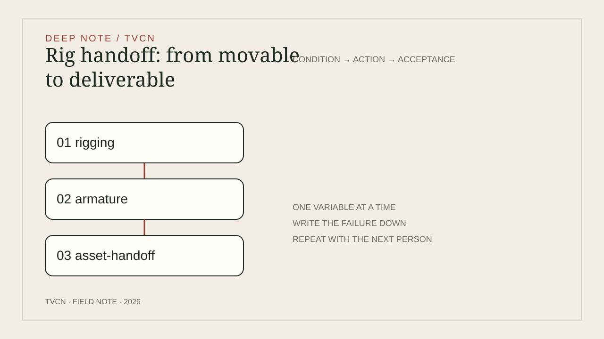

A rig is delivered when extreme poses, naming and weights can be picked up by the next artist. One page of &amp;quot;Rigging: Make the Joints Turn&amp;quot; solves one local problem; joining &amp;quot;Rigging: Make the Joints Turn&amp;quot;, &amp;quot;Armature: It Must Stand Before It Acts&amp;quot; and &amp;quot;Asset Handoff: Names, Versions, Cache&amp;quot; exposes the real failure: conditions are missing, too many variables move, and the result cannot be reproduced.

<!-- DEEP_DIVE_START -->
<!-- DIAGRAM_START -->
<h2>图解</h2>
<figure>
  
  <figcaption>Read &quot;Rigging: Make the Joints Turn&quot; and &quot;Armature: It Must Stand Before It Acts&quot;: write the condition first, then check whether the failure can be recorded.</figcaption>
</figure>
<!-- DIAGRAM_END -->

<section><h2 id="section-1">Problem</h2>
The problem is not a lack of methods; each step works alone, but together they fail because the condition was not written, too many variables moved and the result cannot be reproduced.

The order is condition, judgement, one variable and evidence. A step is complete only when the next person can repeat it.
</section>
<section><h2 id="section-2">Judgement</h2><ul><li>First gate in &quot;Rigging: Make the Joints Turn&quot;: Shoulder, elbow, and knee reach their limits without mesh collapse.</li><li>Second gate in &quot;Armature: It Must Stand Before It Acts&quot;: Collapse was fixed with weights, not covered by extra bones.</li><li>Third gate in &quot;Asset Handoff: Names, Versions, Cache&quot;: Ten-frame rotation playback shows no tearing or pinching.</li></ul>
If one gate fails, return to its single page; do not hide an unsolved point inside a longer chain.
</section>
<section><h2 id="section-3">Method</h2><ol><li>Write the condition first: turn &quot;Rotate shoulder, elbow, and knee, ten frames each.&quot; from &quot;Rigging: Make the Joints Turn&quot; into three rows: material, environment, acceptance.</li><li>Run one minimal action: follow &quot;Rigging: Make the Joints Turn&quot; for 30 seconds and do not add the second page yet.</li><li>Attach the second page: If the mesh collapses, fix weights before adding bones..</li><li>Use the third page as a control: Only animate after all three joints reach their limits..</li><li>Change one variable at a time; write the other conditions down instead of remembering them.</li><li>Film the failure too: put failure and success side by side to see which step cannot be skipped.</li><li>Ask the next person to reproduce from the record; if they cannot, the record is not finished.</li></ol></section>
<section><h2 id="section-4">Field test</h2>
A reproducible test, not a client case: take 30 seconds of material, make version A using &quot;Shoulder, elbow, and knee reach their limits without mesh collaps…&quot; from &quot;Rigging: Make the Joints Turn&quot;, then version B using &quot;Collapse was fixed with weights, not covered by extra bones.&quot; from &quot;Armature: It Must Stand Before It Acts&quot;; only one variable may differ. Put them side by side and record what breaks first in &quot;Asset Handoff: Names, Versions, Cache&quot;: condition, action or acceptance. If it works on the first try, add one real constraint and run it again.
</section>
<section><h2 id="section-5">Failure table</h2>
<table class="data-table"><thead><tr><th>Symptom</th><th>Cause</th><th>Replacement action</th></tr></thead><tbody><tr><td>Do not add bones to fix collapse; wrong weights get messier with …</td><td>Condition was not written</td><td>Return to page one and rewrite the three rows</td></tr><tr><td>Do not let the armature stay soft; it collapses within ten frames…</td><td>Condition was not written</td><td>Return to page one and rewrite the three rows</td></tr><tr><td>Do not leave assets on a personal desktop; the next person cannot…</td><td>Condition was not written</td><td>Return to page one and rewrite the three rows</td></tr></tbody></table>
</section>
<section><h2 id="section-6">Acceptance</h2><ul><li>Shoulder, elbow, and knee reach their limits without mesh collapse.</li><li>Collapse was fixed with weights, not covered by extra bones.</li><li>Ten-frame rotation playback shows no tearing or pinching.</li><li>The puppet stands ten seconds without wobble and the feet are weighted.</li><li>Three steps hold without collapse or sudden joint lock.</li><li>Ten frames of one pose show no positional drift.</li><li>Asset names include project, asset, and version and sort cleanly.</li><li>The shared drive holds a dependency list and cache path.</li><li>The next person opens the asset from the list without asking the original artist.</li><li>The condition from Rigging: Make the Joints Turn fits on one line and can be repeated by someone else.</li></ul></section>
<section><h2 id="section-7">Alternatives</h2><ul><li>For a single-point problem in "Rigging: Make the Joints Turn", go back to <a href="https://animation.tvcn.org/en/article/rigging/">Rigging: Make the Joints Turn</a>; do not use the whole chain.</li><li>To compare two actions, read <a href="https://animation.tvcn.org/en/article/armature/">Armature: It Must Stand Before It Acts</a> and leave the third page alone.</li><li>For acceptance only, use <a href="https://animation.tvcn.org/en/article/asset-handoff/">Asset Handoff: Names, Versions, Cache</a> as a self-test sheet.</li></ul></section>

<!-- SOURCES_START -->
## References and further reading

- [S62] [Blender Foundation: Blender Manual](https://docs.blender.org/manual/en/latest/) — Accessed 2026-11-26. Used to check the terminology and public context in the opening paragraph (“A rig is delivered when extreme poses, naming and weights ca”) against Modelling, rigging, animation and rendering; not a substitute for an on-set test.
- [S63] [Toon Boom: Documentation](https://docs.toonboom.com/) — Accessed 2026-11-26. Used to check the terminology and public context in the opening paragraph (“A rig is delivered when extreme poses, naming and weights ca”) against 2D animation, rigging and production pipeline; not a substitute for an on-set test.
- [S12] [Animation](https://www.britannica.com/art/animation) — Accessed 2026-11-26. Used to check the terminology and public context in the opening paragraph (“A rig is delivered when extreme poses, naming and weights ca”) against Encyclopedia entry on animation principles, techniques and industry history; not a substitute for an on-set test.
- [S59] [Adobe: After Effects User Guide](https://helpx.adobe.com/after-effects/user-guide.html) — Accessed 2026-11-26. Used to check the terminology and public context in the opening paragraph (“A rig is delivered when extreme poses, naming and weights ca”) against Compositing, keyframes, tracking and export; not a substitute for an on-set test.
<!-- SOURCES_END -->

