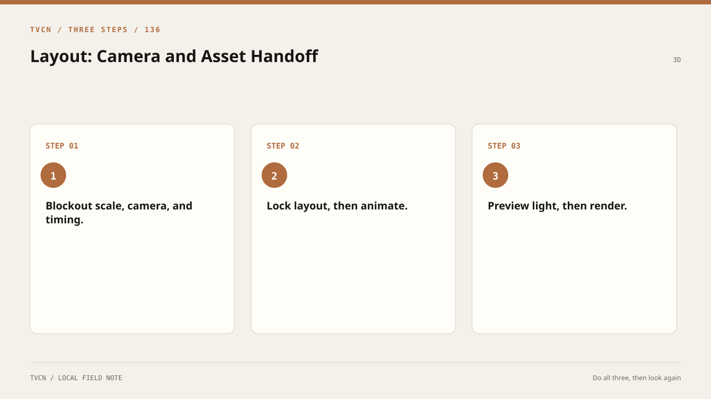

Layout locks camera, scale, and asset versions before animation. A vague handoff makes animators guess.

<!-- DIAGRAM_START -->
<h2>Diagram</h2>
<figure>
  
  <figcaption>Do the three steps in order, then look again at the image or file.</figcaption>
</figure>
<!-- DIAGRAM_END -->
<h2>On set</h2>

Lock three things before handoff: camera, character scale, and asset version. Put the version in the file header and animate to the layout.

<h2>Do this</h2>

Layout locks camera, proportion, and asset version before handoff; unclear handoff makes animators guess.
<ol><li>Lock three things: camera, character scale, asset version.</li><li>Write the version number in the file header.</li><li>Animate to the layout without changing the camera.</li></ol>
<h2>Avoid</h2>

Do not leave the camera live in layout; changing it after animation starts is rework.

<h2>Check</h2>
<ul><li>Camera, character scale, and asset version are locked and versioned.</li><li>The file header shows version and dependencies so animators do not guess.</li><li>Animation does not change the camera and the final shot matches layout.</li></ul>
