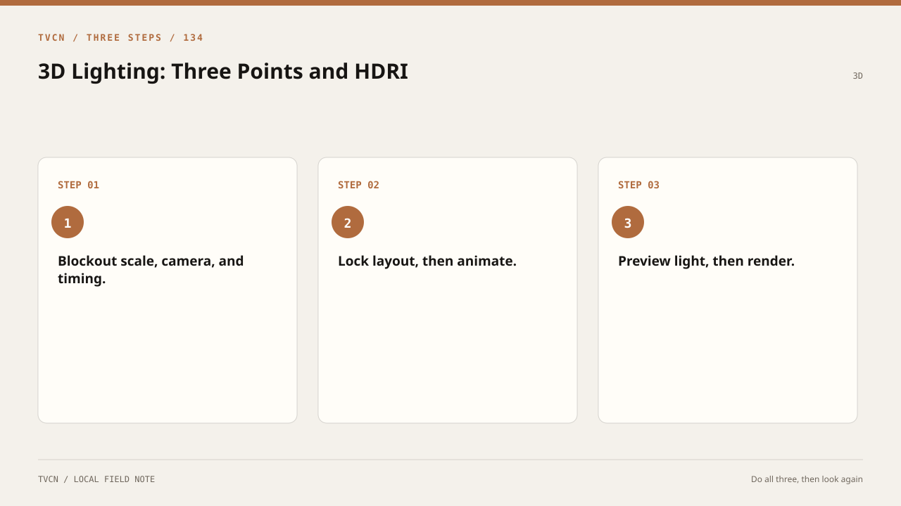

Use key, fill, and rim to build structure, then HDRI for environment. Reverse the order and space flattens.

<!-- DIAGRAM_START -->
<h2>Diagram</h2>
<figure>
  
  <figcaption>Do the three steps in order, then look again at the image or file.</figcaption>
</figure>
<!-- DIAGRAM_END -->
<h2>On set</h2>

Turn off the HDRI and shape the form with the key only. Add fill and rim, then bring the HDRI back to 20 or 30 percent for environment.

<h2>Do this</h2>

3D lighting builds structure with key, fill, and rim before HDRI; reversing the order flattens space.
<ol><li>Turn off HDRI and shape with the key only.</li><li>Add fill and rim.</li><li>Bring HDRI in at 20 to 30 percent to fill the environment.</li></ol>
<h2>Avoid</h2>

Do not start with HDRI; environment light hides the form.

<h2>Check</h2>
<ul><li>With HDRI off, the key already defines form.</li><li>Fill and rim do their jobs without flattening the key.</li><li>HDRI stays at 20 to 30 percent and does not take over.</li></ul>
