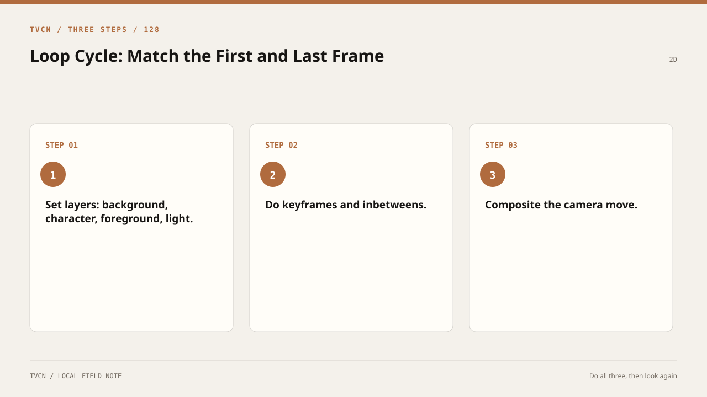

The first and last frames must match, or the loop twitches every cycle.

<!-- DIAGRAM_START -->
<h2>Diagram</h2>
<figure>
  
  <figcaption>Do the three steps in order, then look again at the image or file.</figcaption>
</figure>
<!-- DIAGRAM_END -->
<h2>On set</h2>

Draw the same frame at both ends with eight to twelve frames between. Loop it and check for a jump from last to first.

<h2>Do this</h2>

A loop needs matching first and last frames, or it hiccups every cycle.
<ol><li>Draw the same pose at the head and tail.</li><li>Fill eight to twelve frames between them.</li><li>Play on loop and check the last-to-first transition for a jump.</li></ol>
<h2>Avoid</h2>

Do not leave a one-frame mismatch at the seam; repetition makes the hitch obvious.

<h2>Check</h2>
<ul><li>First and last frames are the same pose in position and shape.</li><li>Eight to twelve frames fill the middle at an even rhythm.</li><li>Ten loops play with no hitch or stick at the seam.</li></ul>
