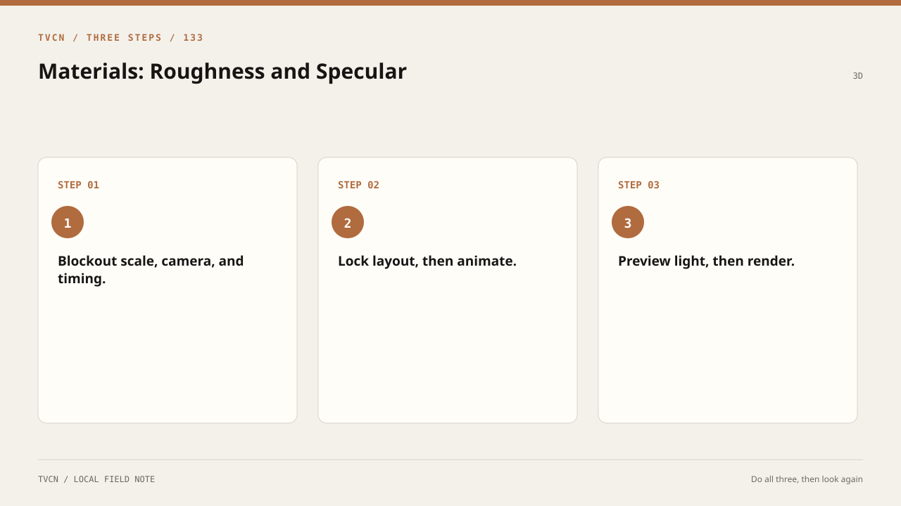

Do not start with “metal” or “wood”; start with behavior: reflection sharpness, roughness, edge translucency, dents. The same “metal” can be mirror, brushed or rusted. The difference is behavior, not the label.

<!-- DIAGRAM_START -->
<h2>Diagram</h2>
<figure>
  
  <figcaption>Watch “Test three spheres under one light with roughness” and “Compare highlight size and edge softness.”; judge whether the speed split between foreground, midground and background reads in one move.</figcaption>
</figure>
<!-- DIAGRAM_END -->
<section><h2 id="section-1">Ask what the surface does before naming it</h2>
Test with a gray ball and a grid: check reflection, roughness and normal; set those three before color.
<h2 id="section-2">Limits</h2>
Materials cannot save a model. Without thickness, seams and bevels, the best texture still looks like paper. Fix shape first.
<h2 id="section-3">Materials: scale first, roughness second</h2>

A material looks fake not because the texture is low resolution, but because its scale is wrong. Wood grain at one meter and at ten centimeters is not the same image. Without a scale reference, roughness is also wrong.

<table class="data-table"><thead><tr><th>Material</th><th>Define first</th><th>Common error</th></tr></thead><tbody>
<tr><td>Wood</td><td>Grain direction, board width</td><td>One tile stretched across a wall</td></tr>
<tr><td>Metal</td><td>Brush direction, roughness</td><td>All mirror, reads as plastic</td></tr>
<tr><td>Cloth</td><td>Weave density, fold scale</td><td>Texture larger than folds</td></tr>
<tr><td>Skin</td><td>Pore scale, oily zones</td><td>One roughness for the whole face</td></tr>
</tbody></table>

<h3>Project-level checks</h3>
<ol><li>Place a known-size reference (coin, A4 sheet) in the scene and calibrate texture repeats first.</li><li>Use a grayscale roughness map, not one value. Paint oil, dry and worn areas separately.</li><li>Start normal strength at 0.3 and add gradually; maxed-out normals darken edges.</li><li>Judge materials under final lighting, not default HDRI. Change the light and the material reads differently.</li></ol>

Before delivery, make a material contact sheet: one material under hard light, backlight and shadow, to prove it is not only working in one setup.
</section><section><h2 id="section-4">On set</h2>
Under one light, test three spheres with roughness from 0.2 to 0.8 and watch the highlight size. Set the material before adding texture.
</section><section><h2 id="section-5">Do this</h2>
Materials set roughness and specular before texture; those two decide plastic, wood, or metal.
<ol><li>Test three spheres under one light with roughness from 0.2 to 0.8.</li><li>Compare highlight size and edge softness.</li><li>Lock the material before adding texture.</li></ol></section><section><h2 id="section-6">Avoid</h2>
Do not hide material with texture; wrong roughness looks like paper no matter the map.
</section><section><h2>Judge</h2>
Three signals are observable on set:
<ul><li>the speed split between foreground, midground and background reads in one pan</li><li>a 0.5-second action still carries weight or anticipation</li><li>turn off any layer and the space still holds</li></ul></section><section><h2>Failures</h2>
These three moves erase the detail you just built:
<ul><li>more layers, same speed: the space stays flat</li><li>anticipation without follow-through: the weight is only half done</li><li>rendering before assets are locked: rework starts at the compositor</li></ul></section><section><h2>Extend</h2>
<strong>10-minute exercise:</strong> Draw three keys at 24 fps, change only “Compare highlight size and edge softness.”, and export two seconds. If the weight still does not read, add anticipation before adding blur.
</section>
<h2>Check</h2><ul><li>Three spheres show clearly different highlight sizes under one light.</li><li>The difference between 0.2 and 0.8 roughness is nameable, not just color.</li><li>Texture is added after material approval and does not hide highlight issues.</li></ul>
