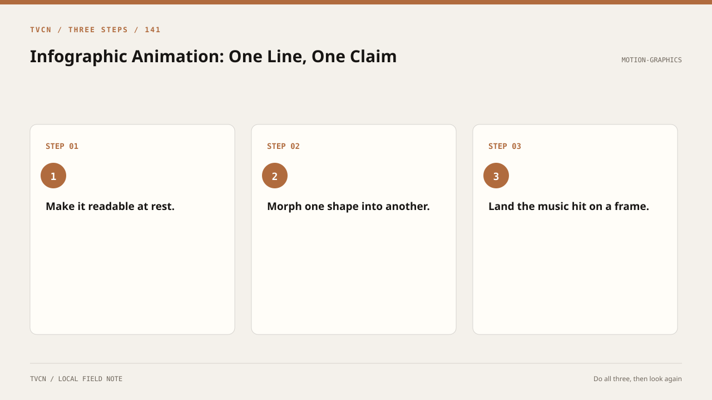

One line carries one claim. More lines mean less memory.

<!-- DIAGRAM_START -->
<h2>Diagram</h2>
<figure>
  
  <figcaption>Do the three steps in order, then look again at the image or file.</figcaption>
</figure>
<!-- DIAGRAM_END -->
<h2>On set</h2>

One line carries one variable. Draw it static first, then grow it with the data; do not add labels and icons at the same time.

<h2>Do this</h2>

One line in an infographic carries one idea; more lines mean less recall.
<ol><li>Each line carries one variable only.</li><li>Draw the line static first, then grow it with data.</li><li>Do not add labels and icons at the same time; let the line speak.</li></ol>
<h2>Avoid</h2>

Do not make one line tell three things; the audience remembers none.

<h2>Check</h2>
<ul><li>Each line maps to one variable and its title names it.</li><li>The line grows with the number instead of finishing before data.</li><li>Muted playback lets you repeat what each line says.</li></ul>
