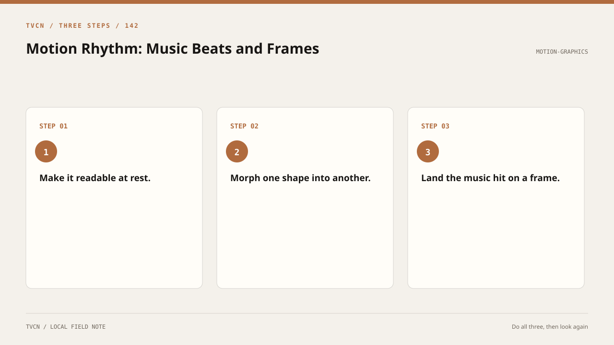

Land music hits on frames before easing. Miss the hit and smoothness is still chaos.

<!-- DIAGRAM_START -->
<h2>Diagram</h2>
<figure>
  
  <figcaption>Do the three steps in order, then look again at the image or file.</figcaption>
</figure>
<!-- DIAGRAM_END -->
<h2>On set</h2>

Put the music waveform on the timeline and mark eight downbeats. Each downbeat gets one keyframe, then adjust easing.

<h2>Do this</h2>

Motion rhythm aligns music hits to frames before easing; if hits are off, smoothness still feels messy.
<ol><li>Put the music waveform on the timeline and mark eight accents.</li><li>Place one keyframe on each accent.</li><li>Then adjust easing; do not animate first and hunt for music later.</li></ol>
<h2>Avoid</h2>

Do not animate first and add music later; misaligned hits make even smooth easing messy.

<h2>Check</h2>
<ul><li>Eight accents are marked on the timeline with matching keyframes.</li><li>Animation changes land on the accents instead of music chasing picture.</li><li>Muted playback still holds rhythm without relying on music.</li></ul>
