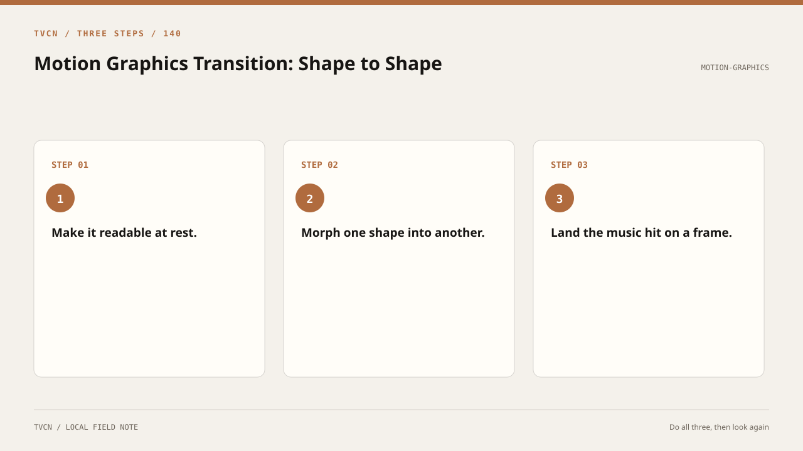

A graphic transition morphs one shape into another, not a white flash or random push.

<!-- DIAGRAM_START -->
<h2>Diagram</h2>
<figure>
  
  <figcaption>Do the three steps in order, then look again at the image or file.</figcaption>
</figure>
<!-- DIAGRAM_END -->
<h2>On set</h2>

Choose one shape change: circle to square, line to arrow. Do it in eight to twelve frames; no white flash.

<h2>Do this</h2>

Graphic transitions morph one shape into another, not a white flash or arbitrary push.
<ol><li>Choose a shape pair: circle to square, line to arrow.</li><li>Complete the morph in eight to twelve frames.</li><li>Do not use a white flash; the information on both sides must connect.</li></ol>
<h2>Avoid</h2>

Do not use white flashes and pushes as universal transitions; if shapes do not connect, the audience loses the thread.

<h2>Check</h2>
<ul><li>The same shape morphs across the transition instead of hard-cutting.</li><li>The morph completes in eight to twelve frames at a readable speed.</li><li>Without a white flash, information still connects and the audience knows where they are.</li></ul>
