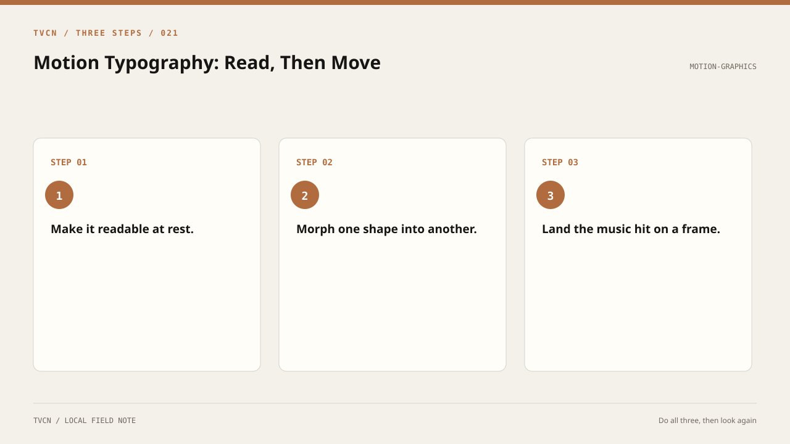

Type must read at rest before it moves; reading while moving cuts comprehension in half.

<!-- DIAGRAM_START -->
<h2>Diagram</h2>
<figure>
  
  <figcaption>Do the three steps in order, then look again at the image or file.</figcaption>
</figure>
<!-- DIAGRAM_END -->
<h2>On set</h2>

Make a still version that reads at phone width. Then animate six frames of entrance using position and opacity only; do not rotate, scale, and glow at once.

<h2>Do this</h2>

Motion typography must read at rest before it moves; reading while moving cuts speed in half.
<ol><li>Make a static version and check it at phone width.</li><li>Animate a six-frame entrance using only position and opacity.</li><li>Do not add rotation, scale, and glow at once; protect the information.</li></ol>
<h2>Avoid</h2>

Do not use white flashes and pushes as universal transitions; unreadable type wastes the motion.

<h2>Check</h2>
<ul><li>The static version reads at phone width and the longest line stays in frame.</li><li>The entrance moves only position and opacity, not rotation and scale together.</li><li>Muted playback still communicates the order of information.</li></ul>
<!-- SOURCES_START -->
<h2>Sources</h2>

Experience: TVCN field notes and project reviews; tested: the review setup and reproducible exercises noted on the page; references: public links below.

<ul><li>[S12] Britannica: Animation</li><li>[S28] Netflix Partner Help</li><li>[S34] Adobe Premiere Pro Guide</li></ul>

<a href="../../SOURCES.md">Full links and notes in SOURCES.md</a>

<!-- SOURCES_END -->
