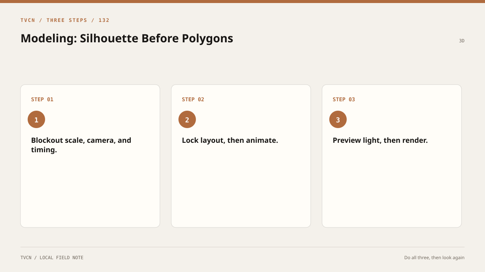

Check the silhouette: fill the model black—can you still recognize the character? Then thickness: bevels at edges, volume at joints. If the silhouette fails, detail will not identify it.

<!-- DIAGRAM_START -->
<h2>Diagram</h2>
<figure>
  
  <figcaption>Watch “Render the model black and check the silhouette.” and “Subdivide only after the outline identifies the character.”; judge whether the speed split between foreground, midground and background reads in one move.</figcaption>
</figure>
<!-- DIAGRAM_END -->
<section><h2 id="section-1">Modeling protects silhouette and thickness</h2>
Start with big planes, add edges gradually; do not begin with pores. Every detail pass returns to the silhouette check.
<h2 id="section-2">Limits</h2>
Polygon count is not precision. Round what should be round, hard what should be hard; polygons in unseen places only slow render.
<h2 id="section-3">Modeling: silhouette, topology, UV — in that order</h2>

The first acceptance test for a model is not polygon count; it is silhouette. Put it on a black background. If the outline does not tell you what it is, clean topology will not save it.

<table class="data-table"><thead><tr><th>Stage</th><th>Check</th><th>Cost to redo</th></tr></thead><tbody>
<tr><td>Silhouette</td><td>Front, side, back</td><td>Low; adjust the big forms</td></tr>
<tr><td>Topology</td><td>Joint loops, bend test</td><td>Medium; rewire</td></tr>
<tr><td>UV</td><td>Seam placement, texel density</td><td>High; re-unwrap</td></tr>
<tr><td>Detail</td><td>Bevels, wear, bumps</td><td>Highest; found after baking</td></tr>
</tbody></table>

<h3>Project-level checks</h3>
<ol><li>Block out proportions and camera relationship before topology. Do not sculpt detail on wrong proportions.</li><li>Use at least three edge loops at joints; test elbow, knee and shoulder separately instead of relying on a smooth modifier.</li><li>Hide UV seams in less visible places; unify texel density with a checker; name multiple UV sets.</li><li>Bevel late, but before baking. Bevel after baking and the normals no longer match.</li></ol>

If a model appears for two seconds and is not in close-up, skip the full high-poly pipeline. Use a mid-poly model plus normal maps and give the time to the shot.
</section><section><h2 id="section-4">On set</h2>
Check the silhouette first: render the model black and see if the shape reads. Then subdivide and spend polygons by camera distance.
</section><section><h2 id="section-5">Do this</h2>
Modeling reads silhouette before polygon count; a wrong outline never looks right with more subdivisions.
<ol><li>Render the model black and check the silhouette.</li><li>Subdivide only after the outline identifies the character.</li><li>Allocate polygons by shot distance: more close, fewer far.</li></ol></section><section><h2 id="section-6">Avoid</h2>
Do not fix a silhouette with subdivision; more polygons will not make it recognizable.
</section><section><h2>Judge</h2>
Three signals are observable on set:
<ul><li>the speed split between foreground, midground and background reads in one pan</li><li>a 0.5-second action still carries weight or anticipation</li><li>turn off any layer and the space still holds</li></ul></section><section><h2>Failures</h2>
These three moves erase the detail you just built:
<ul><li>more layers, same speed: the space stays flat</li><li>anticipation without follow-through: the weight is only half done</li><li>rendering before assets are locked: rework starts at the compositor</li></ul></section><section><h2>Extend</h2>
<strong>10-minute exercise:</strong> Draw three keys at 24 fps, change only “Subdivide only after the outline identifies the character.”, and export two seconds. If the weight still does not read, add anticipation before adding blur.
</section>
<h2>Check</h2><ul><li>The black silhouette identifies the character without color or texture.</li><li>Subdivision happens after silhouette approval, not before.</li><li>Close shots carry more polygons than wide shots by plan.</li></ul>
