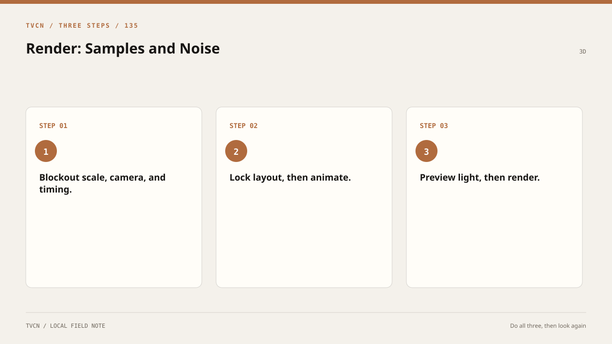

Samples and noise come before resolution; unresolved noise at 4K is just bigger dirt.

<!-- DIAGRAM_START -->
<h2>Diagram</h2>
<figure>
  
  <figcaption>Do the three steps in order, then look again at the image or file.</figcaption>
</figure>
<!-- DIAGRAM_END -->
<h2>On set</h2>

Render at 50 percent resolution with low samples to see where noise lives. Raise light and material samples separately; do not just raise the total.

<h2>Do this</h2>

Rendering checks samples and noise before resolution; unresolved noise at 4K is just bigger dirt.
<ol><li>Render at 50 percent resolution and low samples to see noise distribution.</li><li>Adjust light samples and material samples separately.</li><li>Do not only raise total samples; find which source causes the noise.</li></ol>
<h2>Avoid</h2>

Do not brute-force noise with total samples; without the source, render time burns.

<h2>Check</h2>
<ul><li>A 50 percent low-sample pass shows whether noise comes from light or material.</li><li>Light and material samples were adjusted separately.</li><li>Final noise is traced to a specific source, not brute-forced.</li></ul>
