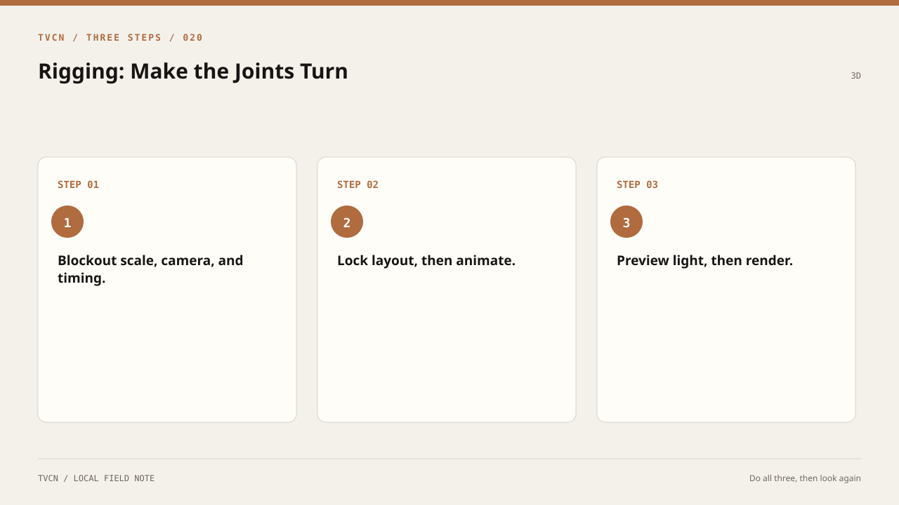

A rig must first do three things: elbows and knees bend one way, shoulders lift, head turns. Limit each joint and test weights before adding dozens of controls.

<!-- DIAGRAM_START -->
<h2>Diagram</h2>
<figure>
  
  <figcaption>Watch “Rotate shoulder, elbow, and knee, ten frames each.” and “If the mesh collapses, fix weights before adding”; judge whether the speed split between foreground, midground and background reads in one move.</figcaption>
</figure>
<!-- DIAGRAM_END -->
<section><h2 id="section-1">The joint turns, the weights do not tear</h2>
Test extreme poses: arms overhead, deep squat, turn. Check armpits, knees and hips for tearing. Fix weights first, not with corrective shapes.
<h2 id="section-2">Limits</h2>
Complexity is not professionalism. A simple skeleton that survives the shots beats a feature-rich rig that breaks every time.
</section><section><h2 id="section-3">On set</h2>
Rotate shoulder, elbow, and knee for ten frames each. If the mesh collapses, fix weights before adding bones.
</section><section><h2 id="section-4">Do this</h2>
Rigging makes joints rotate correctly before skin deforms nicely; if it cannot turn, weights do not matter.
<ol><li>Rotate shoulder, elbow, and knee, ten frames each.</li><li>If the mesh collapses, fix weights before adding bones.</li><li>Only animate after all three joints reach their limits.</li></ol></section><section><h2 id="section-5">Avoid</h2>
Do not add bones to fix collapse; wrong weights get messier with more bones.
</section><section><h2>Judge</h2>
Three signals are observable on set:
<ul><li>the speed split between foreground, midground and background reads in one pan</li><li>a 0.5-second action still carries weight or anticipation</li><li>turn off any layer and the space still holds</li></ul></section><section><h2>Failures</h2>
These three moves erase the detail you just built:
<ul><li>more layers, same speed: the space stays flat</li><li>anticipation without follow-through: the weight is only half done</li><li>rendering before assets are locked: rework starts at the compositor</li></ul></section><section><h2>Extend</h2>
<strong>10-minute exercise:</strong> Draw three keys at 24 fps, change only “If the mesh collapses, fix weights before adding”, and export two seconds. If the weight still does not read, add anticipation before adding blur.
</section>
<h2>Check</h2><ul><li>Shoulder, elbow, and knee reach their limits without mesh collapse.</li><li>Collapse was fixed with weights, not covered by extra bones.</li><li>Ten-frame rotation playback shows no tearing or pinching.</li></ul>
<!-- SOURCES_START -->
