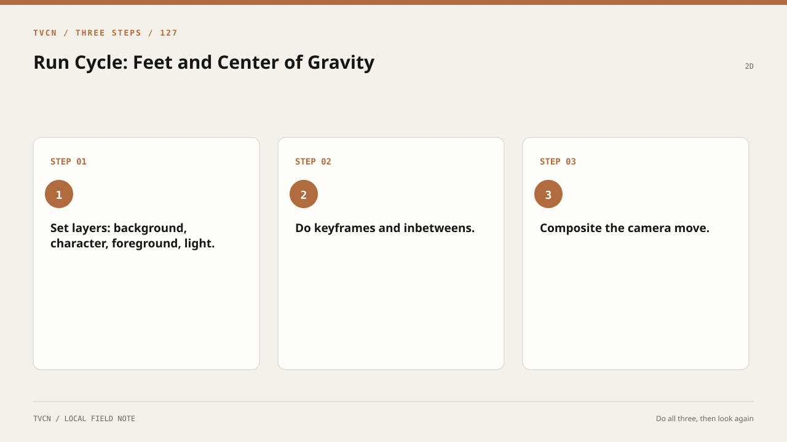

Set the center of gravity and footfall order before arms; wrong feet make the whole body float.

<!-- DIAGRAM_START -->
<h2>Diagram</h2>
<figure>
  
  <figcaption>Do the three steps in order, then look again at the image or file.</figcaption>
</figure>
<!-- DIAGRAM_END -->
<h2>On set</h2>

Draw four key poses: contact, down, pass, and airborne. Roll the foot heel to toe and keep the hips within one head height.

<h2>Do this</h2>

A run cycle fixes weight and foot contact before arms; wrong feet make the whole body float.
<ol><li>Draw four key poses: contact, down, passing, airborne.</li><li>Roll the foot from heel to toe.</li><li>Keep vertical travel within one head height, then fix arms.</li></ol>
<h2>Avoid</h2>

Do not fix arms first; sliding feet make even smooth arms look floaty.

<h2>Check</h2>
<ul><li>All four key poses read: contact, down, passing, airborne.</li><li>The planted foot rolls heel to toe instead of sliding flat.</li><li>Vertical travel stays within one head and the loop does not float.</li></ul>
