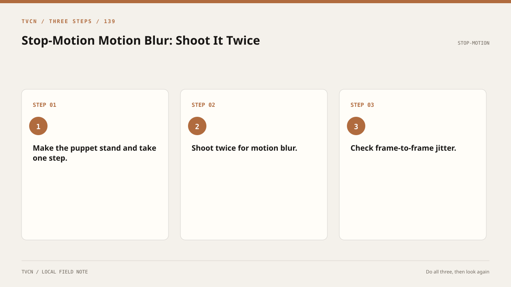

Stop motion does not capture continuous shutter exposure; blur is simulated in post or multiple exposure. Decide which frames need it: fast hand, turn, fall. Do not blur static frames.

<!-- DIAGRAM_START -->
<h2>Diagram</h2>
<figure>
  
  <figcaption>Watch “Shoot each pose twice.” and “Move the moving part two to three millimeters”; judge whether the speed split between foreground, midground and background reads in one move.</figcaption>
</figure>
<!-- DIAGRAM_END -->
<section><h2 id="section-1">Stop-motion blur is decided per frame</h2>
Post blur follows motion direction and length; a uniform blur over everything looks like fog.
<h2 id="section-2">Limits</h2>
Not every stop-motion shot needs blur. Frame-by-frame sharpness is also a style; choose the style before adding it.
</section><section><h2 id="section-3">On set</h2>
Shoot each pose twice and move the moving parts two or three millimeters on the second pass. Blend the two frames for directional blur.
</section><section><h2 id="section-4">Do this</h2>
Stop-motion blur comes from two exposures or post compositing, not a lower frame rate.
<ol><li>Shoot each pose twice.</li><li>Move the moving part two to three millimeters on the second pass.</li><li>Blend the two frames in post for directional blur.</li></ol></section><section><h2 id="section-5">Avoid</h2>
Do not lower the frame rate for blur; that creates stutter, not motion blur.
</section><section><h2>Judge</h2>
Three signals are observable on set:
<ul><li>the speed split between foreground, midground and background reads in one pan</li><li>a 0.5-second action still carries weight or anticipation</li><li>turn off any layer and the space still holds</li></ul></section><section><h2>Failures</h2>
These three moves erase the detail you just built:
<ul><li>more layers, same speed: the space stays flat</li><li>anticipation without follow-through: the weight is only half done</li><li>rendering before assets are locked: rework starts at the compositor</li></ul></section><section><h2>Extend</h2>
<strong>10-minute exercise:</strong> Draw three keys at 24 fps, change only “Move the moving part two to three millimeters”, and export two seconds. If the weight still does not read, add anticipation before adding blur.
</section>
<h2>Check</h2><ul><li>Each pose has two exposures and the second moves two to three millimeters.</li><li>The blended blur has direction matching the motion.</li><li>No fake blur comes from a lower frame rate.</li></ul>
