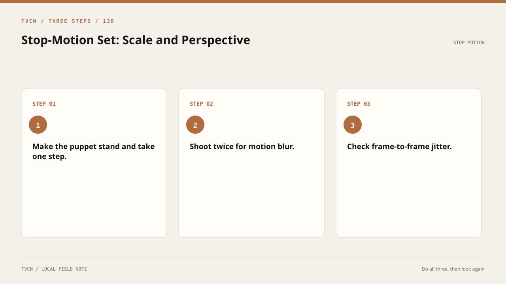

It is not a miniature landscape. Every adjustable position needs two fingers of access; walls, furniture and floor must come apart separately or one touch collapses the set.

<!-- DIAGRAM_START -->
<h2>Diagram</h2>
<figure>
  
  <figcaption>Watch “Measure the puppet height.” and “Calculate set size from the shot perspective.”; judge whether the speed split between foreground, midground and background reads in one move.</figcaption>
</figure>
<!-- DIAGRAM_END -->
<section><h2 id="section-1">A stop-motion set must fit a hand</h2>
Build a paper maquette at 1:6 or 1:12 first, checking camera, lamp and hand space; do not start with detail.
<h2 id="section-2">Limits</h2>
More set is not better. Keep foreground for blocking and background empty so a hand fits; a packed set leaves no room even to focus.
<h2 id="section-3">Stop-motion sets: scale first, light second</h2>

A stop-motion set is not a miniature real world. It is a workbench a hand must fit into. Scale, depth of field and light stability decide quality earlier than fine detail.

<table class="data-table"><thead><tr><th>Item</th><th>On-set practice</th><th>Failure signal</th></tr></thead><tbody>
<tr><td>Scale</td><td>Choose 1:6 or 1:12; all props share it</td><td>Hand and prop scale disagree</td></tr>
<tr><td>Depth</td><td>Small aperture + enough light</td><td>Subject sharp, set mush</td></tr>
<tr><td>Light</td><td>Lock positions, use flags, no auto exposure</td><td>Brightness jumps between frames</td></tr>
<tr><td>Replacements</td><td>Two or three mouths/hands per action</td><td>Run out mid-shot</td></tr>
</tbody></table>

<h3>Project-level checks</h3>
<ol><li>Shoot a ten-frame test: does the hand block light or hit the set?</li><li>Clamp every light and mark its position; after a move you must return to the same mark.</li><li>Lock exposure and white balance in the capture software; disable camera automation.</li><li>Back up after every shot. One lost frame means reshooting the whole section.</li></ol>

If a hand enters frame, rehearse the move. The hand is the prop most likely to break the illusion.
</section><section><h2 id="section-4">On set</h2>
Measure the puppet height, then size the set to the lens perspective. Run one perspective line from camera to background and align everything to it.
</section><section><h2 id="section-5">Do this</h2>
Stop-motion sets scale from the puppet and shot perspective; wrong scale looks fake under any light.
<ol><li>Measure the puppet height.</li><li>Calculate set size from the shot perspective.</li><li>Run one perspective line from camera to background and align everything.</li></ol></section><section><h2 id="section-6">Avoid</h2>
Do not build the set by feel; one door next to the puppet reveals the scale.
</section><section><h2>Judge</h2>
This page passes on three observable checks, not slogans:
<ul><li><strong>1.</strong> Puppet height and set size have a conversion record.</li><li><strong>2.</strong> One perspective line runs camera to background and key objects align.</li><li><strong>3.</strong> The puppet reads correctly beside door and table without hiding it.</li></ul></section><section><h2>Failures</h2>
Any one of these means stop and fix it before post:
<ul><li><strong>1.</strong> Check 1 is only staged (“Puppet height and set size have a conversion r…”); another camera position or location exposes it.</li><li><strong>2.</strong> Check 2 is left to post or a verbal explanation (“One perspective line runs camera to background…”); nothing on set can be rechecked.</li><li><strong>3.</strong> Do not build the set by feel; one door next to the puppet reveals the scale.</li></ul></section><section><h2>Extend</h2>
<strong>10-minute exercise:</strong> Draw three keys at 24 fps, change only “Calculate set size from the shot perspective.”, and export two seconds. If the weight still does not read, add anticipation before adding blur.
</section>
<h2>Check</h2><ul><li>Puppet height and set size have a conversion record.</li><li>One perspective line runs camera to background and key objects align.</li><li>The puppet reads correctly beside door and table without hiding it.</li></ul>

<!-- SOURCES_START -->
## References and further reading

- [S50] [Kodak: Motion Picture](https://www.kodak.com/en/motion/home) — Accessed 2026-11-26. Used to check the terminology/method/rule in the “A stop-motion set must fit a hand” section against Kodak film and motion-picture material, not digital settings; it does not verify numbers, model choices or on-set conclusions derived from this page, and is not a substitute for a test.
- [S62] [Blender: Official Manual](https://docs.blender.org/manual/en/latest/) — Accessed 2026-11-26. Used to check the terminology/method/rule in the “Stop-motion sets: scale first, light second” section against Blender manual, not an industry pipeline standard; it does not verify numbers, model choices or on-set conclusions derived from this page, and is not a substitute for a test.
- [S12] [Britannica: Animation](https://www.britannica.com/art/animation) — Accessed 2026-11-26. Used to check the terminology/method/rule in the “Limits” section against Britannica animation history, not software documentation; it does not verify numbers, model choices or on-set conclusions derived from this page, and is not a substitute for a test.
<!-- SOURCES_END -->

