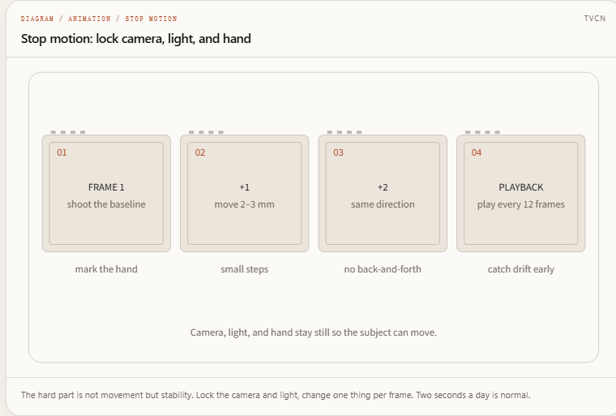

<!-- DIAGRAM_START -->
## Diagram

<figure>
  
  <figcaption>The hard part is not movement but stability. Lock the camera and light, change one thing per frame. Two seconds a day is normal.</figcaption>
</figure>
<!-- DIAGRAM_END -->

The barrier in stop motion is not gear; it is stability. Lock the camera, lock the light, move the puppet a little each frame.

## Lock the camera

Tripod, remote shutter, manual exposure, manual white balance. Any automatic mode will flicker across hundreds of frames. If the camera moves a millimeter, the action jumps.

Tape down the tripod position and focal length. Do not touch the camera until the shot is finished.

## Shoot it twice

Twelve fps is a common stop-motion rate; fast action can use twenty-four. Shoot a test pass to confirm direction and distance, then shoot the real pass.

Use onion skin for the previous frame, but do not rely on it alone. Watch the whole sequence every few frames, or you will get “every frame right, the whole wrong.”

## Light and motion

Use continuous, flicker-free light. Avoid cheap LEDs with PWM flicker; test with a phone video before shooting. Move the puppet a little each frame: two millimeters for a step, three degrees for a turn. More frames are cheaper than a jump.

## Three checks

- Camera, exposure, and white balance are manual and locked.
- There is a twelve-fps test pass.
- The puppet moves only a small amount each frame.

<!-- DEEP_DIVE_START -->
## Deep dive

<strong>About 7 minutes.</strong> Stop motion is not shooting frame by frame. It is calculating how much each frame moves, then keeping light and rig still.

### Count frames first

At twelve frames per second, one second needs twelve moves; a three-second action is thirty-six. Count total frames before shooting, or discover the shortage halfway.

Measure movement in millimeters per frame. Too much jumps; too little sticks. Mark the rig rail with a ruler, not a feeling.

### Lock light and rig

Sandbag and tape every lamp; mark a position line. If someone bumps a light mid-shot, the whole section flickers. Use a cable release or software, not a finger.

Leave frame before touching the puppet; if a hand must enter, use a stand-in or a long tool. Change one joint, shoot one frame. Do not change three at once.

### Set and post

Build a set that survives repeated touching: walls fixed, floor flat, props weighted. Use cloth that does not spring back and hair material that holds shape.

In post, fix flicker first, then add motion blur. Do not hide on-set light flicker with a plugin. Sound can be built later, but footsteps and contacts must land on the frame.

### Five-minute drill: twelve frames, one action

Move an object ten centimeters in twelve frames. Mark the ruler each frame and play it as one second. Does it slide, jump, or move at constant speed?

Shoot a second version: less movement in the first two frames, more in the last two. Compare weight. Keep the ruler chart for next time.

### When stop motion is done

No light flicker, no rig shake, no foot slide, no hand in frame; every contact has a sound on frame; total frames are within two of the plan. All five pass.

If it flickers, check the lamp and shutter before post stabilization. If it sticks, check movement per frame before motion blur.

### Ten stop-motion checks
<ul><li>Total frames counted first</li><li>Twelve fps, measured on a ruler</li><li>Movement in millimeters per frame</li><li>Lamps sandbagged and taped</li><li>Cable release or software</li><li>Hands out of frame before touching</li><li>One joint changed at a time</li><li>Walls and floor fixed</li><li>Flicker fixed before motion blur</li><li>Footsteps and contacts on frame</li></ul>
Stop-motion realism is not puppet detail. It is the same movement per frame and the same light position every frame.

<!-- DEEP_DIVE_END -->
<!-- SOURCES_START -->
<h2>Sources</h2>

Experience: TVCN field notes and project reviews; tested: the review setup and reproducible exercises noted on the page; references: public links below.

<ul><li>[S12] Britannica: Animation</li><li>[S28] Netflix Partner Help</li><li>[S34] Adobe Premiere Pro Guide</li></ul>

<a href="../../SOURCES.md">Full links and notes in SOURCES.md</a>

<!-- SOURCES_END -->
