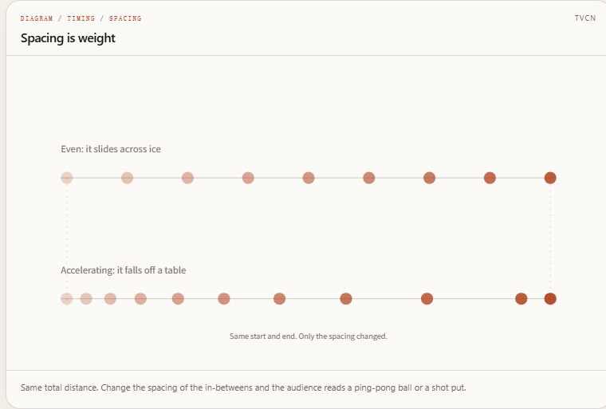

<!-- DIAGRAM_START -->
## Diagram

<figure>
  
  <figcaption>Same total distance. Change the spacing of the in-betweens and the audience reads a ping-pong ball or a shot put.</figcaption>
</figure>
<!-- DIAGRAM_END -->

## Decide the weight first

The same move from A to B reads as a steady slide when the in-betweens are evenly spaced. Pack them near the start and end and spread them in the middle, and you get acceleration and deceleration. That is what animators mean by spacing.

Before drawing, ask: is it thrown, or does it walk? Does it bounce, and how many times? Once those answers are fixed, the in-betweens mostly place themselves.

## Test at 12, finish at 24

Do not animate every frame in the rough pass. Test the timing on twos at 12 fps; a wrong action is obvious there. Once the rhythm works, fill in to 24. Otherwise you spend hours polishing a move that was wrong to begin with.

Shoot live-action reference when you can, especially for lifting, sitting, and turning. Real bodies do not move at a constant speed. The most common animation mistake is being too smooth.

## Judge a loop by its ends

When a cycle is done, put the first and last frame side by side. If they do not line up, the loop will pop. Fix the ends before touching the middle; doing it the other way wastes ten passes.

For a walk, watch the feet. If the planted foot slides, the character looks like they are on ice. Holding the contact frame one extra beat often does more than adding more in-betweens.

## Three checks

- You can say whether the action is heavy or light, and why.
- The action reads clearly in the 12 fps test.
- The first and last frames of the loop connect without a pop.

<!-- DEEP_DIVE_START -->
## Deep dive

<strong>About 6 minutes.</strong> Animation timing is not constant speed. It is acceleration, deceleration, holds, and suddenness; those four create weight.

### Spacing decides speed

Between two keys, inbetweens close to the start read as a slow launch; close to the end read as a fast drop. Even spacing is constant speed, usually the fakest. Adjust spacing before curves.

One action needs at least two speeds: slow start, fast middle, held landing. All constant speed makes objects float.

### A hold is also action

A hold is not missing drawings; it lets the audience read the last one. Two frames before a turn, three before a line, four after a landing. The right hold gives action cause and effect.

Too long breaks the flow, too short blurs it. Watch frame by frame on the phone and find the longest hold the eye can still read.

### Easing is not universal

Heavy objects launch slow and land fast; light objects launch fast and settle slow. Elastic things rebound; machines move linear. Easing everything makes the frame look like jelly.

Ask how heavy it is, who pushes it, what it hits. The answer decides the curve, not the software default.

### Five-minute drill: one action, three timings

Animate a hand picking up a cup three ways: constant, slow start fast landing, fast start slow settle. Change only spacing, not drawings. Play them in sequence and see which reads as a cup, which as a balloon.

Show the three to one person and ask how heavy the cup is. The more specific the answer, the better the timing.

### When the timing is right

Cover the image and watch only motion: you can feel the weight. Slow it by half: you still see launch, travel, landing. Mute it: the action still has rhythm. All three pass.

If only sound effects give weight, the visual timing is not there yet. Adjust spacing and holds before adding music.

### Watch the landing again

Slow the four frames around the landing: if there is no hold at contact, the weight is not there yet. Add one hold frame and remove one rebound frame; that is usually enough. Timing is not about smoothness; it is about daring to stop.

### Ten timing checks
<ul><li>Spacing adjusted first</li><li>At least two speeds per action</li><li>Slow start, fast middle, held landing</li><li>Constant speed only for machines</li><li>Hold lets the last drawing read</li><li>Hold length checked frame by frame</li><li>Heavy: slow launch, fast landing</li><li>Light: fast launch, slow settle</li><li>Elastic rebounds</li><li>Curve decided by weight</li></ul>
Right timing makes an audience believe a ball has weight. Wrong timing makes the finest drawing look like paper.

<!-- DEEP_DIVE_END -->

<!-- SOURCES_START -->
## References and further reading

- [S12] [Britannica: Animation](https://www.britannica.com/art/animation) — Accessed 2026-11-26. Used to check the terminology/method/rule in the “Decide the weight first” section against Britannica animation history, not software documentation; it does not verify numbers, model choices or on-set conclusions derived from this page, and is not a substitute for a test.
- [S62] [Blender: Official Manual](https://docs.blender.org/manual/en/latest/) — Accessed 2026-11-26. Used to check the terminology/method/rule in the “Test at 12, finish at 24” section against Blender manual, not an industry pipeline standard; it does not verify numbers, model choices or on-set conclusions derived from this page, and is not a substitute for a test.
<!-- SOURCES_END -->

