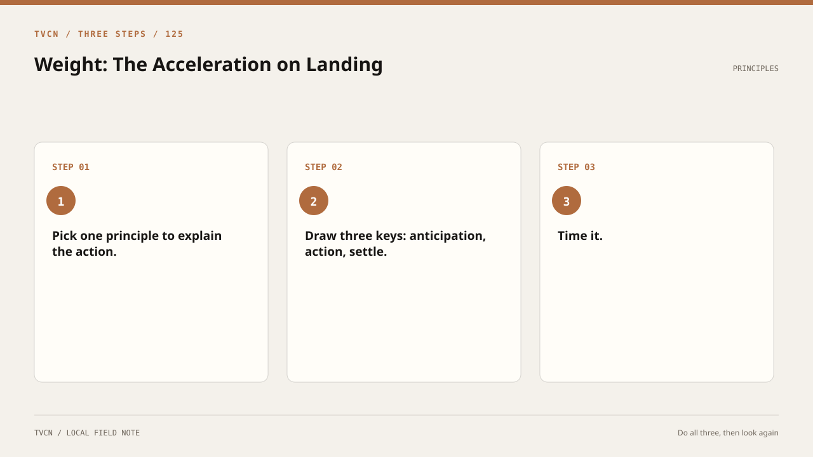

Weight in animation is not a fatter character. Watch three things: feet pressing the ground, knees bending, delay at start and stop. Heavy objects start slow and stop slow; light objects start fast and stop abruptly.

<!-- DIAGRAM_START -->
<h2>Diagram</h2>
<figure>
  
  <figcaption>Watch “Accelerate for two frames before contact.” and “Hold two frames after contact, then rebound for”; judge whether the speed split between foreground, midground and background reads in one move.</figcaption>
</figure>
<!-- DIAGRAM_END -->
<section><h2 id="section-1">Weight is support and delay</h2>
Test with a box: empty versus full changes lean, breath and step rate. Changing only box color does not convince.
<h2 id="section-2">Limits</h2>
Weight is not slow motion. Slowing everything looks underwater; weight lives in the acceleration and deceleration curves.
</section><section><h2 id="section-3">On set</h2>
Accelerate two frames before impact, hold two frames on contact, then settle for three. Add one or two frames of delay for heavy objects.
</section><section><h2 id="section-4">Do this</h2>
Weight is not a pose; it is the acceleration and deceleration at landing. Without it, everything floats.
<ol><li>Accelerate for two frames before contact.</li><li>Hold two frames after contact, then rebound for three.</li><li>Add one or two frames of delay to heavy objects so weight lands after contact.</li></ol></section><section><h2 id="section-5">Avoid</h2>
Do not draw the pose without acceleration; even a heavy pose lands like a balloon.
</section><section><h2>Judge</h2>
This page passes on three observable checks, not slogans:
<ul><li><strong>1.</strong> The fall accelerates, then holds and rebounds after contact.</li><li><strong>2.</strong> Heavy objects lag one or two frames longer than light ones.</li><li><strong>3.</strong> Cover the pose and watch only the landing point; weight still reads.</li></ul></section><section><h2>Failures</h2>
Any one of these means stop and fix it before post:
<ul><li><strong>1.</strong> Check 1 is only staged (“The fall accelerates, then holds and rebounds…”); another camera position or location exposes it.</li><li><strong>2.</strong> Check 2 is left to post or a verbal explanation (“Heavy objects lag one or two frames longer tha…”); nothing on set can be rechecked.</li><li><strong>3.</strong> Do not draw the pose without acceleration; even a heavy pose lands like a balloon.</li></ul></section><section><h2>Extend</h2>
<strong>10-minute exercise:</strong> Draw three keys at 24 fps, change only “Hold two frames after contact, then rebound for”, and export two seconds. If the weight still does not read, add anticipation before adding blur.
</section>
<h2>Check</h2><ul><li>The fall accelerates, then holds and rebounds after contact.</li><li>Heavy objects lag one or two frames longer than light ones.</li><li>Cover the pose and watch only the landing point; weight still reads.</li></ul>

<!-- SOURCES_START -->
## References and further reading

- [S62] [Blender Foundation: Blender Manual](https://docs.blender.org/manual/en/latest/) — Accessed 2026-11-26. Used to check the terminology and public context in the opening paragraph (“Weight is not a pose; it is acceleration in the landing fram”) against Modelling, rigging, animation and rendering; not a substitute for an on-set test.
- [S63] [Toon Boom: Documentation](https://docs.toonboom.com/) — Accessed 2026-11-26. Used to check the terminology and public context in the opening paragraph (“Weight is not a pose; it is acceleration in the landing fram”) against 2D animation, rigging and production pipeline; not a substitute for an on-set test.
- [S12] [Animation](https://www.britannica.com/art/animation) — Accessed 2026-11-26. Used to check the terminology and public context in the opening paragraph (“Weight is not a pose; it is acceleration in the landing fram”) against Encyclopedia entry on animation principles, techniques and industry history; not a substitute for an on-set test.
- [S23] [SMPTE Standards](https://www.smpte.org/standards) — Accessed 2026-11-26. Used to check the terminology and public context in the opening paragraph (“Weight is not a pose; it is acceleration in the landing fram”) against Entry point for timecode, color, cinema and signal-chain standards; not a substitute for an on-set test.
- [S59] [Adobe: After Effects User Guide](https://helpx.adobe.com/after-effects/user-guide.html) — Accessed 2026-11-26. Used to check the terminology and public context in the opening paragraph (“Weight is not a pose; it is acceleration in the landing fram”) against Compositing, keyframes, tracking and export; not a substitute for an on-set test.
<!-- SOURCES_END -->

